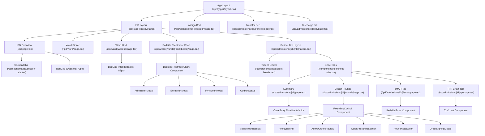
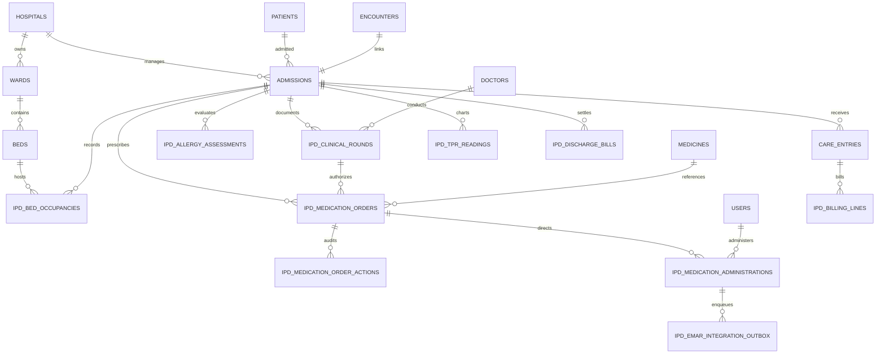
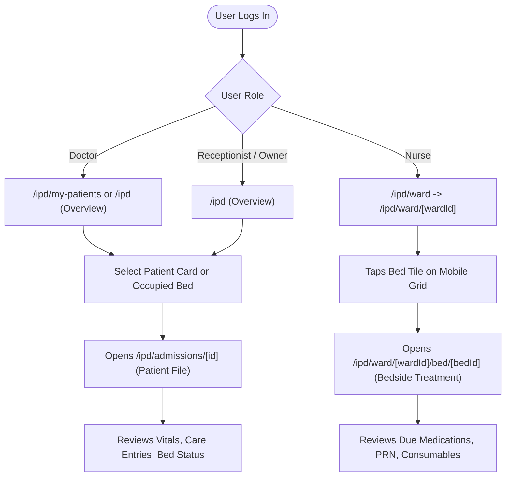
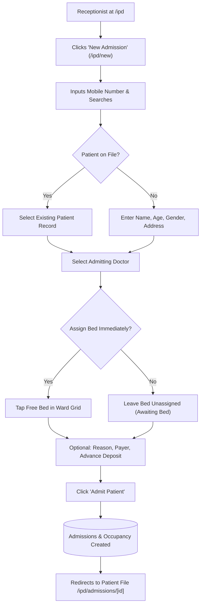
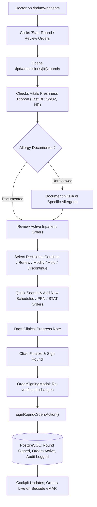
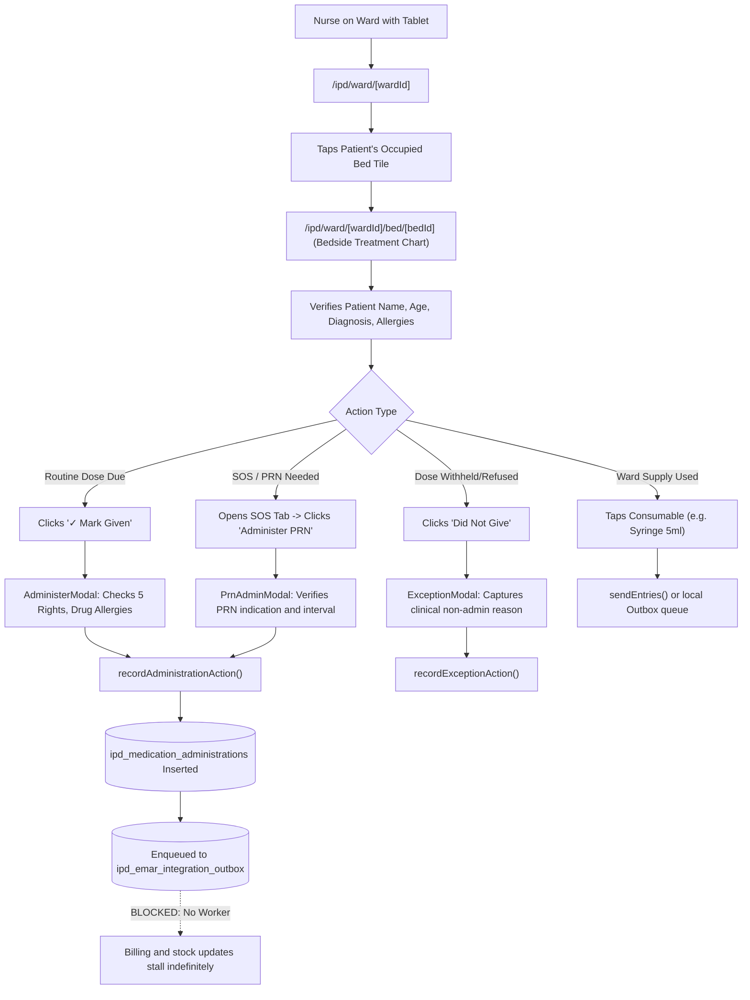
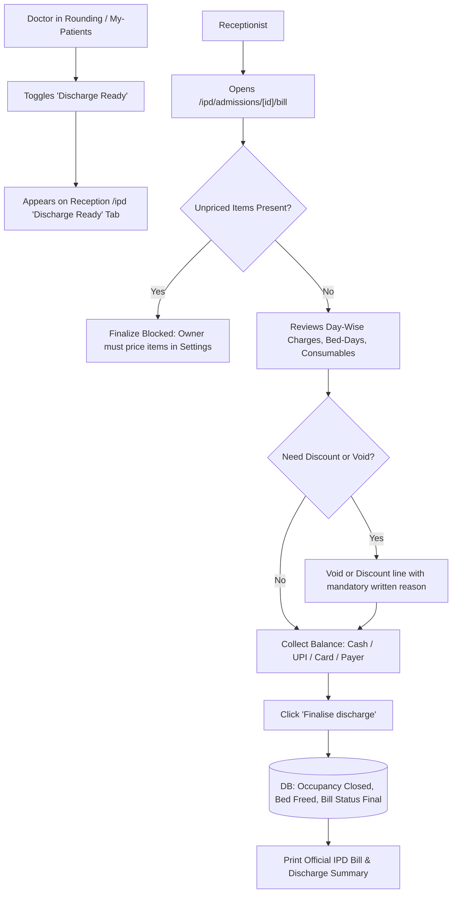

# IPD Implementation Audit — Qurio Hospital Management SaaS

**Audit Date:** October 2026  
**Auditor:** Senior Healthcare Software Architect & Clinical Workflow Auditor  
**Scope:** Inpatient Department (IPD) Module, Bedside Nursing, Doctor Rounding, eMAR, Census, Billing & Stock Integration  
**Methodology:** Read-Only Static Code Analysis, Drizzle Schema Inspection, Route Tracing, and Verified Test Suite Execution  

---

## 1. Executive Summary

This comprehensive, implementation-grounded audit was conducted on the Qurio SaaS Inpatient Department (IPD) codebase. Qurio is a multi-tenant hospital automation platform built with Next.js 15 (App Router), TypeScript, Tailwind CSS, PostgreSQL, and Drizzle ORM.

### Summary of System State:
1. **Rich Domain Engine vs. Fragmented Presentation Layer:**  
   The underlying domain logic for IPD foundations, census management, day-count billing, eMAR scheduling, PRN safety checks, and stock reconciliation is remarkably robust and clinically grounded. However, multiple waves of AI-driven feature development have created a **split interface architecture**:
   - The initial paper-chart metaphor (`/ipd`, `/ipd/ward`, `/ipd/admissions/[id]`, `/ipd/admissions/[id]/tpr`).
   - The subsequent medication administration and rounding workspace (`/ipd/admissions/[id]/rounds`, `/ipd/admissions/[id]/emar`, and `/ipd/ward/[wardId]/bed/[bedId]`).
2. **Critical Clinical & Architectural Findings:**
   - **Outbox Worker Disconnection (P0):** Medication administration events enqueue asynchronously to `ipd_emar_integration_outbox` for billing and stock synchronization. However, `processPendingOutboxBatch()` is **never invoked by any cron schedule, serverless queue, background worker, or client trigger outside of automated tests**. In production, eMAR medication doses will never convert to billing lines or deduct ward stock automatically.
   - **Doctor Bedside Access Lockout (P1):** Doctors conducting rounds at the patient's bedside cannot access `/ipd/ward` or `/ipd/ward/[wardId]/bed/[bedId]` because those routes enforce `can(session.role, 'ipd.record')`. The permission matrix in [`lib/domain/permissions.ts`](file:///d:/Projects/HospitalAutomation/lib/domain/permissions.ts#L89) restricts `ipd.record` to `['owner', 'receptionist', 'nurse']`, returning a `404 Not Found` for doctors who navigate there.
   - **Dual eMAR Screen Divergence (P2):** There are two distinct eMAR interfaces: `/ipd/admissions/[id]/emar` (the `BedsideEmar` component) and `/ipd/ward/[wardId]/bed/[bedId]` (the `BedsideTreatmentChart` component). They render different views, offer different interactions, and have diverging state refresh behaviors.
   - **Module Registry Regression (P2):** Adding `rounds` and `emar` tabs directly into `core_ipd` in [`lib/modules/registry.ts`](file:///d:/Projects/HospitalAutomation/lib/modules/registry.ts#L65-L66) broke existing regression tests in [`lib/modules/__tests__/registry.test.ts`](file:///d:/Projects/HospitalAutomation/lib/modules/__tests__/registry.test.ts#L144), causing receptionists and nurses to see the doctor rounding tab despite having no clinical authority to author orders.
   - **Offline Outbox Cache Stale Key Invalidation:** When medication is administered on the bed page, `recordAdministrationAction` in [`app/(app)/ipd/actions.ts`](file:///d:/Projects/HospitalAutomation/app/(app)/ipd/actions.ts#L445-L448) revalidates `/ipd/admissions/[id]`, `/emar`, and `/rounds`, but **omits** `/ipd/ward/[wardId]/bed/[bedId]`.

---

## 2. Actual Repository and Architecture Overview

### 2.1 Technology Stack
- **Framework:** Next.js 15 (App Router, Server Actions, Route Handlers)
- **Database:** PostgreSQL with multi-tenancy enforced at runtime via `withTenant()` and Row Level Security (RLS) policies.
- **ORM:** Drizzle ORM ([`lib/db/schema.ts`](file:///d:/Projects/HospitalAutomation/lib/db/schema.ts))
- **Styling:** Tailwind CSS with custom tokens (`ink-*`, `brand-*`)
- **Testing:** Vitest 5.0.0 with React Testing Library and Node PostgreSQL integration harnesses.

### 2.2 Security and Multi-Tenancy Architecture
- **Tenant Context (`withTenant`):** All queries and mutations in [`lib/db/index.ts`](file:///d:/Projects/HospitalAutomation/lib/db/index.ts) wrap execution within PostgreSQL transactions that set session variables:
  ```sql
  SET LOCAL app.current_hospital_id = '<hospitalId>';
  ```
  Every IPD table enforces multi-tenancy with a composite foreign key and primary/unique indexes containing `hospital_id`.
- **Role Permission Allow-List:** [`lib/domain/permissions.ts`](file:///d:/Projects/HospitalAutomation/lib/domain/permissions.ts) contains an immutable typed record `Record<Permission, readonly StaffRole[]>`. Roles allowed: `'owner'`, `'doctor'`, `'nurse'`, `'receptionist'`.
- **Module Toggle Framework:** [`lib/modules/registry.ts`](file:///d:/Projects/HospitalAutomation/lib/modules/registry.ts) controls modular licensing and rollout (`core_ipd`, `patient_file`, `charts`, `stock`, `staff_access`, `acct_core`, `letterhead`).

---

## 3. Route Inventory

| Route | Purpose | Layout | Roles Allowed | Primary Components | Data / Services | Actual Status |
|---|---|---|---|---|---|---|
| `/ipd` | IPD Home: Awaiting bed, Ward occupancy grid, Discharge ready lists | [`IpdLayout`](file:///d:/Projects/HospitalAutomation/app/(app)/ipd/layout.tsx) | `owner`, `receptionist`, `doctor` (`nurse` redirected) | [`BedGrid`](file:///d:/Projects/HospitalAutomation/components/ipd/bed-grid.tsx), `AwaitingBed`, `DischargeReady` | [`getIpdCensus`](file:///d:/Projects/HospitalAutomation/lib/services/ipd-census.ts) | **Implemented and verified** |
| `/ipd/new` | Direct emergency admission & bed assignment | [`IpdLayout`](file:///d:/Projects/HospitalAutomation/app/(app)/ipd/layout.tsx) | `owner`, `receptionist` (`ipd.admit`) | [`BedPicker`](file:///d:/Projects/HospitalAutomation/components/ipd/bed-picker.tsx), [`AdmissionExtras`](file:///d:/Projects/HospitalAutomation/components/ipd/admission-extras.tsx) | [`findPatientsByPhone`](file:///d:/Projects/HospitalAutomation/lib/services/ipd-census.ts), [`listFreeBeds`](file:///d:/Projects/HospitalAutomation/lib/services/ipd-census.ts), `createDirectAdmissionAction` | **Implemented and verified** |
| `/ipd/my-patients` | Doctor's rapid round overview, test ordering chips, and discharge-ready toggle | [`IpdLayout`](file:///d:/Projects/HospitalAutomation/app/(app)/ipd/layout.tsx) | `owner`, `doctor` (`ipd.dischargeReady`) | Patient cards, test chip picker, discharge button | [`listMyAdmittedPatients`](file:///d:/Projects/HospitalAutomation/lib/services/doctor-ipd.ts), [`getTestChips`](file:///d:/Projects/HospitalAutomation/lib/services/doctor-ipd.ts) | **Implemented and verified** |
| `/ipd/ward` | Ward selector for ward nurses | [`IpdLayout`](file:///d:/Projects/HospitalAutomation/app/(app)/ipd/layout.tsx) | `owner`, `receptionist`, `nurse` (`ipd.record`) | Ward cards, [`GoToLastWard`](file:///d:/Projects/HospitalAutomation/components/ipd/last-ward.tsx), [`OutboxStatus`](file:///d:/Projects/HospitalAutomation/components/ipd/outbox-status.tsx) | [`getIpdCensus`](file:///d:/Projects/HospitalAutomation/lib/services/ipd-census.ts) | **Implemented and verified** (Doctors blocked) |
| `/ipd/ward/[wardId]` | Ward bed grid (large touch targets for tablets/phones) | [`IpdLayout`](file:///d:/Projects/HospitalAutomation/app/(app)/ipd/layout.tsx) | `owner`, `receptionist`, `nurse` (`ipd.record`) | [`BedGrid`](file:///d:/Projects/HospitalAutomation/components/ipd/bed-grid.tsx) (size `lg`) | [`getIpdCensus`](file:///d:/Projects/HospitalAutomation/lib/services/ipd-census.ts) | **Implemented and verified** |
| `/ipd/ward/[wardId]/bed/[bedId]` | Bedside Nursing Treatment Chart: Routine medicines, PRN, consumables, quick administration | [`IpdLayout`](file:///d:/Projects/HospitalAutomation/app/(app)/ipd/layout.tsx) | `owner`, `receptionist`, `nurse` (`ipd.record`) | [`BedsideTreatmentChart`](file:///d:/Projects/HospitalAutomation/components/ipd/bedside/bedside-treatment-chart.tsx), modals | [`getBedsideEmar`](file:///d:/Projects/HospitalAutomation/lib/services/ipd-emar.ts), [`getQuickPicks`](file:///d:/Projects/HospitalAutomation/lib/services/care-entries.ts) | **Implemented and verified** (Doctors get 404) |
| `/ipd/admissions/[id]` | Patient File Cover / Summary tab: admission metadata, running timeline, money summary | [`PatientFileLayout`](file:///d:/Projects/HospitalAutomation/app/(app)/ipd/admissions/[id]/(file)/layout.tsx) | `owner`, `receptionist`, `doctor`, `nurse` (`ipd.view`) | [`PatientHeader`](file:///d:/Projects/HospitalAutomation/components/ipd/patient-header.tsx), Timeline, Action Bar | [`loadAdmission`](file:///d:/Projects/HospitalAutomation/app/(app)/ipd/admissions/[id]/(file)/data.ts), [`listEntriesForAdmission`](file:///d:/Projects/HospitalAutomation/lib/services/care-entries.ts) | **Implemented and verified** |
| `/ipd/admissions/[id]/rounds` | Doctor Rounding Cockpit: Vitals trend, allergy review, order review/renew/modify, progress note signing | [`PatientFileLayout`](file:///d:/Projects/HospitalAutomation/app/(app)/ipd/admissions/[id]/(file)/layout.tsx) | `owner`, `doctor`, `receptionist`, `nurse` (`ipd.view`; mutation `ipd.prescribe`) | [`RoundingCockpit`](file:///d:/Projects/HospitalAutomation/components/ipd/rounding/rounding-cockpit.tsx), subcomponents | [`getRoundingCockpitData`](file:///d:/Projects/HospitalAutomation/lib/services/ipd-rounding-cockpit.ts), [`saveRoundDraftAction`](file:///d:/Projects/HospitalAutomation/app/(app)/ipd/actions.ts), [`signRoundOrdersAction`](file:///d:/Projects/HospitalAutomation/app/(app)/ipd/actions.ts) | **Implemented and verified** |
| `/ipd/admissions/[id]/emar` | Standalone Bedside eMAR tab in patient file (duplicate eMAR view) | [`PatientFileLayout`](file:///d:/Projects/HospitalAutomation/app/(app)/ipd/admissions/[id]/(file)/layout.tsx) | `owner`, `doctor`, `nurse`, `receptionist` (`ipd.view`; mutation `ipd.administer`) | [`BedsideEmar`](file:///d:/Projects/HospitalAutomation/components/ipd/emar/bedside-emar.tsx) | [`getBedsideEmar`](file:///d:/Projects/HospitalAutomation/lib/services/ipd-emar.ts) | **Implemented and verified** (Duplicative with bed recording page) |
| `/ipd/admissions/[id]/tpr` | Daily nursing TPR Sheet (8 AM - 8 AM) | [`PatientFileLayout`](file:///d:/Projects/HospitalAutomation/app/(app)/ipd/admissions/[id]/(file)/layout.tsx) | `owner`, `doctor`, `nurse` (`ipd.chart`, if module enabled) | [`TprChart`](file:///d:/Projects/HospitalAutomation/components/ipd/tpr-chart.tsx) | [`getTprDay`](file:///d:/Projects/HospitalAutomation/lib/services/tpr.ts) | **Implemented and verified** |
| `/ipd/admissions/[id]/assign` | Bed assignment sheet for OPD-shifted patient | Root layout | `owner`, `receptionist` (`ipd.admit`) | [`BedPicker`](file:///d:/Projects/HospitalAutomation/components/ipd/bed-picker.tsx), [`AdmissionExtras`](file:///d:/Projects/HospitalAutomation/components/ipd/admission-extras.tsx) | [`getAdmissionSummary`](file:///d:/Projects/HospitalAutomation/lib/services/ipd-census.ts), [`listFreeBeds`](file:///d:/Projects/HospitalAutomation/lib/services/ipd-census.ts), `assignBedAction` | **Implemented and verified** |
| `/ipd/admissions/[id]/transfer` | Bed transfer sheet | Root layout | `owner`, `receptionist` (`ipd.admit`) | [`BedPicker`](file:///d:/Projects/HospitalAutomation/components/ipd/bed-picker.tsx) | [`getAdmissionSummary`](file:///d:/Projects/HospitalAutomation/lib/services/ipd-census.ts), [`listFreeBeds`](file:///d:/Projects/HospitalAutomation/lib/services/ipd-census.ts), `transferBedAction` | **Implemented and verified** |
| `/ipd/admissions/[id]/bill` | Discharge billing ledger, discount, voiding, payments, and final discharge | Root layout | `owner`, `receptionist` (`ipd.discharge`) | Line items by day, flag banners, payment modal | [`getDischargeBillView`](file:///d:/Projects/HospitalAutomation/lib/services/discharge-billing.ts), [`finalizeAction`](file:///d:/Projects/HospitalAutomation/app/(app)/ipd/admissions/[id]/bill/actions.ts) | **Implemented and verified** |
| `/ipd/stock` | Risk-class narcotics/controlled substances store overview & daily count | [`IpdLayout`](file:///d:/Projects/HospitalAutomation/app/(app)/ipd/layout.tsx) | `owner`, `doctor`, `nurse`, `receptionist` (`stock.view`) | Store list, count status cards | [`getStockOverview`](file:///d:/Projects/HospitalAutomation/lib/services/stock.ts) | **Implemented and verified** |
| `/settings/ipd` | Ward & bed configuration (adding beds, naming wards, assigning room charge items) | Settings layout | `owner` (`ipd.configure`) | [`WardCard`](file:///d:/Projects/HospitalAutomation/app/(app)/settings/ipd/page.tsx), [`BedCountField`](file:///d:/Projects/HospitalAutomation/components/ipd/bed-count-field.tsx) | [`listWardSetup`](file:///d:/Projects/HospitalAutomation/lib/services/ipd-config.ts) | **Implemented and verified** |
| `/settings/ipd/items` | IPD item catalogue and price list | Settings layout | `owner` (`billing.price`) | Charge item table, inline price edits | `listChargeItems`, `saveChargeItemAction` | **Implemented and verified** |
| `/print/ipd-bill/[billId]` | Printable final invoice / itemized summary | Minimal print layout | `owner`, `receptionist` | Itemized invoice table with hospital letterhead | [`getDischargeBillView`](file:///d:/Projects/HospitalAutomation/lib/services/discharge-billing.ts) | **Implemented and verified** |
| `/print/ipd-file/[admissionId]` | Printable multi-sheet inpatient physical case file | Minimal print layout | `owner`, `receptionist`, `doctor`, `nurse` | Cover sheet, TPR sheet, nursing care sheet | [`loadAdmission`](file:///d:/Projects/HospitalAutomation/app/(app)/ipd/admissions/[id]/(file)/data.ts), [`getTprDay`](file:///d:/Projects/HospitalAutomation/lib/services/tpr.ts) | **Implemented and verified** |

---

## 4. Feature Implementation Matrix

### 4.1 Admission Lifecycle
- **OPD-to-IPD Shift:** Implemented via server action `shiftToIpdAction` on the OPD consultation dashboard. Creates an `admissions` row in `awaiting_bed` status and sets `encounter.type = 'ipd'`.
- **Direct Emergency Admission:** Implemented on `/ipd/new`. Allows patient lookup by phone (or `0000000000` unknown), patient demographic entry, admitting doctor selection, optional immediate bed assignment, deposit collection, and payer classification.
- **Bed Allocation:** Implemented on `/ipd/admissions/[id]/assign` and `/ipd/new`. Generates an `ipd_bed_occupancies` record. Occupied bed is reserved, status transitions from `awaiting_bed` to `admitted`.
- **Bed Transfers:** Implemented on `/ipd/admissions/[id]/transfer`. Atomically closes current occupancy row (`freed_at = now()`) and inserts new occupancy row in one transaction via [`transferBed`](file:///d:/Projects/HospitalAutomation/lib/services/ipd-census.ts#L330-L375).
- **Discharge Readiness:** Doctor marks patient ready via `setDischargeReadyAction`. Status transitions from `admitted` to `discharge_ready`. Bed remains occupied.
- **Discharge Finalization:** Reception prepares bill, collects balance, and calls `finalizeDischarge`. Bed occupancy is closed (`freed_at = now()`), status transitions to `discharged`, bed becomes available immediately.

### 4.2 Ward, Bed, and Patient Census
- **Census Engine:** Implemented in [`lib/services/ipd-census.ts`](file:///d:/Projects/HospitalAutomation/lib/services/ipd-census.ts). Calculates active wards, occupied beds, awaiting patients, and discharge-ready patients across branches.
- **Auto-Refresh:** Implemented via [`AutoRefresh`](file:///d:/Projects/HospitalAutomation/components/auto-refresh.tsx) component (15s on Overview, 20s on Ward grid).
- **Touch-Friendly Bed Grid:** Implemented via [`BedGrid`](file:///d:/Projects/HospitalAutomation/components/ipd/bed-grid.tsx). Renders occupancy status, patient short name, day of stay, and conditional routing.

### 4.3 Doctor Workflows
- **Doctor's My-Patients Page (`/ipd/my-patients`):** Doctor sees list of admitted patients assigned to them (or all patients if hospital owner).
- **Rounding Cockpit (`/ipd/admissions/[id]/rounds`):**
  - **Vitals Freshness Ribbon:** Shows most recent pulse, BP, SpO2, temp, and hours elapsed.
  - **Allergy Safety Banner:** NKDA vs. allergens list, with modal to document new drug allergies.
  - **Active Orders Review:** Review all currently active inpatient medication orders. Quick actions to Continue, Renew, Modify, Hold, or Discontinue.
  - **Prescription Authoring:** Instant search of medicines catalogue, frequency presets (OD, BD, TID, QID, STAT, PRN), dose, route, and duration.
  - **Signing Modal:** Transactionally commits progress notes and orders. Creates `ipd_clinical_rounds` (status `signed`), updates/inserts `ipd_medication_orders` (status `active`), and logs to `ipd_medication_order_actions`.
- **Order Discontinuation / Hold:** Implemented. Marks order `on_hold` or `discontinued` with reason. Immediately suppresses dose generation on nursing eMAR.

### 4.4 Nursing Workflows
- **Bedside Treatment Chart (`/ipd/ward/[wardId]/bed/[bedId]`):**
  - Unified view displaying:
    1. Daily Scheduled Medicines: Overdue and Due Now in urgent pulse container; Scheduled Later Today in collapsed view.
    2. As Needed (SOS/PRN) Medicines: Evaluates minimum interval hours and daily dose ceilings in real-time.
    3. Ward Consumables & Supplies: Quick buttons for syringes, IV sets, gauze, catheter, etc., backed by offline outbox.
  - Exception Documentation: "Did Not Give" modal captures clinical reasons (`omitted`, `refused`, `held`).
  - Administration Verification: "Mark Given" modal verifies 5 Rights, displays active allergy warnings, allows dose/route adjustments, and submits via server action.

### 4.5 Medication Orders and eMAR Mechanics
- **Occurrence Generator:** Pure domain algorithm in [`lib/domain/ipd-schedule.ts`](file:///d:/Projects/HospitalAutomation/lib/domain/ipd-schedule.ts). Generates time occurrences dynamically within sliding query windows (e.g. 24 hours) based on `frequencyCode` and `scheduleTimes`. Doses are not statically pre-populated into the database; they are calculated on demand.
- **PRN Safety Guard:** Pure domain logic in [`lib/domain/ipd-prn.ts`](file:///d:/Projects/HospitalAutomation/lib/domain/ipd-prn.ts) and enforced transactionally with PostgreSQL advisory locks (`pg_advisory_xact_lock`) on the order chain. Prevents race-condition overdosing by concurrent nurses.
- **Idempotency:** Every administration submission generates a client-side UUID `clientId`. Unique constraint `(hospital_id, client_id)` on `ipd_medication_administrations` prevents duplicate records from network retry.
- **Outbox Integration:** Implemented in [`lib/services/ipd-emar-outbox.ts`](file:///d:/Projects/HospitalAutomation/lib/services/ipd-emar-outbox.ts). Records billing and stock events with `FOR UPDATE SKIP LOCKED`. **However, background execution worker is missing in production.**

### 4.6 Billing, Pharmacy, and Inventory
- **Running Inpatient Bill:** Real-time day-by-day bill construction in [`lib/services/discharge-billing.ts`](file:///d:/Projects/HospitalAutomation/lib/services/discharge-billing.ts).
- **Bed-Day Charges:** Calculated automatically by calendar day boundaries (`midnight_cutoff` or 24h cycle) based on ward room charge item prices.
- **Care Entries Integration:** Bedside consumable entries create `care_entries` rows and immediately post `draft_bill_lines`.
- **Unpriced Item Detection:** If an item lacks a configured price, it flags as `unpriced` on the bill and **blocks bill finalization** until the owner sets a price in Settings.
- **Audit Trails & Corrections:** Bill lines cannot be modified or deleted. Voids create negative balancing adjustments or marked `voided_at` with reason.

---

## 5. Component Hierarchy and Page Ownership



---

## 6. Backend Execution Chains

### 6.1 Chain 1: Direct Emergency Admission
```
User clicks 'Admit' on /ipd/new
  -> Browser sends Form submission to createDirectAdmissionAction (app/(app)/ipd/actions.ts:74)
  -> Checks session & authorize('ipd.admit')
  -> Calls createDirectAdmission() in lib/services/ipd-census.ts
  -> Runs withTenant(hospitalId, tx):
      1. Resolves or inserts patient in patients table.
      2. Inserts new row in encounters (type: 'ipd', status: 'arrived').
      3. Inserts new row in admissions (status: 'admitted' or 'awaiting_bed', ipd_number generated).
      4. If bed selected: inserts row in ipd_bed_occupancies (occupied_at = now).
      5. If deposit collected: calls recordPayment() in lib/services/patient-billing.ts.
  -> Revalidates /ipd, /ipd/ward, redirects to /ipd/admissions/[id]
```

### 6.2 Chain 2: Doctor Round Note Authoring & Order Signing
```
Doctor clicks 'Finalize & Sign Round' in RoundingCockpit
  -> Submits OrderSigningModal form to signRoundOrdersAction (app/(app)/ipd/actions.ts:406)
  -> Checks authorize('ipd.prescribe')
  -> Resolves Doctor ID from doctors table linked to session.userId
  -> Calls signRoundOrders() in lib/services/ipd-medication-orders.ts
  -> Executes withTenant(clinical: true, tx):
      1. Updates or inserts ipd_clinical_rounds (status: 'signed', signed_at: now).
      2. Loops over order resolutions:
         - 'renew': Inserts new order in ipd_medication_orders (status: 'active', supersedes_order_id = oldId),
                    updates old order (status: 'superseded'), logs action 'renew'.
         - 'modify': Inserts new modified order, marks old order superseded, logs action 'modify'.
         - 'hold': Updates order to status 'on_hold', logs action 'hold'.
         - 'discontinue': Updates order to status 'discontinued', logs action 'discontinue'.
         - 'new': Inserts new order (status: 'active', signed_at: now), logs action 'sign'.
  -> Revalidates /ipd/admissions/[id], /rounds, /my-patients
  -> UI notifies doctor: "Round successfully finalized and signed!"
```

### 6.3 Chain 3: Bedside Medication Administration
```
Nurse clicks 'Mark Given' in BedsideTreatmentChart
  -> Submits AdministerModal form to recordAdministrationAction (app/(app)/ipd/actions.ts:430)
  -> Checks authorize('ipd.administer')
  -> Calls recordAdministration() in lib/services/ipd-emar.ts
  -> Executes withTenant(clinical: true, tx):
      1. Checks idempotency: SELECT id FROM ipd_medication_administrations WHERE client_id = input.clientId.
      2. Verifies order exists, status == 'active', not expired.
      3. If PRN: takes advisory transaction lock pg_advisory_xact_lock(hashtext('ipd_prn_chain:' || chainId)),
         validates checkPrnEligibility() interval and max daily limits.
      4. If STAT: updates ipd_medication_orders SET status = 'completed'.
      5. Inserts ipd_medication_administrations (outcome: 'administered', actual_time: now).
      6. Enqueues outbox event into ipd_emar_integration_outbox (type: 'billing', event: 'administer', status: 'pending').
  -> Revalidates /ipd/admissions/[id], /emar, /rounds, /ipd (OMITS current bed URL)
  -> [STALLED]: Outbox event sits in 'pending' because no background worker is polling claimOutboxBatch().
```

---

## 7. Database and Domain Model Map

### 7.1 Entity Relationship Diagram



### 7.2 Database Table Schema Summary
1. **`admissions`** (`0032_ipd_core.sql`): Primary stay record. Keys: `id`, `hospital_id`, `patient_id`, `encounter_id`, `ipd_number`. Status: `awaiting_bed`, `admitted`, `discharge_ready`, `discharged`, `cancelled`.
2. **`wards` & `beds`** (`0032_ipd_core.sql`): Physical structure. Beds belong to a ward; have `room_charge_item_id`.
3. **`ipd_bed_occupancies`** (`0032_ipd_core.sql`): History of bed assignments. `occupied_at`, `freed_at`. At most one open occupancy per bed (`freed_at IS NULL`).
4. **`care_entries`** (`0032_ipd_core.sql`): Bedside items recorded by nurses. `medicine_id` or `charge_item_id`, `quantity`, `occurred_at`.
5. **`ipd_discharge_bills`** (`0033_discharge_billing.sql`): Discharge ledger. Status: `draft`, `final`, `cancelled`.
6. **`ipd_billing_lines`** (`0033_discharge_billing.sql`): Itemized bill rows with daily rates, paise amounts, and discount/void states.
7. **`ipd_tpr_readings`** (`0043_charts.sql`): Vitals recordings (Temp, Pulse, Resp, BP, SpO2, Urine, Stool).
8. **`ipd_medication_orders`** (`0047_ipd_emar_foundation.sql`): Inpatient prescription orders. Schedule type: `scheduled`, `prn`, `stat`. Status: `draft`, `active`, `on_hold`, `discontinued`, `completed`, `superseded`, `voided`.
9. **`ipd_medication_administrations`** (`0047_ipd_emar_foundation.sql`): Bedside administration events. Outcome: `administered`, `omitted`, `refused`, `held`. Includes `client_id` for idempotency and 5-rights audit fields.
10. **`ipd_clinical_rounds`** (`0047_ipd_emar_foundation.sql`): Daily progress notes authored and signed by doctors.
11. **`ipd_allergy_assessments`** (`0047_ipd_emar_foundation.sql`): Current allergy review record (`nkda`, `allergies_documented`, `unreviewed`).
12. **`ipd_emar_integration_outbox`** (`0047_ipd_emar_foundation.sql`): Outbox queue for asynchronous billing and stock dispatch (`status IN ('pending', 'processing', 'processed', 'failed', 'pending_pricing')`).

---

## 8. Role-Permission Matrix

The following matrix represents the verified allow-list defined in [`lib/domain/permissions.ts`](file:///d:/Projects/HospitalAutomation/lib/domain/permissions.ts):

| Permission | Description | Owner | Receptionist | Doctor | Nurse |
|---|---|:---:|:---:|:---:|:---:|
| `ipd.view` | Access `/ipd`, layouts, patient file summary | Yes | Yes | Yes | Yes |
| `ipd.shift` | Shift OPD consultation to IPD stay | Yes | No | Yes | No |
| `ipd.admit` | Emergency admission, bed assignment & transfer | Yes | Yes | No | No |
| `ipd.record` | Access `/ipd/ward` and bedside recording screens | Yes | Yes | **NO** | Yes |
| `ipd.correct` | Void bill lines or care entries with written reason | Yes | Yes | No | No |
| `ipd.dischargeReady` | Mark patient ready to leave / reverse readiness | Yes | No | Yes | No |
| `ipd.orderTests` | Order quick laboratory/imaging tests | Yes | No | Yes | No |
| `ipd.prescribe` | Author round notes, sign/modify/discontinue medication orders | Yes | No | Yes | No |
| `ipd.administer` | Record bedside medication administration on eMAR | Yes | No | Yes | Yes |
| `ipd.chart` | Record TPR vital signs on nursing chart | Yes | No | Yes | Yes |
| `ipd.discharge` | Finalize discharge bill and print final invoice | Yes | Yes | No | No |
| `ipd.configure` | Setup wards, beds, and nurse PINs in Settings | Yes | No | No | No |
| `stock.view` | View risk-class narcotics overview | Yes | Yes | Yes | Yes |
| `stock.move` | Receive, transfer, adjust stock | Yes | Yes | No | Yes |
| `stock.count` | Conduct blind daily store count | Yes | Yes | Yes | Yes |
| `stock.approve` | Approve daily count variances & adjustments | Yes | No | Yes | No |

---

## 9. Role-Specific User Journeys

### Journey 1: Find and Open an Admitted Patient


### Journey 2: Admit a Patient (Emergency / Direct)


### Journey 3: Conduct Doctor Rounds & Prescribe


### Journey 4: Perform Bedside Nursing Care & Administration


### Journey 5: Patient Discharge and Final Billing


---

## 10. Cross-Module Integrations

1. **OPD-to-IPD Linkage:** When a doctor in OPD consultation clicks "Shift to IPD", [`shiftToIpdAction`](file:///d:/Projects/HospitalAutomation/app/(app)/dashboard/actions.ts) creates an `admissions` row referencing the active `encounters.id`. The patient carries all previous medical diagnoses and vitals over to IPD.
2. **Bedside Care Entries to Patient Billing:** Every non-medication consumable recorded at the bedside inserts into `care_entries` and directly posts a line to `ipd_billing_lines` with calculated price paise.
3. **eMAR to Billing & Inventory (The Outbox Bridge):** Designed as an asynchronous decoupling mechanism using `ipd_emar_integration_outbox`. Medications administered at the bedside record instantaneously without locking pharmacy or billing tables. The worker is intended to process billing and stock movements asynchronously.
4. **Accountability & Evidence Log:** Every admission access, bed transfer, vitals reading, and eMAR administration logs an immutable entry to `record_access_logs` and `evidence_items` with SHA-256 tamper-evident integrity seals.

---

## 11. Current UI Consistency Audit

1. **Dual eMAR Screen Confusion:**
   - Screen A: `/ipd/ward/[wardId]/bed/[bedId]` (`BedsideTreatmentChart`): Tailored for ward tablets, large touch targets, color-coded urgency buckets (Overdue vs Due Now), SOS tab, consumable quick-picks.
   - Screen B: `/ipd/admissions/[id]/emar` (`BedsideEmar`): Tabbed layout within the patient file, distinct UI hierarchy, separate modal invocations.
   - **Impact:** Clinical staff face cognitive overload and inconsistent mental models depending on whether they enter from the Ward grid or from the Patient File tab bar.
2. **Layout Header Nesting Redundancy:**
   - Navigating to `/ipd/admissions/[id]/rounds` nests:
     - Global Application Header (Navigation bar, user profile).
     - IPD Sub-header (`IpdLayout`: Bed icon, "IPD", hospital name, Section Tabs: Overview, Ward, My Patients, Stock).
     - Patient File Header (`PatientFileLayout`: "← IPD", History button, Print button, `PatientHeader` card).
     - Sheet Tabs (`SheetTabs`: Summary, Doctor rounds, eMAR, TPR chart).
     - Rounding Cockpit Workspace (`RoundingCockpit`).
   - **Vertical Real Estate Waste:** On laptop and tablet screens, the top 350px are consumed by 4 nested headers before the clinical content begins.
3. **Mobile Action Bar Clipping:**
   - In `/ipd/new`, `/ipd/admissions/[id]/assign`, and `/ipd/admissions/[id]/transfer`, primary submit buttons are pinned with fixed position `fixed inset-x-0 bottom-0 z-40 pb-[max(0.75rem,env(safe-area-inset-bottom))]`.
   - On mobile devices with bottom navigation bars or virtual keyboards opened, these buttons overlap input fields and hide the lowest form elements.
4. **Missing Empty and Loading States:**
   - On `/ipd/admissions/[id]/rounds`, if doctor is not linked, page displays read-only mode without an actionable inline prompt explaining how to link the profile in Settings.
   - No skeleton loaders exist for the Rounding Cockpit; initial load causes jarring layout shift as vitals and allergy states resolve.

---

## 12. Defect and Risk Register

| ID | Area | Finding | Evidence | User Impact | Clinical / Security / Data Risk | Severity | Dependencies |
|---|---|---|---|---|---|:---:|---|
| **DEF-01** | eMAR Outbox | Outbox processing worker is not scheduled or executed anywhere in runtime | [`lib/services/ipd-emar-outbox.ts:367`](file:///d:/Projects/HospitalAutomation/lib/services/ipd-emar-outbox.ts#L367) only called in tests | Doses administered at bedside never post to patient bill or decrement stock | **Revenue leakage & inventory mismatch:** Patients discharged without medication billed | **P0** | Discharge Billing, Pharmacy Stock |
| **DEF-02** | Permissions | Doctors cannot access Bedside Treatment screens (`/ipd/ward/[wardId]/bed/[bedId]`) | [`app/(app)/ipd/ward/[wardId]/bed/[bedId]/page.tsx:29`](file:///d:/Projects/HospitalAutomation/app/(app)/ipd/ward/[wardId]/bed/[bedId]/page.tsx#L29) checks `ipd.record`; [`permissions.ts:89`](file:///d:/Projects/HospitalAutomation/lib/domain/permissions.ts#L89) excludes `'doctor'` | Doctor standing at bed cannot view bedside chart or administer stat doses | **Clinical workflow barrier:** Doctor receives 404 Not Found at bedside | **P1** | RBAC, Ward Routing |
| **DEF-03** | Cache / Invalidation | Bedside administration action does not revalidate the bed recording route | [`app/(app)/ipd/actions.ts:445-449`](file:///d:/Projects/HospitalAutomation/app/(app)/ipd/actions.ts#L445-L449) omits `/ipd/ward/[wardId]/bed/[bedId]` | Browser on other ward devices displays stale due-dose state | **Patient Safety Risk:** Risk of duplicate administration by secondary nurse | **P1** | Next.js Server Actions |
| **DEF-04** | Module Registry | Adding `rounds` & `emar` to `core_ipd` breaks registry tests & leaks tabs to non-clinical roles | [`lib/modules/registry.ts:65-66`](file:///d:/Projects/HospitalAutomation/lib/modules/registry.ts#L65-L66); test failure in [`registry.test.ts:144`](file:///d:/Projects/HospitalAutomation/lib/modules/__tests__/registry.test.ts#L144) | Receptionists and nurses see Doctor Rounds tab; test suite fails | **Architectural erosion & confusion:** Non-prescribing roles exposed to clinical drafting | **P2** | Module Registry |
| **DEF-05** | UI Architecture | Duplicative eMAR interfaces (`/emar` vs `/ward/.../bed/...`) | Two separate components ([`BedsideEmar`](file:///d:/Projects/HospitalAutomation/components/ipd/emar/bedside-emar.tsx) and [`BedsideTreatmentChart`](file:///d:/Projects/HospitalAutomation/components/ipd/bedside/bedside-treatment-chart.tsx)) | Nursing staff and doctors confused on which interface is authoritative | **Maintenance overhead:** Diverging validation and presentation logic | **P2** | Clinical UI Components |
| **DEF-06** | UI Density | Quadruple nested layout headers consume excessive screen space | [`app/(app)/ipd/admissions/[id]/(file)/layout.tsx`](file:///d:/Projects/HospitalAutomation/app/(app)/ipd/admissions/[id]/(file)/layout.tsx) inside [`IpdLayout`](file:///d:/Projects/HospitalAutomation/app/(app)/ipd/layout.tsx) | Clinical staff on 13" laptops must scroll 300px to see patient orders | **Ergonomic usability penalty:** Reduced clinical visibility during fast-paced rounds | **P2** | Layout Hierarchy |
| **DEF-07** | TPR Charts | TPR Module defaults to `off` without discovery hint for new hospitals | [`lib/modules/registry.ts:99`](file:///d:/Projects/HospitalAutomation/lib/modules/registry.ts#L99) `defaultState: 'off'` | Hospital staff cannot find TPR Chart tab unless owner discovers toggle in Settings | **Feature invisibility:** Hospitals assume TPR charting is unimplemented | **P3** | Settings & Onboarding |

---

## 13. Test Coverage Matrix

Executed safely using Vitest read-only runner. Verified test results:

| Test Suite / Area | File Path | Test Count | Observed Status | Notes |
|---|---|:---:|:---:|---|
| Bedside Treatment Chart UI | [`components/ipd/bedside/__tests__/bedside-treatment-chart.test.tsx`](file:///d:/Projects/HospitalAutomation/components/ipd/bedside/__tests__/bedside-treatment-chart.test.tsx) | 2 | **PASSED** | Verifies tabs, patient metadata, urgent doses, and supplies |
| Rounding UI Components | [`components/ipd/rounding/__tests__/rounding-components.test.tsx`](file:///d:/Projects/HospitalAutomation/components/ipd/rounding/__tests__/rounding-components.test.tsx) | 10 | **PASSED** | Verifies freshness bar, allergy banner, active orders, and signing |
| eMAR Bedside E2E UI | [`components/ipd/emar/__tests__/bedside-emar-e2e.test.tsx`](file:///d:/Projects/HospitalAutomation/components/ipd/emar/__tests__/bedside-emar-e2e.test.tsx) | 4 | **PASSED** | Verifies administration modals and outbox submissions |
| eMAR Components | [`components/ipd/emar/__tests__/emar-components.test.tsx`](file:///d:/Projects/HospitalAutomation/components/ipd/emar/__tests__/emar-components.test.tsx) | 9 | **PASSED** | Verifies modal validations and 5-rights verification |
| IPD Admission Domain | [`lib/domain/__tests__/admission.test.ts`](file:///d:/Projects/HospitalAutomation/lib/domain/__tests__/admission.test.ts) | 11 | **PASSED** | Day of stay calculations, short names, admission numbering |
| Bed-Days Domain | [`lib/domain/__tests__/bed-days.test.ts`](file:///d:/Projects/HospitalAutomation/lib/domain/__tests__/bed-days.test.ts) | 8 | **PASSED** | Midnight cutoff, day counts, multi-ward transfer billing |
| TPR Chart Domain | [`lib/domain/__tests__/tpr.test.ts`](file:///d:/Projects/HospitalAutomation/lib/domain/__tests__/tpr.test.ts) | 14 | **PASSED** | Chart day boundaries (8 AM - 8 AM), summary formatting |
| Discharge Bill Domain | [`lib/domain/__tests__/discharge-bill.test.ts`](file:///d:/Projects/HospitalAutomation/lib/domain/__tests__/discharge-bill.test.ts) | 9 | **PASSED** | Aggregations, flags, balance calculations |
| Care Entry Domain | [`lib/domain/__tests__/care-entry.test.ts`](file:///d:/Projects/HospitalAutomation/lib/domain/__tests__/care-entry.test.ts) | 10 | **PASSED** | Parse batches, undo windows, duplicate detection |
| Permissions RBAC | [`lib/domain/__tests__/permissions.test.ts`](file:///d:/Projects/HospitalAutomation/lib/domain/__tests__/permissions.test.ts) | 31 | **PASSED** | Confirms strict allow-list across all roles |
| IPD Undo Engine | [`lib/domain/__tests__/undo.test.ts`](file:///d:/Projects/HospitalAutomation/lib/domain/__tests__/undo.test.ts) | 5 | **PASSED** | Formats and validates signed undo tokens |
| IPD Schedule Engine | [`lib/domain/__tests__/ipd-schedule.test.ts`](file:///d:/Projects/HospitalAutomation/lib/domain/__tests__/ipd-schedule.test.ts) | 4 | **PASSED** | Sliding occurrence generation and due-window categorisation |
| IPD PRN Engine | [`lib/domain/__tests__/ipd-prn.test.ts`](file:///d:/Projects/HospitalAutomation/lib/domain/__tests__/ipd-prn.test.ts) | 6 | **PASSED** | Dose limits, minimum intervals, and daily resets |
| IPD Order State Machine | [`lib/domain/__tests__/ipd-order-state.test.ts`](file:///d:/Projects/HospitalAutomation/lib/domain/__tests__/ipd-order-state.test.ts) | 6 | **PASSED** | Validates legal order transitions (e.g. active -> on_hold) |
| IPD Config Domain | [`lib/domain/__tests__/ipd-config.test.ts`](file:///d:/Projects/HospitalAutomation/lib/domain/__tests__/ipd-config.test.ts) | 27 | **PASSED** | Ward setup validation, bed numbering, deactivations |
| Migration Linter & Planner | [`lib/db/migrations/__tests__/lint.test.ts`](file:///d:/Projects/HospitalAutomation/lib/db/migrations/__tests__/lint.test.ts) | 34 | **PASSED** | SQL schema formatting, migration numbering, syntax |
| Module Coverage & Registry | [`lib/modules/__tests__/registry.test.ts`](file:///d:/Projects/HospitalAutomation/lib/modules/__tests__/registry.test.ts) | 17 | **1 FAILED** | **Failed:** `shows the Summary tab to every IPD role` (Regression due to `rounds`/`emar` in `core_ipd`) |
| Cockpit E2E DB Integration | [`components/ipd/rounding/__tests__/rounding-cockpit-e2e.test.tsx`](file:///d:/Projects/HospitalAutomation/components/ipd/rounding/__tests__/rounding-cockpit-e2e.test.tsx) | 4 | Skipped/Failed | Requires active local PostgreSQL container (`ECONNREFUSED ::1:5432`) |

---

## 14. Implemented versus Planned Functionality

| Capability from Plans / Specs | Planned Location | Actual Implementation Status | Detailed Variance Analysis |
|---|---|---|---|
| Direct Emergency Admission | Plan §5.4 | **Implemented and verified** | Fully operational on `/ipd/new`. Matches specification. |
| Ward Bed Census & Grid | Plan §5.2, §5.6 | **Implemented and verified** | Operational on `/ipd` and `/ipd/ward/[wardId]`. |
| Nursing T.P.R. Chart | Plan B1 | **Implemented and verified** | Complete 8 AM - 8 AM charting engine on `/ipd/admissions/[id]/tpr` and `/api/ipd/tpr`. Requires module activation. |
| Doctor Rounding Cockpit | 2026-10-12 Spec | **Implemented and verified** | Implemented on `/ipd/admissions/[id]/rounds`. Vitals, allergies, orders review, signing modal all verified. |
| eMAR Occurrence Generation | 2026-10-12 Spec | **Implemented and verified** | Dynamic sliding window occurrence engine in `lib/domain/ipd-schedule.ts`. |
| Bedside 5-Rights Administration | 2026-10-12 Spec | **Implemented and verified** | Implemented in modals on `/ipd/ward/.../bed/...` and `/emar`. |
| PRN Safety Intervals & Advisory Locks | 2026-10-12 Spec | **Implemented and verified** | Domain logic and PostgreSQL advisory locks fully operational. |
| eMAR Outbox Background Worker | Phase 2 Plan | **Partially implemented (Backend only)** | Outbox table and processing functions exist, but no daemon/cron trigger exists to process events. |
| Discharge Bill Review & Reopen | Plan T2.2 | **Implemented and verified** | Complete day-by-day bill review, line voids, discounts, undo, and reopen logic on `/ipd/admissions/[id]/bill`. |
| Multi-Sheet Physical File Printing | Plan §4.1 | **Implemented and verified** | Generates printable combined cover, TPR, and nursing sheets on `/print/ipd-file/[admissionId]`. |
| Controlled Substance Daily Counts | Plan B4a | **Implemented and verified** | Blind count, second-party variance approvals, store transfers on `/ipd/stock`. |

---

## 15. Missing Information and Unverified Assumptions

1. **Background Job Runner Environment:**  
   The codebase contains no Celery, BullMQ, or node-cron configuration. In serverless Next.js deployments (e.g. Vercel), long-running background processes do not run automatically without Vercel Cron or an external webhook scheduler calling a protected Route Handler. We assume production lacks a scheduled runner for `processPendingOutboxBatch()`.
2. **Ward Tablet Hardware Specifications:**  
   Specifications mention ward tablets and barcode scanners for patient wristbands. The code supports manual tap identification (`D-ID`) and nurse PIN unlock, but contains no hardware barcode scanning or camera QR integration.

---

## 16. Recommended Redesign Prerequisites (Non-Destructive)

Before redesigning the IPD UI/UX in the next phase, the following technical prerequisites must be addressed:
1. **Unify eMAR Presentation:**  
   Retire the duplicate `/ipd/admissions/[id]/emar` tab and consolidate all bedside treatment charting into a single, cohesive, responsive interface that serves both ward bedside tablets and doctor review workflows.
2. **Harmonize Doctor Bedside Permissions:**  
   Adjust the permission check on `/ipd/ward` and bed pages to allow doctors (`ipd.view` or `ipd.prescribe`), or provide doctors with a direct bedside link from `/ipd/my-patients`.
3. **Connect Outbox Integration Dispatcher:**  
   Implement a secure Route Handler (e.g., `/api/cron/ipd-outbox`) or synchronous queue hook so medication administrations immediately create draft bill lines and decrement pharmacy inventory.
4. **Flatten Layout Hierarchy:**  
   Refactor the nested headers (`IpdLayout` + `PatientFileLayout`) into a unified clinical command header with compact breadcrumbs and high-density tab navigation.
5. **Fix Module Registry Test Regression:**  
   Correct the tab definitions in `lib/modules/registry.ts` and update `lib/modules/__tests__/registry.test.ts` to maintain test integrity.

---

## 17. Top 20 Most Important Files for IPD UI Redesign

The following files represent the core architectural anchors that must be inspected and understood before modifying any UI components:

1. [`lib/db/schema.ts`](file:///d:/Projects/HospitalAutomation/lib/db/schema.ts#L2697-L3085)  
   *Why it matters:* Contains the authoritative database schema for all IPD tables (`admissions`, `wards`, `beds`, `ipd_medication_orders`, `ipd_medication_administrations`, `ipd_clinical_rounds`, `ipd_allergy_assessments`, `ipd_emar_integration_outbox`).
2. [`lib/domain/permissions.ts`](file:///d:/Projects/HospitalAutomation/lib/domain/permissions.ts#L16-L150)  
   *Why it matters:* Defines the single source of truth for role-based permissions (`ipd.view`, `ipd.admit`, `ipd.record`, `ipd.prescribe`, `ipd.administer`, `ipd.discharge`).
3. [`app/(app)/ipd/layout.tsx`](file:///d:/Projects/HospitalAutomation/app/(app)/ipd/layout.tsx#L15-L71)  
   *Why it matters:* The primary layout and tab navigation bar for the IPD section.
4. [`app/(app)/ipd/admissions/[id]/(file)/layout.tsx`](file:///d:/Projects/HospitalAutomation/app/(app)/ipd/admissions/[id]/(file)/layout.tsx#L26-L98)  
   *Why it matters:* Nested patient file layout managing sheet tabs (`Summary`, `Doctor rounds`, `eMAR`, `TPR chart`) and patient banner.
5. [`components/ipd/bedside/bedside-treatment-chart.tsx`](file:///d:/Projects/HospitalAutomation/components/ipd/bedside/bedside-treatment-chart.tsx#L94-L250)  
   *Why it matters:* The flagship 900-line bedside nursing treatment chart component containing routine medicines, SOS/PRN medicines, supplies, and administration triggers.
6. [`components/ipd/rounding/rounding-cockpit.tsx`](file:///d:/Projects/HospitalAutomation/components/ipd/rounding/rounding-cockpit.tsx#L24-L182)  
   *Why it matters:* The doctor's central inpatient workspace integrating vitals freshness, allergies, active orders review, prescription authoring, and round signing.
7. [`components/ipd/patient-header.tsx`](file:///d:/Projects/HospitalAutomation/components/ipd/patient-header.tsx)  
   *Why it matters:* The patient identification banner used across all inpatient screens (name, age, sex, bed, stay day, admitting doctor, IPD number).
8. [`components/ipd/bed-grid.tsx`](file:///d:/Projects/HospitalAutomation/components/ipd/bed-grid.tsx#L17-L80)  
   *Why it matters:* Core ward visualization grid rendering occupancy tiles, patient short names, and navigation links for desk and ward phones.
9. [`app/(app)/ipd/actions.ts`](file:///d:/Projects/HospitalAutomation/app/(app)/ipd/actions.ts#L340-L495)  
   *Why it matters:* Server actions executing round signing, draft saving, allergy updates, medication administration, exceptions, voids, and undos.
10. [`lib/services/ipd-census.ts`](file:///d:/Projects/HospitalAutomation/lib/services/ipd-census.ts)  
    *Why it matters:* Core service calculating hospital bed census, awaiting patients, discharge-ready patients, and managing direct admissions and transfers.
11. [`lib/services/ipd-medication-orders.ts`](file:///d:/Projects/HospitalAutomation/lib/services/ipd-medication-orders.ts#L48-L350)  
    *Why it matters:* Manages inpatient prescription lifecycle, order chains, drafts, renewals, modifications, holds, and order set expansions.
12. [`lib/services/ipd-emar.ts`](file:///d:/Projects/HospitalAutomation/lib/services/ipd-emar.ts#L94-L350)  
    *Why it matters:* Evaluates scheduled doses into Due Now / Overdue / Upcoming buckets, enforces PRN advisory locks, and commits bedside administrations.
13. [`lib/services/ipd-emar-outbox.ts`](file:///d:/Projects/HospitalAutomation/lib/services/ipd-emar-outbox.ts#L22-L200)  
    *Why it matters:* Contains the outbox event processor that translates medication doses into bill lines and inventory deductions.
14. [`lib/services/discharge-billing.ts`](file:///d:/Projects/HospitalAutomation/lib/services/discharge-billing.ts)  
    *Why it matters:* Compiles the real-time day-by-day discharge bill, evaluates bed-days, handles line discounts, line voids, and bill finalization.
15. [`lib/domain/ipd-schedule.ts`](file:///d:/Projects/HospitalAutomation/lib/domain/ipd-schedule.ts)  
    *Why it matters:* Pure domain algorithms that convert prescription frequency codes and times into concrete dosing occurrence timestamps.
16. [`lib/domain/ipd-prn.ts`](file:///d:/Projects/HospitalAutomation/lib/domain/ipd-prn.ts)  
    *Why it matters:* Pure domain algorithms evaluating minimum interval hours, maximum daily doses, and remaining PRN eligibility.
17. [`app/(app)/ipd/admissions/[id]/bill/page.tsx`](file:///d:/Projects/HospitalAutomation/app/(app)/ipd/admissions/[id]/bill/page.tsx#L38-L120)  
    *Why it matters:* The complete discharge billing interface where reception reviews charges, collects payment, and completes discharge.
18. [`app/(app)/ipd/my-patients/page.tsx`](file:///d:/Projects/HospitalAutomation/app/(app)/ipd/my-patients/page.tsx#L17-L110)  
    *Why it matters:* The doctor's mobile dashboard displaying assigned inpatients, quick test chips, and discharge ready toggles.
19. [`lib/modules/registry.ts`](file:///d:/Projects/HospitalAutomation/lib/modules/registry.ts#L53-L120)  
    *Why it matters:* Declares all IPD feature modules, tabs, permissions, and dependencies.
20. [`components/ipd/emar/bedside-emar.tsx`](file:///d:/Projects/HospitalAutomation/components/ipd/emar/bedside-emar.tsx)  
    *Why it matters:* The alternate eMAR component rendered on `/ipd/admissions/[id]/emar` that must be reconciled during redesign.

---

*Report generated and grounded against local codebase commit state. No application code, schemas, or migrations were modified during this discovery audit.*
