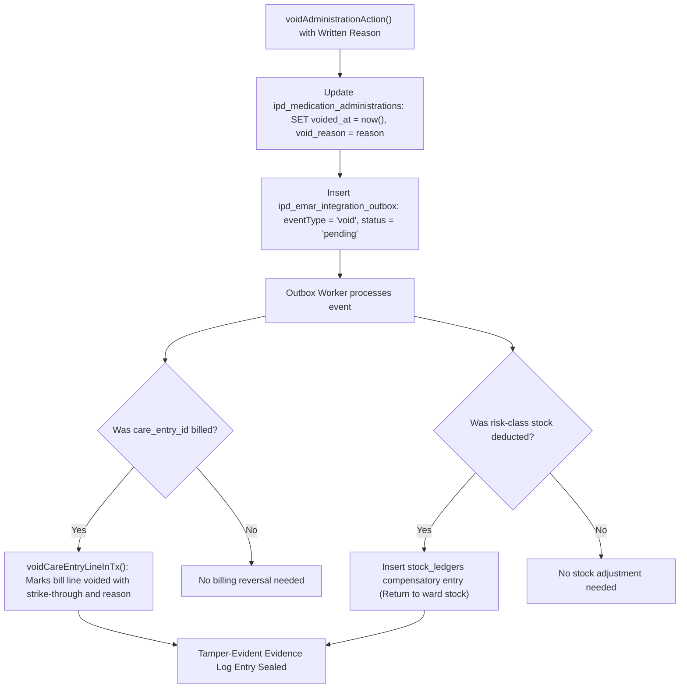
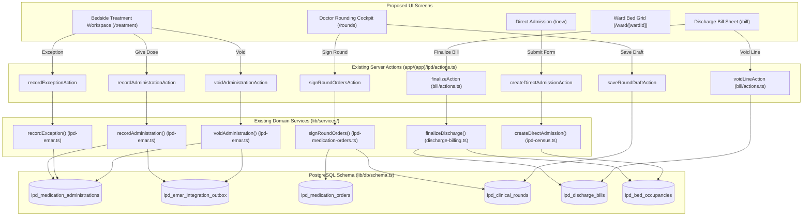
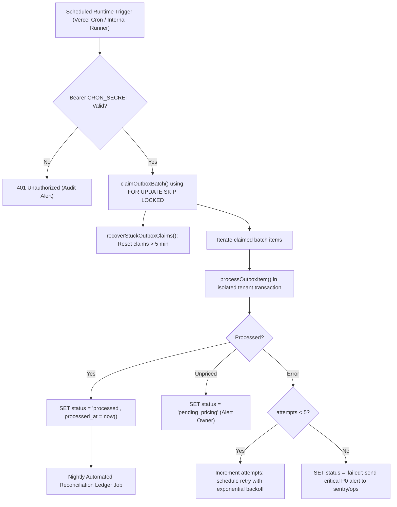
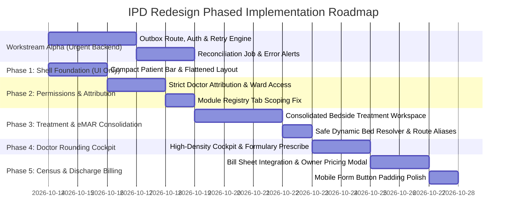

# Qurio IPD — Target UI Architecture and Redesign Plan (Amended)

**Document Version:** 2.0.0 (Amended Architecture & Operational Safety Specification)  
**Status:** Approved Architecture Plan  
**Target Module:** Inpatient Department (IPD), Qurio Hospital Management SaaS  
**Scope:** UI/UX Redesign, Navigation Unification, Component Architecture, Workflow Consolidation, Medico-Legal Attribution, Outbox Engine, and Role-Based Authorization  

---

## 1. Executive Recommendation

The Inpatient Department (IPD) module in Qurio contains a robust, highly sophisticated domain engine: atomic multi-ward bed census, dynamic occurrence generation for medication schedules, transactional PRN advisory locks, tamper-evident audit logs, and day-wise running billing. 

However, previous incremental AI development produced an **uncoordinated, fragmented user interface**:
1. **Vertical Space Exhaustion:** Up to 4–5 nested header strips consume over 300px of screen real estate before clinical data is visible.
2. **Duplicated eMAR Workflows:** Two separate screens implement medication administration ([`/ipd/admissions/[id]/emar`](file:///d:/Projects/HospitalAutomation/app/(app)/ipd/admissions/[id]/(file)/emar/page.tsx) and [`/ipd/ward/[wardId]/bed/[bedId]`](file:///d:/Projects/HospitalAutomation/app/(app)/ipd/ward/[wardId]/bed/[bedId]/page.tsx)), creating cognitive divergence and role confusion.
3. **Role Accessibility Barriers:** Doctors conducting rounds at the bedside are barred with a `404 Not Found` when trying to view the bedside chart due to an overly restrictive `ipd.record` check.
4. **Isolated Operational Steps:** Bed assignment, bed transfers, and discharge billing sit outside the patient file navigation as disjointed screens.

### Core Architectural Principles of the Amended Plan:
- **Strict Clinical Author Attribution:** Zero fallback or impersonation. Clinical orders and progress notes must strictly be authored and signed by a verified doctor linked directly to `session.userId`.
- **Parallel Outbox Reliability Workstream:** Treat the P0 eMAR outbox integration as a critical backend engineering workstream with runtime scheduling, secret-authenticated cron triggers, exponential backoff, concurrency leases, failure dead-lettering, and automated ledger reconciliation.
- **Safe Dynamic Bed Navigation:** Replace aggressive 308 redirects with a dynamic bed resolver handling occupied beds, empty beds, transferred patients, and return-to-ward breadcrumbs without HTTP cache corruption.
- **Role-Based Data and Action Isolation:** Differentiate operational bed data from sensitive clinical progress notes and financial ledgers, enforcing security on the server via `withTenant()` and permission allow-lists.
- **Auditable Correction Semantics:** Treat medication voids as medical record amendments requiring signed reasons, leaving original audit entries intact while issuing compensatory billing and stock reversals.
- **Protected Financial Governance:** Maintain owner-only pricing authority for the catalogue; prevent unpriced bill flags from driving unauthenticated catalogue mutations.
- **Decoupled Execution & Strict Acceptance Gates:** Separate the UI shell refactor from permission and outbox changes so each can be independently reviewed, tested, and validated against non-negotiable acceptance criteria.

---

## 2. Current-State Findings Verified Against Code

| Finding / Area | Verified File & Line | Current Behavior in Repository | Redesign & Safety Resolution |
|---|---|---|---|
| **Author Impersonation Risk** | [`app/(app)/ipd/actions.ts:370-383`](file:///d:/Projects/HospitalAutomation/app/(app)/ipd/actions.ts#L370-L383) | `resolveDoctorId` accepts client-passed `requestedDoctorId` or falls back to `admissions.admittingDoctorId`. | **Strict Enforcement:** Require `doctors.userId = session.userId`. Reject signing if unlinked. No client override; no admitting doctor fallback. |
| **Disconnected Outbox Worker (P0)** | [`lib/services/ipd-emar-outbox.ts:367`](file:///d:/Projects/HospitalAutomation/lib/services/ipd-emar-outbox.ts#L367) | `processPendingOutboxBatch()` is called only in tests; no runtime scheduler invokes it. | **Parallel Workstream:** Build authenticated cron Route Handler (`/api/cron/ipd-outbox`), leases, retries, and reconciliation. |
| **Dual eMAR Screens** | [`components/ipd/emar/bedside-emar.tsx`](file:///d:/Projects/HospitalAutomation/components/ipd/emar/bedside-emar.tsx) vs [`components/ipd/bedside/bedside-treatment-chart.tsx`](file:///d:/Projects/HospitalAutomation/components/ipd/bedside/bedside-treatment-chart.tsx) | Two separate components with diverging bucket tabs, layouts, and supply-logging capabilities. | **Consolidation:** Merge into authoritative `BedsideTreatmentWorkspace` at `/ipd/admissions/[id]/treatment`. |
| **Doctor Bedside 404 Lockout** | [`app/(app)/ipd/ward/[wardId]/bed/[bedId]/page.tsx:29`](file:///d:/Projects/HospitalAutomation/app/(app)/ipd/ward/[wardId]/bed/[bedId]/page.tsx#L29) | `if (!can(session.role, 'ipd.record')) notFound()`. Doctor role lacks `ipd.record` in [`permissions.ts:89`](file:///d:/Projects/HospitalAutomation/lib/domain/permissions.ts#L89). | **Safe Authorization:** Relax route read to `ipd.view`; gate mutation actions individually by role. |
| **Stacked Header Redundancy** | [`app/(app)/ipd/layout.tsx:38`](file:///d:/Projects/HospitalAutomation/app/(app)/ipd/layout.tsx#L38) + [`(file)/layout.tsx:51`](file:///d:/Projects/HospitalAutomation/app/(app)/ipd/admissions/[id]/(file)/layout.tsx#L51) | Global Navbar $\rightarrow$ IPD Subheader $\rightarrow$ Back bar $\rightarrow$ `PatientHeader` $\rightarrow$ `SheetTabs`. | **Layout Flattening:** Compact Patient Bar ($\le 52\text{px}$) inside unified `/ipd/admissions/[id]/layout.tsx`. |
| **Revalidation Omission** | [`app/(app)/ipd/actions.ts:445-449`](file:///d:/Projects/HospitalAutomation/app/(app)/ipd/actions.ts#L445-L449) | `recordAdministrationAction` omits bedside treatment routes from `revalidatePath`. | **Cache Freshness:** Revalidate both `/ipd/admissions/[id]/treatment` and `/ipd/ward/[wardId]/bed/[bedId]`. |
| **Module Registry Tab Leak** | [`lib/modules/registry.ts:65-66`](file:///d:/Projects/HospitalAutomation/lib/modules/registry.ts#L65-L66) | Added `rounds` & `emar` to `core_ipd` with `ipd.view`, exposing them to desk and nurse roles and breaking test. | **Contract Restoration:** Assign clinical permissions (`ipd.prescribe`, `ipd.administer`) to tabs; restore test assertions. |

---

## 3. Target Information Architecture and Role Navigation

```mermaid
graph TD
    AppNav["Global Qurio Navigation Bar (OPD / IPD / Settings / Profile)"] --> IpdRoot["/ipd (Section Shell)"]
    
    subgraph SectionLevel ["1. Section-Level Views (Role-Filtered)"]
        Census["Census & Overview (/ipd) [Desk, Owner, Doctor]"]
        WardGrid["Ward Bed Map (/ipd/ward) [Nurse, Desk, Owner, Doctor]"]
        MyPatients["My Patients (/ipd/my-patients) [Doctor, Owner]"]
        StockStore["Risk-Class Stock (/ipd/stock) [All Roles]"]
        IpdSettings["IPD Setup (/settings/ipd) [Owner]"]
    end
    
    IpdRoot --> Census
    IpdRoot --> WardGrid
    IpdRoot --> MyPatients
    IpdRoot --> StockStore
    IpdRoot --> IpdSettings
    
    subgraph PatientContext ["2. Inpatient Patient File Context (/ipd/admissions/[id]/layout.tsx)"]
        CompactHeader["Compact Sticky Patient Bar (max 52px: Bed, Name, Age/Sex, IPD#, Status, Quick Actions)"]
        
        SheetSummary["Summary Sheet (/ipd/admissions/[id])"]
        SheetRounds["Doctor Rounds & Cockpit (/ipd/admissions/[id]/rounds)"]
        SheetTreatment["Bedside Treatment & eMAR (/ipd/admissions/[id]/treatment)"]
        SheetTpr["TPR Nursing Chart (/ipd/admissions/[id]/tpr)"]
        SheetBill["Discharge Bill & Settlement (/ipd/admissions/[id]/bill)"]
    end
    
    Census -.->|Select Patient| CompactHeader
    WardGrid -.->|Tap Occupied Bed (Dynamic Resolver)| CompactHeader
    MyPatients -.->|Select Patient| CompactHeader
    
    CompactHeader --> SheetSummary
    CompactHeader --> SheetRounds
    CompactHeader --> SheetTreatment
    CompactHeader --> SheetTpr
    CompactHeader --> SheetBill
```

### 3.1 Role Navigation Matrix

| Role | Landing Route | Visible Section Tabs | Default Patient Entry Point | Primary Clinical / Operational Focus |
|---|---|---|---|---|
| **Hospital Owner** | `/ipd` | Overview, Wards, My Patients, Stock, Setup | Patient Summary (`/ipd/admissions/[id]`) | Full clinical & financial oversight, pricing, audit trails. |
| **Doctor** | `/ipd/my-patients` | My Patients, Wards, Overview | Doctor Rounds (`/ipd/admissions/[id]/rounds`) | Daily rounds, active order reconciliation, progress notes. |
| **Ward Nurse** | `/ipd/ward` | Wards, Stock | Bedside Treatment (`/ipd/admissions/[id]/treatment`) | Due medication administration, PRN timers, vitals, supplies. |
| **Receptionist** | `/ipd` | Overview, Wards, Stock | Awaiting Bed $\rightarrow$ Assign (`/assign`) | Bed allocation, transfers, and discharge billing settlement. |

---

## 4. Route Consolidation, Safe Navigation, and Migration Table

### 4.1 Safe Dynamic Bed Navigation (Anti-308 Policy)
**Problem with HTTP 308 on Bed Routes:** Bed URLs are physical hardware/location locators, not permanent patient resources. If `/ipd/ward/[wardId]/bed/[bedId]` permanently redirects (308) to Patient A's admission ID, browser and CDN caches will aggressively cache the redirect. When Patient A is discharged and Patient B occupies the bed, devices will erroneously redirect to Patient A's closed record.

**Safe Dynamic Bed Resolver Strategy:**
1. `/ipd/ward/[wardId]/bed/[bedId]` remains a dynamic Server Component.
2. It queries `getBedOccupancy(hospitalId, bedId)` in real time.
3. **Execution Logic:**
   - **Occupied Bed:** Dynamically renders `BedsideTreatmentWorkspace` under the bed route context, passing the occupant's `admissionId` and setting breadcrumbs to `"← Back to Ward [Ward Name]"`. Alternatively, issues an explicit HTTP 307 Temporary Redirect with header `Cache-Control: no-store, must-revalidate` to `/ipd/admissions/[id]/treatment?fromWard=[wardId]`.
   - **Empty Bed:** Renders an informative empty bed state: *"Bed [Label] is currently empty. [ Assign a Waiting Patient ] or [ Back to Ward ]"*.
   - **Discharged / Transferred Resident:** If accessing via an old browser tab after occupancy ended, displays: *"Patient [Name] has been transferred to Bed [NewLabel] / discharged. [ Go to Current Record ] or [ Return to Ward ]"*.
4. **Permanent 308 Redirect Restriction:** Reserved strictly for static resource aliases: `/ipd/admissions/[id]/emar` $\rightarrow$ `308 Permanent Redirect` to `/ipd/admissions/[id]/treatment`.

### 4.2 Route Migration Table

| Existing Route | Target Route | Purpose | Allowed Roles | Navigation / Migration Behavior |
|---|---|---|---|---|
| `/ipd` | `/ipd` | Hospital census, awaiting bed list, wards overview | Owner, Desk, Doctor | Retained. Preserves search params (`?tab=awaiting`, `?tab=wards`, `?tab=ready`). |
| `/ipd/new` | `/ipd/new` | Direct emergency admission & bed booking | Owner, Desk | Retained with compact single-page layout. |
| `/ipd/my-patients` | `/ipd/my-patients` | Doctor's assigned patient cards & test chips | Doctor, Owner | Retained. Patient cards link directly to `/rounds`. |
| `/ipd/ward` | `/ipd/ward` | Ward selector for ward tablets | Nurse, Desk, Owner, Doctor | Retained. Relaxed route check from `ipd.record` to `ipd.view`. |
| `/ipd/ward/[wardId]` | `/ipd/ward/[wardId]` | Touch-first bed grid for specific ward | Nurse, Desk, Owner, Doctor | Retained. Bed tiles link directly to dynamic bed resolver. |
| `/ipd/ward/[wardId]/bed/[bedId]` | Dynamic Bed Resolver | Bedside treatment chart (medications & supplies) | Nurse, Doctor, Owner | Dynamic server resolver: renders treatment workspace or 307 temporary redirect. |
| `/ipd/admissions/[id]/(file)/emar` | `/ipd/admissions/[id]/treatment` | Consolidated patient eMAR & treatment sheet | Nurse, Doctor, Owner | HTTP 308 Permanent Redirect to `/treatment`. |
| `/ipd/admissions/[id]` | `/ipd/admissions/[id]` | Summary sheet: stay history & care timeline | All Roles | Retained as Case File Cover. |
| `/ipd/admissions/[id]/(file)/rounds` | `/ipd/admissions/[id]/rounds` | Doctor rounding cockpit & prescribing | Doctor, Owner | Retained. Strict author attribution; no unlinked signing. |
| `/ipd/admissions/[id]/(file)/tpr` | `/ipd/admissions/[id]/tpr` | Nursing TPR hourly vitals sheet | Nurse, Doctor, Owner | Retained. Integrates with compact patient context. |
| `/ipd/admissions/[id]/assign` | `/ipd/admissions/[id]/assign` | Bed picker for OPD-shifted patient | Desk, Owner | Retained with compact header; returns to `/ipd?tab=awaiting`. |
| `/ipd/admissions/[id]/transfer` | `/ipd/admissions/[id]/transfer` | Bed transfer sheet | Desk, Owner | Retained with compact header; returns to `/ipd/admissions/[id]`. |
| `/ipd/admissions/[id]/bill` | `/ipd/admissions/[id]/bill` | Discharge billing ledger & final settlement | Desk, Owner | Embedded inside patient file layout; reuses `CompactPatientBar`. |

---

## 5. Role-to-Data and Role-to-Action Governance Matrix

Authorization must be enforced on the server for both data retrieval and mutations. Hiding a button in the UI is never considered security.

### 5.1 Role-to-Data Retrieval Matrix (Server-Enforced Reads)

| Data Domain | Information Entities Included | Owner | Doctor | Nurse | Receptionist | Enforcement Mechanism |
|---|---|:---:|:---:|:---:|:---:|---|
| **Patient Identity & Bed Logistics** | Name, age, sex, bed label, ward, day of stay, IPD #, admission status, emergency phone | **Read** | **Read** | **Read** | **Read** | `withTenant(hospitalId, tx)`; `can(session.role, 'ipd.view')` |
| **Bedside Operational Vitals & Care Records** | Pulse, BP, SpO2, temp, blood sugar, consumables recorded, nurse bedside notes | **Read** | **Read** | **Read** | **Blocked** (Desk sees bill lines, not clinical vitals) | Service query guards in [`lib/services/tpr.ts`](file:///d:/Projects/HospitalAutomation/lib/services/tpr.ts); `can('ipd.view')` + role filter |
| **Sensitive Clinical Progress Notes** | Doctor evaluation notes, physical exam findings, provisional diagnoses, psychiatric notes | **Read** | **Read** | **Blocked** | **Blocked** | `withTenant(clinical: true)`; excluded from nurse/desk DTOs |
| **Medication Orders & Active Prescriptions** | Drug name, dose, route, frequency, schedule times, PRN indication, special instructions | **Read** | **Read** | **Read** | **Blocked** | [`lib/services/ipd-medication-orders.ts`](file:///d:/Projects/HospitalAutomation/lib/services/ipd-medication-orders.ts) requires clinical roles |
| **Medication Administration Audit History** | Timestamps, dose given, non-admin exception reasons, nurse identity, void audit logs | **Read** | **Read** | **Read** | **Blocked** | Masked in non-clinical views; only billed consumable names shown to desk |
| **Financial Ledger & Item Pricing** | Item price paise, margin, total bill amount, deposit ledger, discounts, payment transactions | **Read** | **Blocked** | **Blocked** | **Read** | [`lib/services/discharge-billing.ts`](file:///d:/Projects/HospitalAutomation/lib/services/discharge-billing.ts) requires `billing.collect` or `ipd.discharge` |

### 5.2 Role-to-Action Mutation Matrix (Server-Enforced Mutations)

| Mutation Action | Server Action Symbol | Required Permission | Allowed Roles | Critical Server-Side Pre-Conditions |
|---|---|---|:---:|---|
| **Shift OPD to IPD** | `shiftToIpdDynamic` | `ipd.shift` | Owner, Doctor | Linked doctor check; encounter must be active in consultation. |
| **Admit Patient (Emergency)** | `createDirectAdmissionAction` | `ipd.admit` | Owner, Receptionist | Tenant isolation; bed must be free at time of commit. |
| **Assign / Transfer Bed** | `assignBedAction`, `transferBedAction` | `ipd.admit` | Owner, Receptionist | Atomic transaction; closes old occupancy (`freed_at = now()`). |
| **Author Round Note Draft** | `saveRoundDraftAction` | `ipd.prescribe` | Owner, Doctor | **Doctor link required:** `doctors.userId = session.userId`. Rejects if unlinked. |
| **Sign Round & Commit Orders** | `signRoundOrdersAction` | `ipd.prescribe` | Owner, Doctor | **Strict attribution:** Sets `prescriberDoctorId = doc.id`. Zero fallback. |
| **Administer Medication** | `recordAdministrationAction` | `ipd.administer` | Owner, Nurse, Doctor | Verifies order is `active` and unexpired; transactional PRN advisory lock. |
| **Record Non-Admin Exception** | `recordExceptionAction` | `ipd.administer` | Owner, Nurse, Doctor | Validates mandatory clinical reason (`char_length >= 3`). |
| **Void Medication Administration** | `voidAdministrationAction` | `ipd.administer` | Owner, Nurse, Doctor | Mandatory written justification; records `voided_by_user_id`; triggers outbox void. |
| **Record Bedside Consumable** | `recordCareEntries` (API/Action) | `ipd.record` | Owner, Nurse, Receptionist | Idempotency key checked; posts draft bill line; hides price from nurse. |
| **Record Hourly TPR Vitals** | `recordTprEntries` (API) | `ipd.chart` | Owner, Nurse, Doctor | Checks ward module rollout; checks chart day boundaries (8 AM - 8 AM). |
| **Toggle Discharge Readiness** | `setDischargeReadyAction` | `ipd.dischargeReady` | Owner, Doctor | Patient must be in bed (`admitted` or `discharge_ready`). |
| **Void / Discount Bill Line** | `voidLineAction`, `discountLineAction` | `ipd.correct` | Owner, Receptionist | Bill must be `draft`; mandatory written justification; immutable ledger row. |
| **Collect Inpatient Payment** | `recordPaymentAction` | `billing.collect` | Owner, Receptionist | Validates positive amount; issues payment ID; logs payment method. |
| **Finalize Discharge** | `finalizeAction` | `ipd.discharge` | Owner, Receptionist | Unpriced items count must be 0; closes bed occupancy; sets bill `final`. |
| **Update Catalogue Price** | `saveChargeItemAction` | `billing.price` | **Owner Only** | Rejects receptionist and doctors; writes to `price_change_logs`. |

---

## 6. Medication Administration Correction and Reversal Semantics

Medication records are permanent medical and legal documents. Deleting an administration record is strictly prohibited. The system enforces the following correction and reversal protocol:

### 6.1 Two-Phase Correction Lifecycle
1. **Immediate Undo Window ($\le 2\text{ minutes}$):**  
   - If the nurse inadvertently records an administration, they may click "Undo" within 120 seconds.  
   - Reversal requires identity match: `session.userId === admin.nurseUserId`.  
   - System marks `voided_at = now()`, `void_reason = 'Immediate nurse undo within 2 minutes'`, `voided_by_user_id = session.userId`.  
   - An outbox event is enqueued with `eventType = 'void'`.
2. **Post-Window Clinical Correction ($> 2\text{ minutes}$):**  
   - Nurse or attending doctor must use the "Void Entry" or "Correct Entry" modal.  
   - Requires a mandatory clinical explanation (minimum 10 characters, e.g., *"Patient vomited oral tablet immediately after ingestion"*).  
   - The original administration row remains permanently in `ipd_medication_administrations` with audit attribution (`voided_at`, `void_reason`, `voided_by_user_id`).  
   - If replacing the entry (e.g. wrong dose documented), `correctAdministration` inserts the replacement record with `corrects_administration_id` pointing to the voided row, linking the audit chain.

### 6.2 Downstream Compensatory Effects


---

## 7. Catalogue Pricing Governance and Financial Safety

### 7.1 Separation of Catalogue Pricing from Bill Settlement
- **Catalogue Pricing Authority:** Only the hospital `owner` possessing `billing.price` permission is authorized to set or modify medicine or consumable prices in [`app/(app)/settings/ipd/items`](file:///d:/Projects/HospitalAutomation/app/(app)/settings/ipd/items/page.tsx).
- **Non-Owner Desk Isolation:** Desk receptionists settling bills on `/ipd/admissions/[id]/bill` **cannot** mutate the central pricing catalogue. Giving non-owners inline price-editing powers creates rogue price alterations across the hospital.

### 7.2 Handling Unpriced Items on the Discharge Bill
1. **Detection:** When a nurse records an unpriced consumable at the bedside, or a doctor orders an unpriced medicine, the item is flagged with `unpriced: true`.
2. **Blocking Safety Check:** In [`lib/services/discharge-billing.ts:630`](file:///d:/Projects/HospitalAutomation/lib/services/discharge-billing.ts#L630), `finalizeDischarge()` explicitly throws `DischargeBillError('Price the unpriced items before finalising')`.
3. **Authorized Owner Inline Resolution:**
   - If the active session user is the **Owner** (`can('billing.price')`): The bill screen renders a dedicated "Set Item Price" action modal. Setting the price updates `medicines.selling_price_paise` or `charge_items.price_paise`, logs an audit entry to `price_change_logs`, and immediately re-evaluates the draft bill line for this stay.
4. **Receptionist Protocol (Non-Owner):**
   - If the active user is a **Receptionist**: The bill screen renders: *"2 unpriced items detected. Ask hospital owner to price [Item Names] in Settings → Items, or record an authorized stay discount."* A "Copy Unpriced Summary" button allows instant WhatsApp/internal dispatch to the owner.
5. **Immutability of Historical Bills:** Setting a catalogue price updates future draft lines and the current stay's draft bill; it **never retrospectively alters finalized bills** from previous patients.

---

## 8. Screen Specifications

### 8.1 Screen 1: The Unified Bedside Treatment Workspace
* **Route:** `/ipd/admissions/[id]/treatment` (and dynamic resolution from `/ipd/ward/[wardId]/bed/[bedId]`)
* **Users & Goals:** Ward Nurses (administering & logging consumables), Doctors (verifying bedside administration status & giving stat doses).
* **Layout:**
  - **Desktop / Tablet (Landscape):** Two-column clinical workspace.
    - Left Column (65%): Active Medications grouped by urgency:
      - Top Banner: Urgent Medications (Overdue + Due Now) with pulsing indicator.
      - Middle: Scheduled Later Today (collapsible).
      - Bottom: As Needed (SOS / PRN) with live eligibility timers and interval countdowns.
    - Right Column (35%): Tabbed Auxiliary Panel:
      - Tab 1: Ward Supplies & Consumables (1-tap quick buttons for syringes, IV sets, gauze).
      - Tab 2: Today's Administration Audit Log (given, omitted, refused doses with void buttons).
  - **Mobile / Tablet (Portrait):** Stacked single column with sticky segmented filter (`Due Now (3)`, `SOS (2)`, `Supplies`, `History`).
* **Header:** Uses `CompactPatientBar` (max 52px): Bed number in bold pill, Patient name, Age/Gender, Admitting doctor, Allergy status chip, Link back to Ward Bed Grid.
* **Modals:**
  - `AdministerModal`: Re-verifies 5 Rights, displays active drug allergy alerts, allows dose/route adjustment, commits via `recordAdministrationAction`.
  - `ExceptionModal`: Captures non-administration clinical reason (`omitted`, `refused`, `held`), commits via `recordExceptionAction`.
  - `PrnAdminModal`: Evaluates minimum interval hours and daily dose ceilings, commits PRN administration.
  - `VoidAdministrationModal`: Captures mandatory signed explanation before voiding prior administrations.

### 8.2 Screen 2: The Doctor Rounding Cockpit
* **Route:** `/ipd/admissions/[id]/rounds`
* **Users & Goals:** Attending Doctors and Hospital Owners evaluating inpatient status, reviewing vitals trends, reconciling active orders, prescribing from formulary, drafting daily progress notes, and executing legal signature.
* **Strict Author Attribution Rule:**
  - Session user must have a verified doctor row (`doctors.userId = session.userId`).
  - If unlinked: The workspace is strictly **Read-Only**. A warning banner displays: *"Your login is not linked to a verified doctor profile. Clinical orders cannot be authored or signed. Contact the administrator."*
  - The server action strictly rejects signing if `session.userId` has no linked doctor record.
* **Layout:**
  - Row 1: Vitals Freshness Ribbon (Pulse, BP, SpO2, Temp, Blood Sugar, hours elapsed).
  - Row 2: Allergy Safety Alert (NKDA vs Documented Allergens with inline update trigger).
  - Main Workspace (Split Grid):
    - Left Panel (60%): Active Inpatient Medication Orders review card stream. Decision chips: `[ Continue ]` `[ Renew ]` `[ Modify ]` `[ Hold ]` `[ Stop ]`.
    - Right Panel (40%): Rapid Inpatient Prescribing Section (Formulary search, route, frequency OD/BD/TID/STAT/PRN, duration) + Progress Note Editor.
  - Sticky Footer Bar: Order reconciliation summary with primary CTA: `[ Finalize & Sign Round ]`.

### 8.3 Screen 3: Patient Overview & Case File Cover
* **Route:** `/ipd/admissions/[id]`
* **Users & Goals:** All Roles reviewing admission summary, stay duration, diagnoses, bed history, and chronological care-entry timeline.
* **Content Sections:**
  1. Admission Demographics Card: Admission date, day of stay, primary diagnosis, payer/insurance, advance deposit.
  2. Bed Movement History: Ward and bed occupancy timestamps.
  3. Care Entry Timeline: Reverse chronological feed of items given, medications administered, tests ordered, and nursing observations.
  4. Quick Actions: Transfer Bed, Order Tests, Discharge Ready toggle, Print Physical File.

### 8.4 Screen 4: Discharge Billing & Financial Ledger
* **Route:** `/ipd/admissions/[id]/bill`
* **Users & Goals:** Desk Receptionists and Hospital Owners reviewing day-wise charges, resolving unpriced item warnings, applying authorized discounts/voids with written reasons, collecting payment, and finalizing discharge.
* **Layout:**
  - Embedded inside unified patient context with `CompactPatientBar`.
  - Day-by-Day Charge Groups: Oldest to newest, detailing bed charges, consumables, pharmacy items, and doctor visits.
  - Financial Summary Card: Gross Total, Total Discount, Approved Insurance Amount, Advance Deposit Deducted, Net Balance Due.
  - Unpriced Item Warning: Owner inline pricing modal / Receptionist notification trigger.
  - Payment Modal: Cash, UPI, Card, Bank, Insurance with receipt reference number.
  - Finalize Button: Closes bed occupancy, marks patient discharged, transitions bill status to `final`.

---

## 9. Shared Component Architecture

```
components/ipd/
├── shell/
│   ├── ipd-section-nav.tsx             # [Presentational] Compact section tabs (Overview, Wards, My Patients, Stock, Setup)
│   ├── compact-patient-bar.tsx         # [Presentational] Universal max-52px sticky patient identity header
│   └── sheet-navigation.tsx            # [Presentational] Patient sheet tabs (Summary, Rounds, Treatment, TPR, Billing)
├── bedside/
│   ├── bedside-treatment-workspace.tsx # [Container] Consolidated treatment screen
│   ├── urgent-medication-stream.tsx    # [Presentational] Overdue & Due Now doses card list
│   ├── routine-schedule-list.tsx       # [Presentational] Doses scheduled later today
│   ├── prn-medication-card.tsx         # [Presentational + Action] SOS medication cards with interval timers
│   ├── consumable-quick-grid.tsx       # [Container] 1-tap ward consumable supply logger
│   └── administration-audit-table.tsx  # [Presentational + Action] Today's given/withheld log with void actions
├── rounding/
│   ├── rounding-cockpit.tsx            # [Container] Main doctor rounding workspace
│   ├── vitals-freshness-ribbon.tsx     # [Presentational] Vitals ribbon with aging indicators
│   ├── allergy-safety-alert.tsx        # [Presentational + Modal] High-contrast allergy alert banner
│   ├── order-reconciliation-row.tsx    # [Presentational + Action] Active order review with decision chips
│   ├── quick-prescribe-card.tsx        # [Presentational + Action] Formulary medicine picker
│   └── order-signing-modal.tsx         # [Container] Transactional round signature modal
├── shared/
│   ├── bed-grid.tsx                    # [Presentational] Unified responsive bed occupancy grid
│   ├── status-chips.tsx                # [Presentational] Status chips for admissions, orders, and beds
│   ├── outbox-status-pill.tsx          # [Presentational] Offline outbox synchronization indicator
│   ├── void-with-reason-modal.tsx      # [Container] Generic modal requiring written justification for voids
│   └── unpriced-item-price-modal.tsx   # [Container] Owner-only modal for pricing catalogue items from bill
```

### Component Boundaries & Architectural Rules:
1. **Presentational vs Container Separation:**  
   Card renderers receive pure props and callback handlers (`onAdminister`, `onExcept`). They never invoke server actions or router transitions directly.
2. **Single Source of Patient Context:**  
   The `CompactPatientBar` replaces `PatientHeader` across all patient screens. It renders patient initials, age/sex, bed label, ward name, day of stay, IPD number, and allergy summary in $\le 52\text{px}$ height.
3. **Touch-Target Compliance:**  
   All buttons and interactive targets on mobile and tablet screens enforce minimum $44\times 44\text{px}$ touch boundaries.

---

## 10. Existing Workflow-to-Service Wiring Map



---

## 11. UI/UX versus Functional Defect Backlogs

### 11.1 UI/UX Redesign Backlog (Independent of Backend Fixes)

| Task ID | Component / Area | Description | Severity | Acceptance Criteria |
|---|---|---|:---:|---|
| **UI-01** | Header Architecture | Implement `CompactPatientBar` (max 52px) replacing 4 stacked headers across all patient routes. | **High** | Viewport gain $\ge 220\text{px}$; patient name, bed, doctor, day, status visible on desktop and mobile. |
| **UI-02** | eMAR Consolidation | Merge `BedsideEmar` and `BedsideTreatmentChart` into single `BedsideTreatmentWorkspace`. | **High** | Route `/emar` 308 redirects to `/treatment`; unified view displays routine doses, SOS, supplies, and history. |
| **UI-03** | Rounding Cockpit Polish | Refactor `RoundingCockpit` layout into high-density 2-column clinical grid with sticky sign summary bar. | **High** | Doctor can review orders and author new prescriptions without scrolling past 5 nested cards. |
| **UI-04** | Discharge Billing Integration | Integrate `/bill` into patient context with `CompactPatientBar` and sheet navigation tabs. | **Medium** | Bill page shares identical patient bar; unpriced item banners link directly to item price resolution. |
| **UI-05** | Mobile Form Button Fix | Fix fixed bottom submit buttons in `/ipd/new`, `/assign`, and `/transfer` to avoid input occlusion. | **Medium** | Forms on mobile scroll smoothly above virtual keyboards without hiding inputs. |
| **UI-06** | Ward Grid Visual Polish | Update `BedGrid` component with distinct color accents for Discharge Ready, Overdue Medication, and Free. | **Low** | Grid tiles unambiguous without relying solely on color (includes icons and text labels). |

### 11.2 Functional and Safety Backlog (Backend / Architecture)

| Task ID | System Area | Defect Description | Severity | Verification & Fix Requirement |
|---|---|---|:---:|---|
| **FN-01** | Outbox Execution | Outbox processing worker is not scheduled in runtime; administrations never bill or deduct stock. | **P0** | Parallel Workstream Alpha: Build authenticated cron Route Handler and reconciliation engine. |
| **FN-02** | Author Attribution Fix | `resolveDoctorId` allows client-supplied `requestedDoctorId` or falls back to `admittingDoctorId`. | **P0** | Require `doctors.userId = session.userId`. Rejects unlinked users with `AuthorNotLinkedDoctorError`. |
| **FN-03** | Doctor Ward Access | Doctors receive 404 on `/ipd/ward` and bed pages due to restrictive `ipd.record` check. | **P1** | Relax page authorization to `can(session.role, 'ipd.view')` while gating mutations by role. |
| **FN-04** | Cache Invalidation | `recordAdministrationAction` does not revalidate bed recording and treatment routes. | **P1** | Add `revalidatePath('/ipd/admissions/' + id + '/treatment')` and bed path to action. |
| **FN-05** | Module Registry Regression | `rounds` and `emar` tabs added into `core_ipd` broke regression tests in `registry.test.ts`. | **P2** | Scope tab permissions correctly in `lib/modules/registry.ts` and ensure all registry tests pass. |
| **FN-06** | Owner Pricing Protection | Non-owners must not be permitted to set catalogue prices on the bill. | **P2** | Add owner-only inline price modal; restrict non-owner desk users to notification triggers. |

---

## 12. Urgent Parallel Workstream: eMAR Outbox Engine & Reconciliation

The P0 defect (unprocessed eMAR outbox rows) must be engineered in a dedicated parallel workstream with production-grade reliability:



### Engineering Specifications for Workstream Alpha:
1. **Endpoint & Security:**  
   Implement `app/api/cron/ipd-outbox/route.ts` accepting `POST` with `Authorization: Bearer <CRON_SECRET>` verified using `crypto.timingSafeEqual`.
2. **Concurrency & Leases:**  
   Uses `claimOutboxBatch()` with `FOR UPDATE SKIP LOCKED` and a 5-minute lease timestamp `claimed_at`. Stale claims are automatically returned to `pending` by `recoverStuckOutboxClaims()`.
3. **Exponential Backoff:**  
   Retries schedule with delay: $\text{delay} = 2^{\text{attempts}} \times 30\text{ seconds}$ (capped at 5 attempts before transitioning to `failed`).
4. **Dead-Letter Monitoring:**  
   Rows transitioning to `failed` trigger immediate operational notifications.
5. **Nightly Reconciliation Engine:**  
   An automated service verifies that every non-voided `administered` row in `ipd_medication_administrations` has a matching active care entry and billing line, flagging discrepancies in the audit log.

---

## 13. Phased Delivery Plan

The execution is strictly phased to decouple the layout refactoring from permission changes and backend outbox engineering:



### Phase 1: Shell Foundation & Compact Patient Context (UI Only)
- **Objective:** Reclaim vertical viewport space without modifying permission logic or database transactions.
- **Scope:**
  - Build `CompactPatientBar` component ([`components/ipd/shell/compact-patient-bar.tsx`](file:///d:/Projects/HospitalAutomation/components/ipd/shell/compact-patient-bar.tsx)).
  - Refactor [`app/(app)/ipd/admissions/[id]/(file)/layout.tsx`](file:///d:/Projects/HospitalAutomation/app/(app)/ipd/admissions/[id]/(file)/layout.tsx) into a single compact header.
- **Verification:** Confirm viewport height gain $\ge 220\text{px}$; ensure no permissions or server actions are touched.

### Phase 2: Author Attribution, Ward Access & Registry Alignment
- **Objective:** Eliminate author impersonation risks and allow doctor ward entry while restoring module registry test contracts.
- **Scope:**
  - Enforce `doctors.userId = session.userId` in `resolveDoctorId`. Remove all fallbacks.
  - Relax route check on `/ipd/ward` and bed pages to `ipd.view`.
  - Fix tab scoping in `lib/modules/registry.ts` and verify `registry.test.ts` passes.
- **Verification:** Run `npx vitest run lib/modules/__tests__/registry.test.ts` and `lib/domain/__tests__/permissions.test.ts`.

### Phase 3: Consolidated Bedside Treatment Workspace
- **Scope:** Merge `bedside-treatment-chart.tsx` and `bedside-emar.tsx` into `bedside-treatment-workspace.tsx`. Wire safe dynamic bed resolver and 308 redirect for `/emar`.
- **Verification:** Run `npx vitest run components/ipd/bedside` and `components/ipd/emar`.

### Phase 4: Doctor Rounding Cockpit Workspace
- **Scope:** High-density 2-column clinical grid in `RoundingCockpit`; sticky order summary bar; inline allergy documenting modal.
- **Verification:** Run `npx vitest run components/ipd/rounding`.

### Phase 5: Census, Discharge Billing & Financial Safety
- **Scope:** Integrate `/bill` into unified patient context; add owner-only catalogue pricing modal; fix mobile action button occlusion.
- **Verification:** Run `npx vitest run lib/domain/__tests__/discharge-bill.test.ts`.

---

## 14. Acceptance Testing Gates and Regression Matrix

Every phase must pass its non-negotiable acceptance gate before proceeding:

### Gate 1: Layout & Context Integrity Gate
- [ ] Viewport height consumed by headers is $\le 60\text{px}$ across all `/ipd/admissions/[id]/*` sheets.
- [ ] Patient identity, bed label, day of stay, doctor name, and allergy chips remain sticky on mobile scroll.
- [ ] Zero existing URLs or bookmarks to `/ipd/admissions/[id]` or `/rounds` are broken.

### Gate 2: Clinical Author Attribution & Security Gate
- [ ] Attempting to sign clinical round orders with an unlinked doctor account throws `AuthorNotLinkedDoctorError` on both client and server.
- [ ] `requestedDoctorId` passed in client payloads is strictly ignored.
- [ ] Doctor account can navigate to `/ipd/ward` and view bed census without 404 error.
- [ ] Non-clinical roles (receptionist) receive `Forbidden` error if attempting to access clinical progress notes.

### Gate 3: Dynamic Bed Navigation & Safe Routing Gate
- [ ] Navigating to `/ipd/ward/[wardId]/bed/[bedId]` for an occupied bed dynamically renders the treatment workspace with `"← Back to Ward"` navigation.
- [ ] Navigating to `/ipd/ward/[wardId]/bed/[bedId]` for an empty bed renders the empty bed prompt; **no redirect occurs**.
- [ ] Accessing `/ipd/admissions/[id]/emar` permanently redirects (308) to `/ipd/admissions/[id]/treatment`.

### Gate 4: PRN Concurrency & Order State Gate
- [ ] Concurrent requests to administer PRN medication past interval or daily limit are blocked by `pg_advisory_xact_lock`.
- [ ] Draft orders authored in Doctor Rounds **never appear** on bedside treatment or nursing eMAR screens until signed.
- [ ] Stat orders immediately transition to `completed` upon verified administration.

### Gate 5: Medication Correction & Audit Integrity Gate
- [ ] Voiding an administration requires a minimum 10-character written clinical explanation.
- [ ] Voided row remains in `ipd_medication_administrations` with `voided_at` and `voided_by_user_id` populated; never deleted.
- [ ] Outbox void event is enqueued and voids the corresponding draft bill line.

### Gate 6: Financial Safety & Pricing Governance Gate
- [ ] Receptionist attempting to edit catalogue prices on `/bill` is blocked; UI renders owner alert trigger.
- [ ] Owner pricing an unpriced item updates `medicines.selling_price_paise`, logs to `price_change_logs`, and updates the current stay's bill line.
- [ ] Finalized historical bills for discharged patients remain strictly unaltered.

### Gate 7: Parallel Outbox Worker Reliability Gate
- [ ] Unauthenticated calls to `/api/cron/ipd-outbox` return `401 Unauthorized`.
- [ ] Authenticated cron invocation claims pending items with `FOR UPDATE SKIP LOCKED`.
- [ ] Medication administrations successfully convert to active care entries and draft bill lines.
- [ ] Simulated processing failures retry with exponential backoff and dead-letter after 5 attempts.

---

## 15. Unverified Assumptions and Infrastructure Requirements

1. **Local PostgreSQL Integration Testing:**  
   Service-level integration tests (`rounding-cockpit-e2e.test.tsx`, `ipd-emar-outbox.integration.test.ts`) require an active PostgreSQL instance (`ECONNREFUSED ::1:5432`). These tests cannot run in a headless environment without a running database container. Unit tests in `lib/domain/__tests__` and component tests in `components/ipd` execute in memory and pass cleanly.
2. **Cron Scheduling Infrastructure:**  
   We assume production supports either Vercel Cron (`vercel.json`) or an external scheduler (e.g. AWS EventBridge / Cloudflare Worker) triggering `/api/cron/ipd-outbox` every 60 seconds with bearer authentication.

---

## 16. Final Recommendation: The First Implementation Slice

**Execute Phase 1 (Shell Foundation & Compact Patient Context) in parallel with launching Workstream Alpha (Outbox Worker Engine).**

### Justification:
1. **Immediate Ergonomic Relief:** Phase 1 delivers immediate, visible relief to hospital staff by recovering over 220px of vertical viewport space across all inpatient screens without touching sensitive domain logic.
2. **Decoupled Safety:** Keeping Phase 1 strictly presentational guarantees zero risk to clinical state machines or billing transactions while Workstream Alpha resolves the P0 outbox worker deficiency in the backend.
3. **Firm Structural Base:** Completing the `CompactPatientBar` provides the exact UI container into which the consolidated treatment workspace (Phase 3) and doctor rounding cockpit (Phase 4) will seamlessly fit.

---

*Amended plan grounded against active repository source code across 25 inspected files. No application code, schemas, or migrations were modified during this planning phase.*
