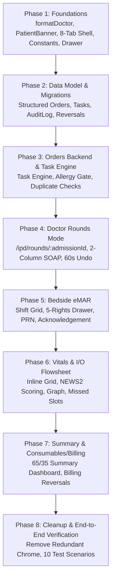

# Specification: Qurio IPD Patient Chart Full Redesign

**Date:** 2026-10-13  
**Status:** In Review (Revised per Clinical Architecture Feedback)  
**Source Document:** `IPD Screen-by-Screen Addendum (for the coding agent)`  
**Scope:** IPD Patient Chart subsystem only, built strictly in the order of Section 9.

---

## 1. System Architecture & Global Rules

### 1.1 Canonical Routing & Patient Identifiers
To prevent wrong-patient hazards, ambiguous readmission resolution, and PII leakage in browser histories:
- **Canonical Route:** Strictly uses the admission UUID:
  `/ipd/patients/:admissionId/{summary|orders|emar|vitals|notes|investigations|billing|discharge}`
  - Legacy routes `/ipd/admissions/:id/*` will execute a 307 temporary redirect to the canonical `/ipd/patients/:admissionId/*` route.
- **Lookup Routes (Patient UUID or UHID):**
  - Resolving a patient by patient UUID or UHID must occur through an explicit lookup endpoint:
    `/ipd/lookup?uhid=<uhid>` or `/ipd/lookup?patientId=<uuid>`
  - The lookup checks active inpatient stays. If an active admission exists, it redirects to `/ipd/patients/:admissionId/summary`. If multiple admissions exist (e.g. history), it renders a disambiguation selection screen.
- **Identifier Separation:**
  - **UHID (Hospital Identifier):** Displayed on the sticky patient banner (`patients.mrn`).
  - **IPD No. (Inpatient Stay Identifier):** Displayed on the sticky patient banner (`admissions.ipdNumber`).
  - **QID (Universal Person ID):** Stored in `patients.qid`. Kept in the detailed patient demographics drawer rather than the sticky header, preserving bedside privacy while remaining accessible to staff.

### 1.2 PatientBanner Specification
A single sticky banner rendered strictly by the chart layout directly below the top bar:
- **Rendered once by the layout, never duplicated by child tabs.**
- **Fields:**
  - Patient Name in Title Case
  - Age / Sex (e.g. `45 yrs · Male`)
  - **UHID** and **IPD No.**
  - Ward · Bed (e.g. `General Ward A · Bed 12`)
  - Day N of admission
  - Consultant formatted via `formatDoctor(name)` (strictly eliminating `"Dr. Dr."`)
  - Diagnosis: text or amber clickable chip `"Diagnosis not recorded"` (opens diagnosis drawer)
  - Allergy Chip:
    - Red: `Allergies: <list>`
    - Grey: `No known allergies`
    - Amber (clickable): `Allergies not recorded` (opens allergy assessment drawer)
  - Admission status badge (`Admitted`, `Discharge planned`, `Ready for discharge`, `Discharged`)
  - Actions: `[History]` (accountability trail) and `[Print file]`
- **Removed chrome:** In-page monospace bed chips, "Back to General Ward A" rows, and "TPR Chart / Patient File / Refresh" buttons inside the eMAR/treatment pages.

### 1.3 Fixed Tab Sequence & No-Regression Rule
The 8 canonical tabs in fixed sequence:
`Summary | Orders | eMAR | Vitals & I/O | Notes | Investigations | Consumables & Billing | Discharge`

- **Phase 1 Non-Regression Requirement:**
  - Summary tab links to "View all orders". Therefore, Phase 1 will **not** render `Orders` or `Discharge` as blank empty states.
  - Phase 1 delivers a minimal, functioning `Orders` tab (active orders table with Stop and Modify actions) and a functioning `Discharge` tab (housing the existing "Discharge ready" and "Discharge bill" actions previously removed from billing).
  - Notes and Investigations will render standard `EmptyState` components until their dedicated phases.
- **Doctor Rounds:** Doctor rounds is **not a tab**; it is an active clinical **mode** accessed via `/ipd/rounds/:admissionId` or the `[Start rounds]` quick action.

### 1.4 Hard Clinical Rules (§1.5)
These 4 rules apply across all screens and tabs:
1. **Universal Audit Trail:** Every clinical record stores `created_by`, `created_at`, `updated_by`, `updated_at`. Any modification, correction, or void to recorded data creates an immutable row in `audit_log` (`table_name`, `record_id`, `old_value`, `new_value`, `reason`, `user_id`, `created_at`).
2. **Strict Missing Value Representation:** Never render a missing value as `0`, `normal`, or `"Done"`. Missing data must explicitly render as `"—”` or `"Not recorded"`.
3. **Focus Protection:** Tables and flowsheets must **never auto-reorder or sort rows** while any cell or row has active user focus.
4. **Standard 4 Screen States:** Every page, tab, and drawer must provide:
   - **Loading:** Skeleton loader matching component layout.
   - **Empty:** Specific clinical empty state (see §5.6).
   - **Error:** Clinical error banner with a `[Retry]` action.
   - **No-Permission:** Clear access-denied message without broken layouts.

### 1.5 Typography, Touch Targets & Shared Widgets
- **Typography:** Body 14px, table cells 13px, metadata 12px. Nothing below 12px. Font weights 400 and 600 only. No monospace in chrome (monospace restricted to IDs inside tables at 12px).
- **Touch Targets:** Minimum 44px on nurse touch interfaces (eMAR, Vitals & I/O).
- **ShiftNavigator:** `‹ Previous shift | Current shift | Next shift ›` with date picker and shift boundaries from hospital settings (default 08:00–14:00, 14:00–20:00, 20:00–08:00).
- **Drawer:** Standardized 480px right-hand slide-over; header displays Patient Name + UHID + Bed; primary/cancel footer; Escape-key close; unsaved-changes confirmation.
- **StatusBadge:** Driven strictly by `constants/clinical.ts`.

---

## 2. Clinical Data Contracts & Role Permissions

### 2.1 Role & Permission Matrix
| Action | Nurse | Doctor / Consultant | Billing Officer | Admin / Owner |
| :--- | :---: | :---: | :---: | :---: |
| Administer Scheduled Medication / Record Task | ✓ | ✓ | ✗ | ✗ |
| Give Unordered Drug (Verbal Order) | ✓ | ✓ | ✗ | ✗ |
| Co-sign Verbal Order | ✗ | ✓ | ✗ | ✗ |
| Sign / Stage / Stop / Modify Medication Orders | ✗ | ✓ | ✗ | ✗ |
| Record Allergy Assessment | ✓ | ✓ | ✗ | ✓ |
| Record Vitals & Intake / Output | ✓ | ✓ | ✗ | ✗ |
| Record Ward Consumables | ✓ | ✓ | ✓ | ✓ |
| Set Price on Unpriced Items | ✗ | ✗ | ✓ | ✓ |
| Mark Discharge Ready | ✓ | ✓ | ✗ | ✓ |
| Finalize Discharge Bill | ✗ | ✗ | ✓ | ✓ |
| Override Drug Allergy / Duplicate Block | ✗ | ✓ (with logged reason) | ✗ | ✗ |
| Override PRN Interval / Max Dose Block | ✗ | ✓ (with doctor name + logged reason) | ✗ | ✗ |

### 2.2 Clinical Constants (`constants/clinical.ts`)
```typescript
export const OrderType = {
  MEDICATION: 'MEDICATION',
  IV_FLUID: 'IV_FLUID',
  INVESTIGATION: 'INVESTIGATION',
  NURSING: 'NURSING',
  DIET: 'DIET',
  VITALS_FREQ: 'VITALS_FREQ',
} as const;

export const OrderStatus = {
  DRAFT: 'DRAFT',
  ACTIVE: 'ACTIVE',
  ON_HOLD: 'ON_HOLD',
  COMPLETED: 'COMPLETED',
  STOPPED: 'STOPPED',
  CANCELLED: 'CANCELLED',
} as const;

export const PriorityTag = {
  ROUTINE: 'ROUTINE',
  STAT: 'STAT',
  PRN: 'PRN',
  EMERGENCY: 'EMERGENCY',
} as const;

export const TaskStatus = {
  DUE: 'DUE',
  OVERDUE: 'OVERDUE', // derived if > 60 min past slot
  GIVEN: 'GIVEN',
  HELD: 'HELD',
  REFUSED: 'REFUSED',
  NOT_AVAILABLE: 'NOT_AVAILABLE',
  MISSED: 'MISSED',
} as const;

export const HoldReasons = [
  'NPO',
  'Vomiting',
  'Patient asleep',
  'Awaiting doctor review',
  'Abnormal vitals',
  'Other',
] as const;

export const RefusedReasons = [
  'Patient refused',
  'Patient unwell',
  'Other',
] as const;

export const NotAvailableReasons = [
  'Out of stock',
  'Awaiting pharmacy',
  'Other',
] as const;

export const LateReasons = [
  'Patient away from ward',
  'Procedure',
  'Staff delay',
  'Other',
] as const;

export const StopReasons = [
  'Course complete',
  'Adverse reaction',
  'Changed therapy',
  'Patient discharged',
  'Other',
] as const;

export const OverrideReasons = [
  'Benefit outweighs risk',
  'Patient previously tolerated',
  'Confirmed with clinical specialist',
  'Emergency life-saving indication',
  'Other clinical rationale',
] as const;

export const AdmissionStatus = {
  ADMITTED: 'Admitted',
  DISCHARGE_PLANNED: 'Discharge planned',
  READY_FOR_DISCHARGE: 'Ready for discharge',
  DISCHARGED: 'Discharged',
} as const;

export const BadgeColors = {
  neutral: 'bg-ink-100 text-ink-700 ring-ink-200',
  blue: 'bg-sky-50 text-sky-800 ring-sky-300',
  green: 'bg-emerald-50 text-emerald-800 ring-emerald-300',
  amber: 'bg-amber-50 text-amber-900 ring-amber-300',
  red: 'bg-rose-50 text-rose-900 ring-rose-300',
  grey: 'bg-ink-100 text-ink-500 ring-ink-200',
} as const;
```

---

## 3. Data Model & Migration Strategy

### 3.1 Extended Schemas
- **`Order.details` for Medication:**
  ```json
  {
    "drug_id": "uuid",
    "drug_name": "string",
    "strength": "string",
    "form": "string",
    "dose": "string",
    "dose_unit": "string",
    "route": "string",
    "frequency_code": "OD|BD|TDS|QID|Q4H|Q6H|Q8H|STAT|PRN|CUSTOM",
    "times": ["08:00", "20:00"],
    "duration_days": 5,
    "indication": "string",
    "instructions": "string",
    "prn": {
      "min_interval_hours": 4,
      "max_doses_per_24h": 4,
      "prn_reason": "Fever > 100.5F"
    },
    "iv": {
      "diluent": "Normal Saline 100ml",
      "volume_ml": 100,
      "rate_ml_hr": 50,
      "infuse_over_min": 60
    }
  }
  ```
- **Order Versioning:**
  Orders track `supersedes_order_id` and `superseded_by_order_id`. A modification terminates the previous order (`status = STOPPED`, `stop_reason = 'Modified'`) and creates an immutable successor order.
- **Verbal Orders & Co-Sign:**
  Orders have `is_verbal: boolean`, `verbal_doctor_name: string`, `co_signed_by_doctor_id: uuid`, `co_signed_at: timestamp`. An un-cosigned verbal order displays an amber `"Co-sign pending"` badge and flags in the Doctor Rounding cockpit until co-signed within 24 hours.
- **Per-User Round Drafts:**
  Notes store `admission_id`, `author_user_id`, `doctor_id`, `soap_s`, `soap_o`, `soap_a`, `soap_p`, `body`, `status: 'DRAFT' | 'SIGNED'`, `signed_at`. Keying drafts by `(admission_id, author_user_id)` prevents two concurrent doctors from overwriting each other's work.
- **Vitals & I/O Columns:**
  - `vitals_readings`: `pain_score` (0–10), `avpu` (A/V/P/U), `o2_support` (RA/NC/Mask/NIV), `news2_score`, `abd_girth_cm`, `bsl`, `scheduled_slot`.
  - `intake_output`: `kind: 'DRAIN' | 'URINE' | 'RT_ASPIRATE' | 'ORAL' | 'IV'`, `ml: integer`.
- **Compensating Billing Reversals:**
  When a `GIVEN` task is corrected or voided, the system generates a negative compensating `BillItem` (`qty: -1`, `source_id: admin.id`, `status: 'PRICED'`) with a mandatory audit log entry, keeping the financial ledger reconciled with the eMAR without silent deletions.

### 3.2 Legacy Data Migration Strategy
Existing inpatient records contain medications recorded directly through the generic "Record item" interface without an order (e.g. Pantoprazole):
1. **Migration Backfill:** Existing medication care entries will be tagged `source: 'MANUAL'`, with `metadata: { legacy_entry: true, reason: 'Recorded prior to eMAR order workflow' }`.
2. **Review Flag:** Marked in the billing table with a neutral badge `"Legacy, no order"`.
3. **Exemption:** These historical entries are grandfathered and excluded from breaking the new strict "no drug without order" validation rule.

---

## 4. Screen Implementations

### 4.1 Summary Tab (§3)
- **Layout (65/35 Two Columns):**
  - **Left (65%):**
    - **Needs Attention Strip (Hides when empty):**
      - Allergy assessment required (`[Assess allergies]` drawer).
      - Diagnosis missing (`[Add diagnosis]` drawer).
      - Vitals overdue (`[Record vitals]` flowsheet).
      - Overdue tasks (`[Open eMAR]`).
      - Missing room charges: checks day of stay vs room rate configuration. If Day 8 has ₹0 room charges, displays: `"Room charges not configured for this ward"` with action `[Configure ward rate]`.
      - Unpriced items (`[Set price]`).
      - Pending lab results.
    - Diagnosis + Admission Reason.
    - Latest Vitals + NEWS2 Score + 24h mini-trend.
    - Active Orders (top 5, with `"View all (N)"` deep-link to Orders tab).
    - Next Due Medications (next 4 hours).
    - Results since admission (last 5).
    - 24-hour Intake/Output balance.
  - **Right (35%):**
    - Care Team (clean `formatDoctor(name)` consultant, nurse in charge).
    - Expected discharge / Length of stay.
    - Running bill compact statistic (total amount badge linking to Consumables & Billing tab). Zero detailed billing tables here.
- **Header Actions:** Primary `[Start rounds]` (opens `/ipd/rounds/:admissionId`), secondary menu `⋯` for `Transfer bed` and `Mark discharge ready`.

### 4.2 Doctor Rounds Mode (§4)
- **Route:** `/ipd/rounds/:admissionId`.
- **Top Carousel:** `‹ Previous patient | 3 of 8 · Bed 13 · Name | Next patient ›` + `[Exit rounds]`. Sort order frozen at start of rounds.
- **Two Columns (≥1100px):**
  - **Left Context (40%, read-only):**
    1. Needs attention (compact).
    2. Latest vitals + NEWS2 + 24h trend.
    3. Active orders (with Stop [reason required] and Modify [versioned]).
    4. Results since last round.
    5. Previous round note (collapsible, with `[Copy plan to today]`).
    6. 24h I/O balance.
  - **Right Action (60%):**
    1. New staged orders (Segmented picker: Medication · IV fluid · Investigation · Nursing instruction · Diet · Vitals frequency).
    2. Round note (SOAP text areas; Objective auto-filled from latest vitals/results; template chips: SOAP, Stable/Afebrile, Post-op Day 1, Step-down plan; autosaved every 10s per doctor).
    3. Sticky footer: `[Save draft]`, `[Sign orders]`, `[Sign note]`, and `[Sign all]`.
- **Allergy Gate:** Until `AllergyAssessment` exists, `[Sign orders]` is hard-disabled: *"Allergy assessment required to sign medication orders"*. Actions: `[No known allergies]` (confirmation prompt) or `[Add known allergies]` (opens drawer).
- **Inline Staging Validations:**
  - **Duplicate Active Ingredient:** Blocks staging with warning `"Paracetamol is already ordered"` + options `[Replace]` or `[Keep both with reason]` (requires `OverrideReasons` dropdown + note).
  - **Allergy Match:** Blocks staging, requiring an explicit override reason.
  - **PRN Validation:** Min interval (h) and Max doses/24h are hard-required before staging.
  - **IV Validation:** Diluent, volume (ml), and rate (ml/hr or infuse-over min) are hard-required before staging.
  - **Weight Prompt:** If drug is weight-based and admission lacks weight, triggers inline prompt `[Add weight]`.
- **Signing & 60s Undo:**
  - `[Sign orders]` opens a Confirm Dialog listing each order in one line.
  - Orders become `ACTIVE` and immediately generate eMAR tasks.
  - Post-signing toast: `"N orders signed. Sent to eMAR"` with `[Undo within 60 s]`. Clicking Undo cancels signed orders provided no task has already been administered.

### 4.3 eMAR Tab (§5)
- **Task Generation Engine (§5.1):**
  - Generates tasks strictly from `frequency_code` and `times[]` across the scheduled duration (or current 24h rolling window).
  - **Idempotency:** Generates tasks exactly once; retried signing calls will never create duplicate tasks.
  - **Shift Boundary Handling:** Shifts (08:00–14:00, 14:00–20:00, 20:00–08:00) cross calendar midnight. Date and occurrence generation are computed strictly in server timezone (`Asia/Kolkata` or hospital timezone).
  - **Order Stopping / Holding:** Stopping or holding an order automatically cancels or flags all pending future tasks.
  - **STAT:** Creates a single immediate task.
  - **PRN:** Creates zero scheduled tasks; lives in the PRN panel.
- **Shift Grid:**
  - Columns: Shift hours (e.g. 08, 09, 10, 11, 12, 13, 14). Sticky first column (Drug, strength, route, frequency, prescriber).
  - Cell States: `○ Due` (blue outline), `! Overdue` (red outline after 60 min grace), `✔ Given hh:mm` (green fill), `⏸ Held` (amber), `✖ Refused` (grey-red), `∅ Not available` (grey), `Missed` (dark red).
- **Administration Drawer:**
  - Header: Patient Name + UHID + Bed + Allergy chip.
  - Shows medication summary, instructions, last given time.
  - Mandatory 5-Rights verification checkbox: `"I have verified the five rights (Patient, Drug, Dose, Route, Time)"`.
  - Actions: `[Mark given]` (if >60m late, requires `LateReasons` dropdown + note), `[Hold]` (requires `HoldReasons`), `[Refused]` (requires `RefusedReasons`), `[Not available]` (requires `NotAvailableReasons`).
  - IV capture: Start time, stop infusion with volume delivered.
  - **Correction Flow:** Recorded administrations cannot be silently modified. Clicking `"Correct entry"` requires an audit-logged reason, voids the prior entry, creates the replacement entry, and posts a compensating billing item.
- **PRN Panel:**
  - Displays last given time, doses used today, interval status.
  - `[Give]` is disabled if `min_interval` not elapsed or `max_doses/24h` reached.
  - Override requires attending doctor name + logged override reason (`PRN_OVERRIDE`).
- **New-Order Acknowledgement:**
  - Banner alert: `"N new orders to acknowledge"` with `[Review]` action.
  - Unacknowledged orders after 30 minutes display a high-visibility escalation badge.
- **Unordered Drug Administration:**
  - `[+ Give unordered drug]` requires recording verbal order details (doctor name + clinical rationale).
  - Automatically provisions the drug, creates an `ACTIVE` STAT order tagged `EMERGENCY` (`verbal=true`), generates the task, and marks it administered.
  - Displays an amber `"Co-sign pending"` chip in active orders until co-signed by the doctor within 24h.
- **Empty States:**
  - No orders: `"No medication orders. Doctors can add orders from the Orders tab or in rounds."`
  - Nothing due this shift: `"Nothing due in this shift. Next due: Ceftriaxone at 14:00."`
  - Replaced: The ambiguous message `"all administered or none scheduled"` is permanently eliminated.
  - Live Updates: Real-time `"New updates"` chip; the manual `"Refresh"` button is removed.

### 4.4 Vitals & I/O Tab (§6)
- **Flowsheet Rows:** Scheduled slots from `VITALS_FREQ` order + any unscheduled readings. Toggle for `"Show all hours"` (Print sheet **always** uses the full grid).
- **Missed Slots:** Past empty scheduled slots display a `"Missed"` status label after the grace period.
- **Inline Entry:** Tab/Enter navigation across cells; auto-saves on blur or row completion with a visible `✔ Saved` indicator. Esc reverts.
- **Plausibility & Units:** All column headers display units. Values outside plausible range (e.g. SpO2 > 100, Temp < 30°C or > 45°C) require a `"Confirm value?"` dialog. Temp supports °C/°F setting.
- **NEWS2 Early Warning System:**
  - Calculated automatically across Pulse, BP, SpO2, Temp, RR, AVPU.
  - Per-cell abnormal indicators: icon + color (▲/▼).
  - Score ≥ 5 triggers: high-visibility warning banner on Vitals page, `"Needs attention"` item on Summary, and alert badge on Census.
- **Treatment Column:** Displays read-only short names of medications administered during that slot from eMAR + nursing observation note.
- **Audit Markers:** Post-save edits show an `"Edited"` badge. Hover displays prior value, user, and timestamp. Edits after 15 minutes require a documented reason.
- **Navigation:** Date picker + dual-direction navigation (`‹ Day before | Date Picker | Day after ›`).
- **Ward Customization:** Unused columns can be hidden per ward type via hospital settings.

### 4.5 Consumables & Billing Tab (§7)
- **Top Actions:** `[+ Record item]` with search and deduplicated ward quick-picks.
- **Table:** Time | Item | Qty | Unit Price | Amount | Source (`eMAR` | `Consumable` | `Room` | `Service` | `MANUAL`) | Recorded by | Actions (`Correct`, `Remove with reason`).
- **Ordered Medication Rule:** Ordered drugs are read-only and generated strictly via eMAR administrations. The UI blocks manually adding drugs that have an active doctor order, providing a link to eMAR instead.
- **Unpriced Handling:** Unpriced items show amber `"No price"` badge and `[Set price]` action, incrementing the unpriced count in the tab label.
- **Room-Day Charges:** System automatically generates room charges per elapsed day of stay.

---

## 5. Build Phases & Handoff Protocol

Each phase will run type checking (`npx tsc --noEmit`), execute automated tests (`vitest run`), capture **1440px and 390px responsive screenshots**, and verify acceptance items with file evidence.



### Detailed Phase Breakdown

#### Phase 1: Foundations & Shell
- Implement `formatDoctor(name)` in `lib/domain/doctor.ts` and verify `"Dr. Dr."` appears nowhere.
- Create `constants/clinical.ts` with all order types, statuses, reasons, and badge colors.
- Build sticky `PatientBanner` with title-cased name, age/sex, UHID, IPD no., Ward · Bed, Day N, formatted consultant, diagnosis chip, allergy chip, status badge, `[History]`, and `[Print file]`.
- Establish the canonical layout `/ipd/patients/[id]/layout.tsx` with 8 tabs.
- Ship minimal functioning `Orders` tab (active orders list, stop with reason, modify) and `Discharge` tab (discharge-ready toggle and discharge billing).
- Ship standardized 480px `Drawer` and `StatusBadge`.

#### Phase 2: Data Model & Migrations
- Add `audit_logs` table.
- Extend `ipd_medication_orders` with structured PRN (`min_interval_hours`, `max_doses_per_24h`, `prn_reason`) and IV (`diluent`, `volume_ml`, `rate_ml_hr`) columns, `supersedes_order_id`, `superseded_by_order_id`, verbal order fields.
- Implement `ipd_clinical_tasks` schema (`order_id`, `admission_id`, `scheduled_at`, `status`, `acted_by`, `acted_at`, `reason`, `dose_given`, `site`, `note`).
- Implement `draft_rounds` table keyed by `(admission_id, author_user_id)`.
- Extend `vitals_readings` with `pain_score`, `avpu`, `o2_support`, `news2_score`, `abd_girth_cm`, `bsl`, and `intake_output`.
- Backfill legacy non-ordered medication care entries with `source: 'MANUAL'` and review flag.

#### Phase 3: Orders Backend & Task Engine
- Implement idempotent task generation engine in `lib/services/ipd-tasks.ts` supporting midnight-crossing shifts.
- Enforce Allergy Assessment gate on order signing.
- Implement duplicate active ingredient and allergy checking with mandatory `OverrideReasons`.
- **Test Deliverables:** Task generation idempotency test, duplicate drug blocking test.

#### Phase 4: Doctor Rounds Mode
- Build `/ipd/rounds/:admissionId` with 2-column responsive layout (≥1100px).
- SOAP editor with auto-filled Objective section and template chips.
- Separate `[Sign orders]` and `[Sign note]` actions with confirmation dialog.
- 60-second undo toast after signing.
- Patient carousel navigation (`[` and `]`).
- **Test Deliverables:** Rounds signing test, per-user draft isolation test, 60s undo test.

#### Phase 5: Bedside eMAR
- Build shift-based flowsheet grid with 7 distinct cell states and sticky columns.
- Administration drawer with 5-Rights checkbox and late reason validation.
- PRN panel with real-time interval compliance and daily dose limits.
- New-order acknowledgement banner with 30-minute escalation badge.
- `[+ Give unordered drug]` verbal emergency order flow with billing link.
- "Correct entry" flow with audit log and compensating `BillItem` reversal.
- **Test Deliverables:** PRN interval block test, late administration reason test, verbal order co-sign test.

#### Phase 6: Vitals & I/O Flowsheet
- Inline editable flowsheet table with Tab/Enter navigation, plausibility checks, and autosave.
- Past empty slot marking (`Missed`).
- Automatic NEWS2 total calculation, per-cell flags, and score ≥ 5 escalation banner.
- Graph view toggle and landscape printable sheet.
- **Test Deliverables:** Inline entry navigation test, NEWS2 calculation and banner trigger test.

#### Phase 7: Summary & Consumables/Billing Tabs
- Two-column 65/35 Summary view with dynamic Needs Attention strip (including missing room charge check).
- Consumables & Billing table with room charges and unpriced item badges.
- Strict block on adding ordered medications directly to consumables.
- **Test Deliverables:** Missing room charge attention item test, billing synchronization test.

#### Phase 8: Cleanup & End-to-End Verification
- Remove in-page headers, duplicate bed chips, and refresh buttons.
- Execute full 10-scenario clinical test suite.
- Run complete browser test run with 1440px and 390px visual evidence.

---

## 6. End-to-End Test Scenarios

1. **Order to eMAR to Billing:** Doctor signs Ceftriaxone 1g IV BD → two Tasks appear in eMAR for today's shift; nurse marks dose 1 given → Billing records item from source `eMAR`.
2. **Duplicate Drug Blocking:** Doctor stages Paracetamol while active Paracetamol exists → blocking warning appears requiring structured override reason.
3. **Allergy Contraindication:** Patient with allergy "Penicillin" → staging amoxicillin triggers blocking warning with required override reason.
4. **PRN Interval Compliance:** Tramadol PRN (min interval 6h) → second dose at 4h is blocked; override requires doctor name + reason.
5. **Late Dose Documentation:** Dose administered 90 minutes after slot requires selecting a late reason.
6. **Vitals Inline Entry & NEWS2:** Nurse records RR 28 inline → cell flags red with ▲ icon; row NEWS2 ≥ 5 displays escalation banner and Summary attention item.
7. **Dynamic Vitals Frequency:** Changing `VITALS_FREQ` order to Q2H recalculates scheduled flowsheet slots.
8. **Unordered Verbal Order:** Nurse gives emergency drug via `[+ Give unordered drug]` → creates `EMERGENCY` active order requiring doctor co-sign within 24h.
9. **Draft Isolation:** Two doctors opening rounds on the same patient edit drafts without clobbering each other's notes.
10. **Print Alignment:** Printable Vitals sheet and eMAR reproduce patient banner, shift subtotals, and page numbers on A4 landscape.
