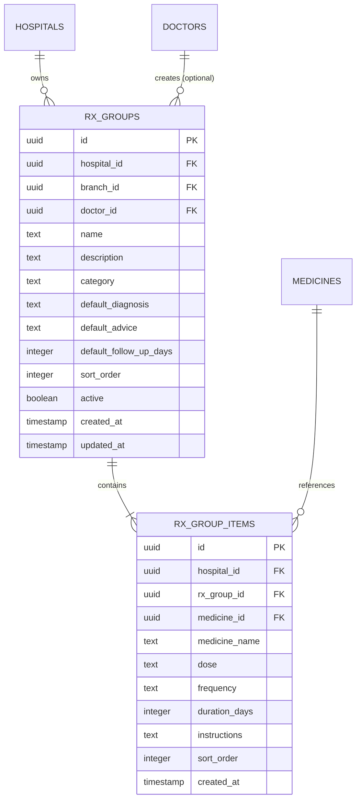
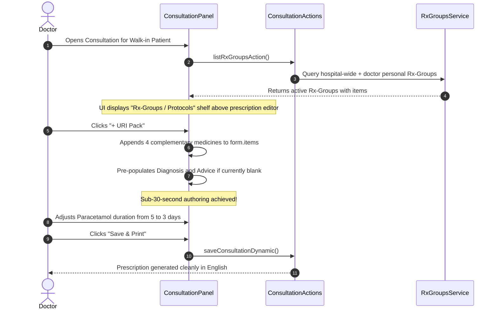

# Doctor Consultation Speed & Pre-Bundled "Rx-Groups" — Design Specification

**Date:** November 4, 2026  
**Status:** PROPOSED & READY FOR IMPLEMENTATION  
**Module:** Outpatient Department (OPD) / Doctor Consultation & Digital Prescription  
**Master Plan Reference:** Phase 1, Item 4.3 (Doctor Consultation Speed & Rx-Groups)  
**Competitor Benchmarks:** HealthPlix EMR (Rx-Groups & Visit Pad speed), Eka Care (Consultation Context)  

---

## 1. Clinical Need & Problem Statement

### 1.1 The Operational Bottleneck in Outpatient Care
In Indian outpatient departments and polyclinics, high-volume consulting physicians see 40 to 80 patients per day. Under standard EMR interfaces, writing a prescription for a common presentation (e.g. Acute Upper Respiratory Tract Infection, Acute Gastroenteritis, or Stage-1 Hypertension) requires:
1. Searching for an antibiotic/first-line drug $\rightarrow$ selecting formulation $\rightarrow$ typing/selecting dose $\rightarrow$ selecting frequency $\rightarrow$ selecting duration $\rightarrow$ typing instructions.
2. Searching for a supportive antacid/PPI $\rightarrow$ entering dosage and instructions.
3. Searching for a symptomatic antipyretic/analgesic $\rightarrow$ entering dosage and instructions.
4. Searching for an antiallergic or antiemetic $\rightarrow$ entering dosage and instructions.
5. Manually typing diagnosis text and standard clinical advice (e.g., "Plenty of warm fluids, steam inhalation, rest").

This multi-step search-and-select flow consumes **2 to 4 minutes per consultation** and generates severe cognitive fatigue. In real-world clinics, doctors abandon EMR typing and revert to illegible paper prescriptions if software slows them down.

### 1.2 The Solution: Pre-Bundled "Rx-Groups"
As proven by **HealthPlix EMR** (generating 3–4% of all outpatient prescriptions in India with sub-30-second authoring), the solution is **Pre-Bundled Rx-Groups**:
- A single click on an Rx-Group badge (e.g., `"URI Pack"`) simultaneously inserts 3 to 5 clinically matched medications with preset dosages, administration routes, standard frequencies (`1-0-1`, `1-1-1`, `SOS`), food timings (`"After food"`, `"Before food"`), and durations.
- Optionally applies standard working diagnosis and clinical advice.
- Every line remains **100% editable** before finalization (the doctor can adjust doses, change durations, or remove individual lines with one click).
- Inserting an Rx-Group **never auto-finalizes or sends** the prescription; clinical autonomy and doctor sign-off are strictly preserved.
- Doctors can save their currently drafted prescription as a personal reusable Rx-Group in 1 click.

### 1.3 Non-Negotiable Development Rules
- **Rule 2.1 (Domain Grounding):** Reuse existing `medicines`, `prescriptions`, `prescription_items`, and `consultation_drafts` tables and conventions.
- **Rule 2.2 (English-Only Mandate):** All medication names, dosage instructions, frequencies, directions, and advice must be in professional English medical notation. No regional language directions.
- **Rule 2.3 (UI & Styling):** Consistent Tailwind design tokens (`bg-surface`, `text-ink-950`, `bg-brand-600`), accessible keyboard interactions, and responsive mobile/tablet layout.
- **Rule 2.4 (Multi-Tenant Scoping & Transactions):** Database migrations must include Row-Level Security (RLS) policies; all queries must be scoped with `withTenant(hospitalId, ...)`.

---

## 2. Architecture & Data Model

### 2.1 Database Schema (`rx_groups` & `rx_group_items`)

#### DDL Migration Details:
- **Migration `0074_rx_groups.sql`:**
  - `rx_groups` table with foreign keys to `hospitals(id)` and `doctors(id)`.
  - If `doctor_id` is `NULL`, the Rx-Group is **Hospital-Wide** (institutional protocol).
  - If `doctor_id` is populated, the Rx-Group is **Personal** to that physician.
  - `rx_group_items` table with foreign keys to `rx_groups(id)` and `medicines(id)`.
  - Composite tenant indexes: `uniqueIndex('rx_groups_tenant_key').on(t.hospitalId, t.id)` and `uniqueIndex('rx_group_items_tenant_key').on(t.hospitalId, t.id)`.
  - Postgres RLS enabled with `tenant_isolation` and `read_only_write` policies.

### 2.2 Standard Common Clinical Rx-Group Presets
The system will provide standard default bundles that can be seeded or created per hospital:
1. **Upper Respiratory Infection (URI) Pack (Adult)**
   - Augmentin 625 Duo / Amoxicillin 500mg (1 tablet · 1-0-1 · 5 days · After food)
   - Paracetamol 650mg (1 tablet · SOS · 5 days · After food)
   - Cetirizine 10mg (1 tablet · 0-0-1 · 5 days · At bedtime)
   - Pantoprazole 40mg (1 tablet · 1-0-0 · 5 days · Before food / Empty stomach)
   - *Default Advice:* "Plenty of warm fluids, steam inhalation twice daily, rest."
   - *Follow-up:* 5 days.
2. **Acute Gastroenteritis Pack**
   - Ciprofloxacin 500mg + Tinidazole 600mg (1 tablet · 1-0-1 · 3 days · After food)
   - ORS Sachet (1 sachet in 1 liter water · SOS · 3 days)
   - Ondansetron 4mg (1 tablet · 1-0-1 · 3 days · Before food)
   - Zinc Sulfate 20mg (1 tablet · 1-0-0 · 14 days · After food)
   - *Default Advice:* "Maintain adequate hydration with ORS and coconut water. Avoid oily or spicy food."
   - *Follow-up:* 3 days.
3. **Stage-1 Hypertension Protocol**
   - Telmisartan 40mg (1 tablet · 1-0-0 · 30 days · Morning after breakfast)
   - Amlodipine 5mg (1 tablet · 0-0-1 · 30 days · At bedtime)
   - *Default Advice:* "Low salt diet (< 5g/day), regular 30-minute brisk walk, daily blood pressure log."
   - *Follow-up:* 30 days.
4. **Type-2 Diabetes Mellitus Starter**
   - Metformin 500mg SR (1 tablet · 1-0-1 · 30 days · With meals)
   - Glimepiride 1mg (1 tablet · 1-0-0 · 30 days · Before breakfast)
   - *Default Advice:* "Strict diabetic diet, avoid refined carbohydrates, monitor fasting and PP blood sugar weekly."
   - *Follow-up:* 30 days.
5. **Pediatric Fever & Pain**
   - Paracetamol 250mg/5ml Syrup (5 ml · SOS · 3 days · Max 4 times in 24 hours)
   - Cetirizine 5mg/5ml Syrup (2.5 ml · 0-0-1 · 3 days · At night)
   - *Default Advice:* "Tepid sponging if temperature exceeds 101 F. Offer plenty of oral fluids."
   - *Follow-up:* 3 days.

---

## 3. User Experience & Workflow Integration

### 3.1 Interaction Highlights
1. **Quick-Apply Rx-Group Badges:**
   - Positioned prominently below `Prescription` header and next to `MedicinePicker`.
   - Badges display the group name and pill count: e.g. `⚡ URI Pack (4 meds)`, `⚡ Gastroenteritis (4 meds)`, `⚡ Hypertension (2 meds)`.
   - Hovering displays a tooltip preview of all medicines and doses in the bundle.
   - Clicking immediately appends items to `form.items` without overwriting existing medications already typed by the doctor.
   - If diagnosis or advice is currently empty, the bundle's defaults are automatically applied.
2. **"Save as Rx-Group" Action:**
   - When a doctor crafts a customized regimen in `form.items` (e.g. for a recurrent seasonal condition), a small button **"Save as Rx-Group"** opens a drawer/modal allowing them to name the bundle and save it to their personal library for immediate reuse across future consultations.
3. **Full Line-by-Line Editability:**
   - Every inserted medicine card retains full inline edit controls (dose amount, frequency picker, duration, instructions, and delete button).

---

## 4. API & Service Architecture

### 4.1 Service Layer (`lib/services/rx-groups.ts`)
- `listRxGroups(args: { hospitalId: string; doctorId?: string; category?: string })`: Retrieves institutional and personal groups.
- `getRxGroupById(args: { hospitalId: string; rxGroupId: string })`: Retrieves bundle details with ordered items.
- `createRxGroup(args: { hospitalId: string; doctorId?: string; name: string; description?: string; category?: string; defaultDiagnosis?: string; defaultAdvice?: string; defaultFollowUpDays?: number; items: CreateRxGroupItemInput[] })`: Transactional creation of group and items.
- `updateRxGroup(args: { hospitalId: string; rxGroupId: string; name?: string; ... items?: CreateRxGroupItemInput[] })`: Transactional update.
- `deleteRxGroup(args: { hospitalId: string; rxGroupId: string })`: Soft or hard delete.
- `seedDefaultRxGroups(args: { hospitalId: string })`: Automatically populates standard clinical bundles if none exist.

### 4.2 Server Actions (`app/(app)/dashboard/consultation-actions.ts`)
- `getRxGroupsAction()`: Loads active Rx-groups for current doctor/hospital.
- `createRxGroupFromPrescriptionAction(input)`: Saves current prescription draft as a new Rx-group.

---

## 5. Security, Multi-Tenancy & Authorization
- RBAC permission: `consultation.write` required for using and creating Rx-groups.
- Multi-tenant isolation: All queries enforce `hospital_id` filter via `withTenant(hospitalId, ...)`.
- RLS enabled on `rx_groups` and `rx_group_items`.
- Auditability: Audit log entry created on template creation.

---

## 6. Verification & Acceptance Criteria
1. Drizzle migration `0074_rx_groups.sql` created, journaled, linted with 0 errors.
2. Unit tests for `lib/services/rx-groups.ts` testing CRUD, multi-tenant boundaries, and default seeding.
3. Unit tests for `app/(app)/dashboard/consultation-actions.ts`.
4. Component tests for Rx-Groups shelf in `consultation-panel.tsx`.
5. Full regression test pass (`npm test`).
