# Stable Patient Identity & Duplicate Prevention — Design Specification

**Date:** November 5, 2026  
**Status:** PROPOSED & READY FOR IMPLEMENTATION  
**Module:** Patient Registration, Master Patient Index (MPI), OPD Walk-In & MRD  
**Master Plan Reference:** Phase 1, Item 4.4 (Stable Patient Identity & Duplicate Prevention)  
**Competitor Benchmarks:** Practo Insta HMS (Pre-Registration Duplicate Prompts & MRD Merge Console), OpenMRS (Multi-Factor & Phonetic Matching)

---

## 1. Operational Need & Clinical Problem Statement

### 1.1 The Operational Hazard of Duplicate Patient Records
In hospital reception and outpatient registration desks, duplicate patient profiles are a primary driver of clinical risk, revenue leakage, and administrative overhead:
1. **Scattered Clinical History:** When a returning patient is registered under a new record, doctors in OPD or IPD cannot see their previous diagnoses, active medications, chronic conditions, drug allergies, or earlier discharge summaries.
2. **Family Mobile Phone Sharing:** In Indian healthcare, 3 to 5 family members commonly share a single mobile number (e.g., father, mother, and two children). Naive systems that either treat phone numbers as unique identifiers or auto-merge on phone mix pediatric records with geriatric prescriptions.
3. **Indian Name Transliteration Variations:** Names entered phonetically from regional languages into English have ubiquitous spelling variations (*Patil* vs *Patel*, *Choudhary* vs *Chowdhry*, *Pooja* vs *Puja*, *Joshi* vs *Joshee*). A clerk typing a returning patient's name with a single-letter variation currently bypasses exact matching and generates an unnecessary duplicate.
4. **Post-Facto vs Pre-Registration Prevention:** While Qurio contains underlying PostgreSQL identity primitives (`qurio_name_key`, `persons`, `patient_merges`), the walk-in registration UI does not surface matching candidates *before* creating a record. Receptionists create duplicate profiles unnoticed, burdening hospital management with manual reconciliation.

### 1.2 The Solution
1. **Standardized Hospital-Scoped UHID:** Every newly registered patient receives a permanent, standardized identifier formatted as `<HOSPITAL_PREFIX>-<YYYY>-<SEQUENCE>` (e.g. `QR-2026-00042`), configured per hospital and tracked atomically in `document_sequences`.
2. **Multi-Factor & Phonetic Matching Engine:** Real-time scoring combining exact phone matching, phonetic transliteration normalization, token-level Damerau-Levenshtein distance, and demographic proximity (gender and age tolerance).
3. **Pre-Registration Interactive Duplicate Shelf in Walk-In Modal:** Dynamic lookup as the receptionist types. High-confidence returning patients can be selected in 1 click (`"Use This Patient"`), auto-filling details and linking the visit without creating a duplicate. Shared family members can be confirmed with 1 click (`"Different Person (Family Member)"`).
4. **Empowered Front-Desk & MRD Merging with Critical Admin Alerts:** Delegating standard patient merges to receptionists and medical records staff, while detecting **critical merges** (active IPD admissions, outstanding balances, gender conflicts, age disparity > 5 years) and automatically raising an **Admin Audit Alert** for executive review.

---

## 2. Architecture & System Flow

```mermaid
flowchart TD
    subgraph Reception Desk Walk-In Registration
        A["Receptionist Enters Phone, Name, Age, Gender"] --> B["Debounced Search (300ms) /api/patients/duplicate-check"]
        B --> C{"Matching Candidates Found?"}
        
        C -- "No Match (Unique Profile)" --> D["Standard Walk-In Form (Create New UHID)"]
        
        C -- "Candidates Found" --> E["Surface Interactive Candidate Shelf"]
        E --> F{"Receptionist Action"}
        
        F -- "Click [Use This Patient]" --> G["Auto-populate Form & Link Visit to Existing UHID (kind: 'existing')"]
        F -- "Click [Different Person (Family Member)]" --> H["Explicit Flag forceNew: true (Distinct Person on Shared Phone)"]
        F -- "Direct Submit with Unresolved High Match" --> I["Soft Confirmation Dialog: 'Confirm New vs Existing'"]
    end

    subgraph Administrative & MRD Duplicate Merge
        J["Receptionist / MRD Staff Selects 2 Records to Merge"] --> K{"Is Critical Merge?\n• Active IPD Admission\n• Unpaid Balance\n• Conflicting Gender\n• Age Disparity > 5y"}
        K -- "Standard Merge" --> L["Execute Merge: Survivor Retains All History"]
        K -- "Critical Merge" --> M["Require Mandatory Reason & Prompt Confirmation"]
        M --> N["Execute Merge + Record Audit Alert for Admin Review"]
    end
```



---

## 3. Detailed Technical Design

### 3.1 Standardized UHID Formatting (`lib/domain/uhid.ts` & `lib/services/patients.ts`)

#### Format Specification
- Standard Format: `<HOSPITAL_PREFIX>-<YYYY>-<SEQUENCE>`
  - `HOSPITAL_PREFIX`: Derived from `hospitals.mrn_prefix` (e.g. `'QR'`, `'KAV'`). If empty or null, defaults to first 4 uppercase characters of hospital slug or `'HOSP'`.
  - `YYYY`: 4-digit current calendar/fiscal year in the hospital's timezone (e.g. `'2026'`).
  - `SEQUENCE`: 5-digit zero-padded sequential integer (e.g. `'00042'`).
- Example UHID: `QR-2026-00042`.

#### Sequence Storage & Atomicity
`nextMrnInTx` in `lib/services/patients.ts` leverages `document_sequences`:
```sql
INSERT INTO document_sequences (hospital_id, kind, fiscal_year, last_number)
SELECT hospital_id, 'uhid', current_year, mrn_start
FROM hospitals WHERE id = $hospitalId
ON CONFLICT (hospital_id, kind, fiscal_year) DO UPDATE
  SET last_number = document_sequences.last_number + 1,
      updated_at = now()
RETURNING last_number;
```
- Row-locked counter prevents collisions under high-concurrency walk-in intake.
- Populates `patients.mrn` with the canonical UHID string and ensures platform `qid` (`QID-XXXX-XXXX`) remains intact for ABHA/inter-hospital linking.

---

### 3.2 Multi-Factor & Phonetic Matching Engine (`lib/domain/patient-match.ts`)

#### Phonetic Tokenizer & Normalizer for Indian Names
We introduce `phoneticKey(name: string): string` to normalize common Indian transliteration patterns:
- Vowel conflations: `ee` $\rightarrow$ `i`, `oo` $\rightarrow$ `u`, `aa` $\rightarrow$ `a`.
- Consonant conflations: `ph` $\rightarrow$ `f`, `w` $\rightarrow$ `v`, `sh` $\rightarrow$ `s`, `ch` $\rightarrow$ `c`, `ksh` $\rightarrow$ `x`, `d` $\leftrightarrow$ `dh`, `t` $\leftrightarrow$ `th`.
- Trailing short vowels dropped in English transliterations (*Suresh* vs *Suresha*, *Ramesh* vs *Ramesha*).

#### Edit Distance Proximity
- Damerau-Levenshtein metric on normalized name tokens:
  - Token length $\le 4$: edit distance $\le 1$.
  - Token length $\ge 5$: edit distance $\le 2$.

#### Multi-Factor Match Confidence Scoring
Given typed inputs $(P_{typed}, N_{typed}, A_{typed}, G_{typed})$ and existing patient $(P_{exist}, N_{exist}, A_{exist}, G_{exist})$:

| Tier | Conditions | Implication & UI Treatment |
| :--- | :--- | :--- |
| **`exact`** | $P_{typed} = P_{exist}$ **AND** $nameKey(N_{typed}) = nameKey(N_{exist})$ | Returning Patient. Highlighted in green. Auto-populate ready. |
| **`high`** | $P_{typed} = P_{exist}$ **AND** ($phoneticKey(N) match$ OR edit distance $\le 2$) **OR** ($nameKey(N)$ exact match **AND** $G_{typed} = G_{exist}$ **AND** $|\text{BirthYear}| \le 1$) | Highly probable duplicate / typo. Highlighted in amber. Interstitial warning if user clicks register new. |
| **`medium`** | $P_{typed} = P_{exist}$ **AND** different names | Shared Family Mobile. Highlighted in blue: *"Family Member on File"*. One-click family acknowledgment. |
| **`weak`** | Same surname / phonetic name but different phone and no demographic match | Low confidence suggestion. Displayed in search dropdown only. |

---

### 3.3 Walk-In Reception Workflow & Interactive UI

#### Inline Candidate Shelf in `AddWalkInModal` (`app/(app)/dashboard/dashboard-queue-actions.tsx`)
1. **Dynamic Debounce:** When 10 digits of mobile phone are entered OR $\ge 3$ characters of patient name are typed, a server action `findPatientDuplicatesDynamic({ phone, name, age, gender })` executes.
2. **Match Notification Shelf:**
   - Appears immediately under the phone/name inputs without shifting layout jarringly.
   - Summarizes matching candidates:
     - Avatar icon, Patient Name, UHID, Age/Gender, Address summary, Last Visit.
     - Match badge: `"Exact Returning Patient"`, `"Possible Duplicate (Spelling Variant)"`, or `"Family Member (Same Phone)"`.
3. **One-Click Actions:**
   - **`[Use This Patient]` Button:** Sets `selectedPatientId = candidate.id`, auto-fills form inputs, disables new UHID generation, and executes queue check-in under `{ kind: 'existing', patientId }`.
   - **`[Register as New Family Member]` Button:** Dismisses the warning shelf, sets `forceNew = true`, allowing receptionists to proceed immediately without nuisance modal alerts.

---

### 3.4 Front-Desk & MRD Duplicate Merging with Critical Admin Alerts

#### Permissions & Workflow
- Standard merge capability extended to `receptionist`, `mrd`, and `owner` roles under `patients.merge` permission.
- Merge UI in Patient Management / MRD section allows selecting a **Source Duplicate Patient (To Be Merged)** and a **Target Master Patient (Survivor)**.

#### Critical Merge Detection Criteria
A merge is classified as **CRITICAL** if any of the following conditions are met:
1. **Active Inpatient Admission:** Either patient is currently admitted in IPD (`status = 'admitted'`).
2. **Outstanding Dues / Active Invoices:** Either patient has unpaid bills or non-zero dues (`duePaise > 0`).
3. **Gender Mismatch:** Source and Target patients have conflicting non-null genders (e.g. Male vs Female).
4. **Significant Age Disparity:** Absolute difference between birth years exceeds 5 years ($|\Delta \text{BirthYear}| > 5$).
5. **Cross-Doctor Clinical History:** Patients have active prescriptions from multiple distinct doctors within the last 30 days.

#### Critical Merge Execution & Alerting Mechanism
- When a critical merge is initiated by a receptionist or MRD clerk:
  - Form requires an explicit, mandatory **Clinical Justification / Reason** (minimum 10 characters).
  - Displays a high-contrast warning banner: *"Warning: This merge involves critical clinical or financial records. Hospital administration will be notified."*
  - On execution, executes atomic PostgreSQL merge via `patient_merges` and `merge_person_local`.
  - Atomically writes an entry to `admin_audit_alerts` table:
    - `hospital_id`, `alert_type = 'critical_patient_merge'`
    - `actor_user_id`, `actor_role`
    - `from_patient_id`, `from_uhid`, `from_patient_name`
    - `to_patient_id`, `to_uhid`, `to_patient_name`
    - `critical_reasons` (array of flags, e.g. `['active_ipd_admission', 'unpaid_balance']`)
    - `justification_reason`
    - `created_at`
- Hospital owners/administrators see the alert in their administrative notification center/audit log.

---

## 4. Test Strategy & Verification Plan

1. **UHID Formatting & Sequencing Unit Tests:**
   - Standard format compliance: `<HOSPITAL_PREFIX>-<YYYY>-<SEQUENCE>`.
   - Concurrency tests: Ensure zero collision on sequential numbers across concurrent intakes.
2. **Phonetic & Multi-Factor Matching Tests:**
   - Verify Indian phonetic equivalence: *Patil/Patel*, *Choudhary/Chowdhry*, *Pooja/Puja*, *Joshi/Joshee*.
   - Verify Damerau-Levenshtein typo handling.
   - Verify family phone disambiguation (shared phone + different name yields `medium` score, never auto-merging).
3. **Interactive UI & Duplicate Prevention Component Tests:**
   - Test walk-in modal dynamic candidate rendering on 10-digit phone entry.
   - Test `[Use This Patient]` action setting `{ kind: 'existing', patientId }`.
   - Test `[Different Person (Family Member)]` action with `forceNew: true`.
4. **Duplicate Merge & Critical Alert Integration Tests:**
   - Standard receptionist merge passes cleanly.
   - Critical merge with active IPD admission or unpaid balance triggers validation warning and writes audit alert.
   - Full non-destructive history resolution via `resolveRow` and `patientGroupIds`.
5. **Regression Verification:**
   - 100% pass across full regression suite (`npm test`).
   - 0 database migration errors (`npm run db:lint-migrations`).
