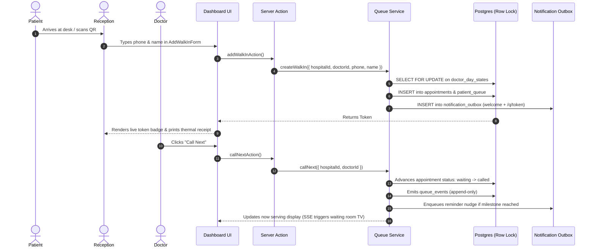
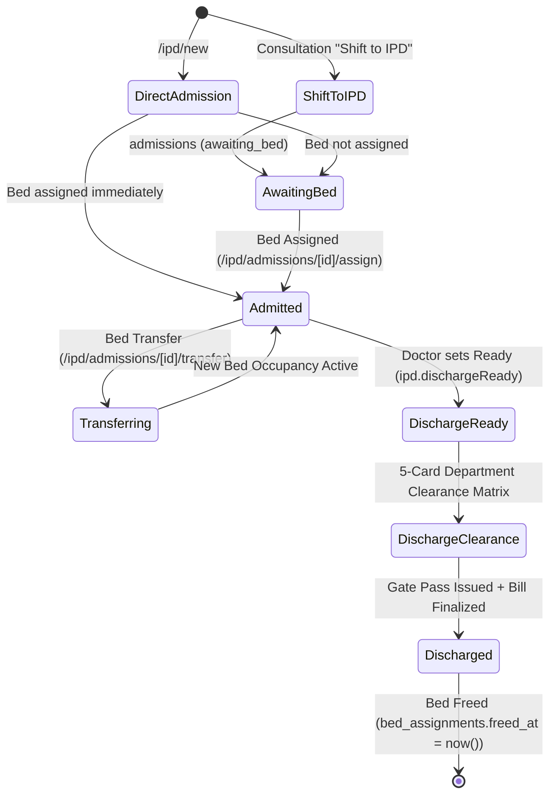
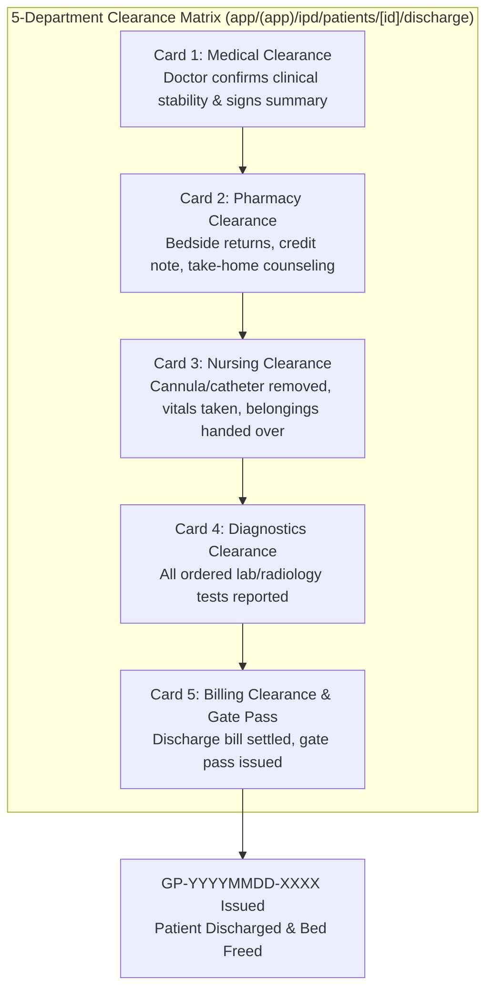

# Baseline Product & Technical Architecture Audit: Qurio Hospital Management SaaS

**Date:** November 2026  
**Auditor:** Senior Software Architect & Clinical Product Systems Analyst  
**Deliverable:** Baseline Product Audit (`/research/competitor-benchmark/00-existing-product-audit.md`)  
**Companion Artifact:** Capability Inventory Matrix (`/research/competitor-benchmark/product-capability-inventory.csv`)  
**Repository Target:** Qurio Healthcare SaaS Platform (internal project code: `opd-queue` / `QueueCare` / `QuriioHQ`)

---

## 1. Executive Summary & Product Architecture Baseline

### 1.1 Product Identity & Core Thesis
The software under audit is **Qurio** (referenced across iterations as *QueueCare*, *QuriioHQ*, and *opd-queue*). Originally designed as a focused, lightweight, multi-tenant outpatient queue and patient flow management platform for small-to-midsize Indian hospitals (100–200 outpatients/day, bilingual Marathi/Hindi/English, budget mobile hardware), the system has recently expanded into a broader clinical automation suite.

The platform's foundational thesis is: **The primary bottleneck in Indian healthcare facilities is not booking or appointment scheduling; it is information asymmetry and queue uncertainty.** Patients wait in corridors for hours because they cannot predict their consultation time. Qurio solves this by turning physical queues into live, trackable web and WhatsApp streams.

However, recent development cycles have added significant clinical surface area:
- Full Inpatient Electronic Medication Administration Records (eMAR)
- Clinical Rounding Cockpit & Order Sets
- Hourly Nursing T.P.R. Charts with automated NEWS2 deterioration scoring
- 5-Department Discharge Clearance Matrix with Gate Pass generation
- Risk-Class Stock Management (NDPS / Narcotics double-witness registers)
- Insurance Claims & TPA Pre-authorization Management with AES-256-GCM encryption
- Broadcast WhatsApp notice campaigns
- Cryptographic Tamper-Evident Evidence Logging (SHA-256 HMAC chained digests)

### 1.2 Technology Stack
The application is structured as a monolithic Next.js repository deployed as a single unit without external cache or message broker dependencies:

```
┌─────────────────────────────────────────────────────────────────────────────┐
│                             PRESENTATION LAYER                              │
│  Next.js 16.3.8 (App Router) · React 19.2.8 · Tailwind CSS v4 · TypeScript 5│
│  Surfaces: Reception Desk · Doctor Cockpit · Patient Tracker · TV Display   │
└──────────────────────────────────────┬──────────────────────────────────────┘
                                       │ Server Actions / Route Handlers
┌──────────────────────────────────────▼──────────────────────────────────────┐
│                            DOMAIN & SERVICE LAYER                           │
│  lib/domain/   Pure business rules (Queue invariants, ETA, GST, pricing)   │
│  lib/services/ Transactional database operations, tenant-scoped withTenant() │
│  lib/notify/   Provider-agnostic messaging (Meta WhatsApp Cloud API v20.0)  │
│  lib/auth/     Multi-tenant sessions, PIN lock, RBAC allow-lists, modules   │
└──────────────────────────────────────┬──────────────────────────────────────┘
                                       │ Postgres.js (Connection Pool: 10)
┌──────────────────────────────────────▼──────────────────────────────────────┐
│                               DATABASE LAYER                                │
│  PostgreSQL 17 · Drizzle ORM 0.45.2 · Row-Level Security (RLS)              │
│  Strict Transaction-Local Context: set_config('app.hospital_id', ..., true) │
│  Append-Only Triggers · Table Partitioning (Monthly) · Chained Hashes       │
└─────────────────────────────────────────────────────────────────────────────┘
```

- **Framework:** Next.js 16.3.8 (App Router, Server Actions, Route Handlers).
- **Runtime:** Node.js 22.x on Linux / Windows.
- **Frontend:** React 19.2.8, Server Components, client state via React 19 transitions, Lucide-style inline SVGs, Tailwind CSS v4 design tokens (`ink-*`, `brand-*`).
- **Database:** PostgreSQL 17 managed database.
- **ORM & Migrations:** Drizzle ORM 0.45.2, `drizzle-kit` 0.31.10, custom two-tier migration runner (`scripts/migrate-v2.ts`).
- **External Integrations:** Meta WhatsApp Cloud API (direct graph API endpoints; no third-party BSP like Twilio or Gupshup), Razorpay SDK (SaaS plan payments).
- **Testing:** Vitest 5.0.0 with React Testing Library and live PostgreSQL integration test runner.

---

## 2. Comprehensive Module-by-Module Technical Audit

Each feature has been traced across its full execution stack:
$$\text{UI} \longrightarrow \text{API / Action} \longrightarrow \text{Business Logic} \longrightarrow \text{Database} \longrightarrow \text{Permissions} \longrightarrow \text{Integrations} \longrightarrow \text{Tests}$$

### 2.1 Outpatient Department (OPD) & Queue Flow
The OPD module is the most mature, rigorously tested, and production-ready component of the platform.



1. **Walk-in Registration:**
   - **Trace:** `components/dashboard-queue-actions.tsx:AddWalkInForm` $\to$ `app/(app)/dashboard/opd-actions.ts:addWalkInAction` $\to$ `lib/services/queue.ts:createWalkIn` $\to$ `patients`, `appointments`, `patient_queue`, `queue_events` $\to$ Guard: `can(role, 'queue.mutate')` $\to$ Integrations: Meta WhatsApp Outbox $\to$ Tests: `lib/services/__tests__/queue.integration.test.ts`.
   - **Status:** **Fully implemented.**
   - **Characteristics:** Atomically inserts patient or matches existing phone number; allocates sequential token number for the doctor's current session; inserts queue row; enqueues live tracker link into `notification_outbox`.

2. **Queue State Machine (Call Next, Skip, Recall, Hold, Pause):**
   - **Trace:** `components/dashboard-queue-actions.tsx` $\to$ `dashboard/opd-actions.ts` $\to$ `lib/services/queue.ts` $\to$ `doctor_day_states`, `appointments`, `queue_events` $\to$ Guard: `queue.mutate`.
   - **Status:** **Fully implemented.**
   - **Concurrency Safety:** Concurrent mutations take `SELECT ... FOR UPDATE` on `doctor_day_states` row for that doctor on that date. Two receptionists clicking *Call next* simultaneously queue behind a single row lock; no double-advancement or split tokens can occur.

3. **Emergency & Priority Triage Insertion:**
   - **Trace:** `components/dashboard-queue-actions.tsx:EmergencyButton` $\to$ `opd-actions.ts:insertEmergencyAction` $\to$ `lib/services/queue.ts` $\to$ `appointments.is_emergency = true`, `priority = 100`.
   - **Status:** **Fully implemented.**
   - **Characteristics:** Bypasses normal FIFO order; placed immediately at the front of the queue; updates TV display with visual alert; enforces daily hospital quota configured by owner (`lib/domain/capacity.ts`).

4. **Patient Real-Time Queue Tracker (`/q/[token]`):**
   - **Trace:** `app/q/[token]/page.tsx` $\to$ `lib/services/queue.ts:getPatientQueueView` $\to$ `appointments`, `doctor_day_states`, `doctors`, `hospitals` $\to$ Guard: Public unauthenticated token lookup via `SECURITY DEFINER` function `resolve_public_appointment_token(token)`.
   - **Status:** **Fully implemented.**
   - **Characteristics:** No login or password required. Displays current token, live position, "N patients ahead of you", doctor delay warnings, and dynamic ETA calculation based on median consultation duration (last 50 consults). Multilingual (English, Hindi, Marathi).

5. **Waiting Room TV Display (`/display/[branchId]`):**
   - **Trace:** `app/display/[branchId]/page.tsx` $\to$ `app/api/display/[branchId]/events/route.ts` $\to$ `lib/services/display-events.ts` $\to$ Server-Sent Events (SSE) $\to$ `components/display/display-audio.tsx`.
   - **Status:** **Fully implemented.**
   - **Characteristics:** High-contrast full-screen TV view showing active consulting rooms and now-serving tokens. Audio chime with synthetic SpeechSynthesis Marathi/Hindi voice announcement ("Token number 14, please proceed to Room 2").

6. **Doctor Consultation Recording (OPD EMR):**
   - **Trace:** `app/(app)/dashboard/consultation-panel.tsx` $\to$ `dashboard/consultation-actions.ts:saveConsultationAction` $\to$ `lib/services/consultations.ts:saveConsultation` $\to$ `encounters`, `consultation_drafts`, `diagnoses`, `clinical_notes`, `prescriptions`, `prescription_items` $\to$ Guard: `can(role, 'clinical.write')` + verification that `session.userId === doctors.user_id`.
   - **Status:** **Fully implemented.**
   - **Characteristics:** Autosaves drafts every 1,500ms into `consultation_drafts`. Save commits diagnosis, clinical examination notes, prescription items with dosage presets (OD, BD, TID, QID, STAT, PRN), duration, food instructions, and follow-up date.

7. **OPD Prescription Document Print (`/print/prescription/[id]`):**
   - **Trace:** `app/print/prescription/[id]/page.tsx` $\to$ `lib/services/consultations.ts:getPrescriptionPrintView` $\to$ `lib/services/letterhead.ts` $\to$ Print CSS.
   - **Status:** **Fully implemented.**
   - **Characteristics:** Renders Indian Medical Council / National Medical Commission compliant A4 letterhead with doctor registration number, hospital header, Rx symbol, generic salt names, directions, and doctor signature line.

8. **WhatsApp Bot Booking Flow:**
   - **Trace:** `app/api/whatsapp/webhook/route.ts` $\to$ `lib/notify/webhook.ts` $\to$ `lib/services/booking.ts:handleInboundMessage` $\to$ `whatsapp_conversations`, `appointments`, `notification_outbox`.
   - **Status:** **Fully implemented.**
   - **Characteristics:** 4-message interactive booking dialogue (Greeting $\to$ Doctor selection $\to$ Time slot $\to$ Confirmation token link). Enforces prompt budgeting and prevents replay storms.

---

### 2.2 Inpatient Department (IPD) — Census, Wards & Bed Lifecycle



1. **Ward & Bed Infrastructure Configuration:**
   - **Trace:** `app/(app)/settings/ipd/page.tsx` $\to$ `lib/services/ipd-config.ts` $\to$ `wards`, `beds`, `charge_items`.
   - **Status:** **Fully implemented.**
   - **Characteristics:** Manage wards (General Male/Female, ICU, Deluxe, Semi-Private), bed numbers, room rent charge items.

2. **Real-time Census Board & Bed Grid:**
   - **Trace:** `app/(app)/ipd/page.tsx`, `app/(app)/ipd/ward/[wardId]/page.tsx` $\to$ `components/ipd/bed-grid.tsx` $\to$ `lib/services/ipd-census.ts:getIpdCensus`.
   - **Status:** **Fully implemented.**
   - **Characteristics:** High-visibility color-coded cards (Green: Occupied, Blue: Vacant, Amber: Cleaning/Readying). Auto-refreshes every 15s. Touch-optimized for ward tablets.

3. **Bed Allocation & Transfer Engine:**
   - **Trace:** `app/(app)/ipd/admissions/[id]/assign/page.tsx`, `transfer/page.tsx` $\to$ `app/(app)/ipd/actions.ts:assignBedAction`, `transferBedAction` $\to$ `lib/services/ipd-census.ts:transferBed` $\to$ `bed_assignments`.
   - **Status:** **Fully implemented.**
   - **Characteristics:** Atomically sets `freed_at = now()` on previous bed assignment and inserts new assignment within a single PostgreSQL transaction.

4. **Midnight-to-Midnight Bed Day Billing Engine:**
   - **Trace:** `lib/services/bed-days.ts:calculateBedDays` $\to$ `lib/domain/bed-days.ts` $\to$ `charge_items`, `bills`, `bill_items`.
   - **Status:** **Fully implemented.**
   - **Characteristics:** Calculates calendar days occupied across midnight boundaries with configurable grace periods.

---

### 2.3 Inpatient Department (IPD) — Clinical Rounding & eMAR

1. **Doctor Rounding Cockpit (`/ipd/patients/[id]/orders`):**
   - **Trace:** `app/(app)/ipd/patients/[id]/orders/page.tsx` $\to$ `components/ipd/rounding/rounding-cockpit.tsx` $\to$ `app/(app)/ipd/actions.ts:signRoundOrdersAction` $\to$ `lib/services/ipd-rounding-cockpit.ts` $\to$ `ipd_clinical_rounds`, `ipd_medication_orders`, `ipd_medication_order_actions`.
   - **Status:** **Fully implemented.**
   - **Characteristics:** Review active orders; quick-actions to Continue, Renew, Modify, Hold, or Discontinue; medicine search with dosage presets; progress note drafting; cryptographic signing.

2. **Bedside Electronic Medication Administration Record (eMAR):**
   - **Trace:** `app/(app)/ipd/ward/[wardId]/bed/[bedId]/page.tsx` $\to$ `components/ipd/bedside/bedside-treatment-chart.tsx` $\to$ `app/(app)/ipd/actions.ts:recordAdministrationAction` $\to$ `lib/services/ipd-emar.ts:recordAdministration` $\to$ `ipd_medication_administrations`, `ipd_emar_integration_outbox`.
   - **Status:** **Fully implemented (with RBAC Navigation Bug).**
   - **Characteristics:** Displays scheduled medication timeslots, PRN cooldown timers, STAT urgent doses, and dose status indicators. Supports exception recording (held, refused, patient vomiting) with mandatory reason.

3. **eMAR Asynchronous Billing & Stock Integration Outbox:**
   - **Trace:** `lib/services/ipd-emar-outbox.ts:processPendingOutboxBatch` $\to$ `ipd_emar_integration_outbox` $\to$ `care_entries`, `bill_items`, `stock_ledger`.
   - **Status:** **Implemented but incomplete (Worker Asymmetry).**
   - **Finding:** While invoked by HTTP tick endpoint `app/api/internal/tick/route.ts` and cron route `app/api/cron/ipd-outbox/route.ts`, it is **completely omitted** from CLI worker scripts `scripts/tick.ts` and `scripts/worker-daemon.ts`.

4. **Doctor Progress Notes (Track A vs Track B):**
   - **Track A (Active):** `app/(app)/ipd/patients/[id]/notes/page.tsx` $\to$ `clinical_notes`, `ipd_clinical_rounds`. **Fully implemented.**
   - **Track B (Orphaned):** `app/(app)/ipd/admissions/[id]/(file)/notes/page.tsx` $\to$ `ipd_notes`. **UI Only / Broken (Postgres relation does not exist).**

5. **Treatment Card & MAR (Track B):**
   - **Trace:** `app/(app)/ipd/admissions/[id]/(file)/treatment/page.tsx` $\to$ `lib/services/mar.ts` $\to$ `treatment_orders`, `mar_administrations`.
   - **Status:** **UI Only / Broken.**
   - **Finding:** Migration `0048_treatment_mar.sql` was never applied. Table `treatment_orders` does not exist in the active database.

6. **Allergy Documentation & Checking:**
   - **Track A:** `components/ipd/allergies-modal.tsx` $\to$ `ipd_allergy_assessments`, `clinical_alerts`. **Fully implemented.**
   - **Track B:** `app/(app)/ipd/admissions/[id]/(file)/allergies/page.tsx` $\to$ `admission_allergies`. **UI Only / Broken.**

---

### 2.4 Inpatient Department (IPD) — Nursing Vitals & TPR Charts

1. **Bedside Nursing T.P.R. Sheet (8 AM - 8 AM):**
   - **Trace:** `app/(app)/ipd/patients/[id]/vitals/page.tsx` $\to$ `components/ipd/tpr-chart.tsx` $\to$ `app/(app)/ipd/actions.ts:recordVitalsAction` $\to$ `lib/services/tpr.ts:recordVitals` $\to$ `vitals_readings`, `chart_entries`.
   - **Status:** **Fully implemented.**
   - **Characteristics:** Displays 24-hour nursing chart grid partitioned into morning (8 AM–2 PM), evening (2 PM–8 PM), and night (8 PM–8 AM) blocks. Captures Pulse, Blood Pressure (Systolic/Diastolic), Temperature (°F), SpO2 (%), Respiratory Rate, Blood Glucose, Intake (IV, Oral, Ryles Tube), and Output (Urine, Drain, Vomitus).

2. **Automated NEWS2 Clinical Deterioration Scoring:**
   - **Trace:** `lib/domain/vitals-news2.ts:calculateNews2Score` $\to$ `components/ipd/vitals-news2.tsx`.
   - **Status:** **Fully implemented (Alert Notification Missing).**
   - **Characteristics:** Automatically computes the National Early Warning Score 2 (NEWS2) from vital parameters. Renders a crimson warning card when score $\ge 5$ with mandatory review protocols. However, it does not send automated push messages or SMS alerts to the resident doctor.

---

### 2.5 Inpatient Department (IPD) — Discharge Clearance & Gate Pass



1. **5-Department Clearance Matrix:**
   - **Trace:** `app/(app)/ipd/patients/[id]/discharge/page.tsx` $\to$ `components/ipd/discharge/discharge-tab.tsx` $\to$ `app/(app)/ipd/actions.ts` (`recordPharmacyClearanceAction`, `recordNursingClearanceAction`, `issueGatePassAction`) $\to$ `lib/services/ipd-clearance.ts` $\to$ `ipd_discharge_clearances`.
   - **Status:** **Fully implemented (Database Drift).**
   - **Finding:** The feature works in the local environment because table `ipd_discharge_clearances` was manually created. However, **no Drizzle SQL migration file exists** in `drizzle/` for this table. Any deployment to a clean database will fail at runtime.

2. **Gate Pass Generation:**
   - **Trace:** `components/ipd/discharge/modals/gate-pass-modal.tsx` $\to$ `app/(app)/ipd/actions.ts:issueGatePassAction` $\to$ `lib/services/ipd-clearance.ts:issueGatePass`.
   - **Status:** **Fully implemented.**
   - **Characteristics:** Enforces that Medical, Pharmacy, Nursing, and Diagnostics clearance must all be completed before issuing a numbered gate pass (`GP-YYYYMMDD-XXXX`).

3. **Discharge Bill Finalization:**
   - **Trace:** `app/(app)/ipd/admissions/[id]/bill/page.tsx` $\to$ `app/(app)/ipd/admissions/[id]/bill/actions.ts:finalizeAction` $\to$ `lib/services/discharge-billing.ts:finalizeDischarge`.
   - **Status:** **Fully implemented.**
   - **Characteristics:** Reconciles room rent, consumables, medicines, investigations, GST, and deposits. Marks bill `finalized`, patient `discharged`, and frees the bed occupancy.

---

### 2.6 Pharmacy & Medication Management

1. **Master Medicines Catalogue:**
   - **Trace:** `app/(app)/settings/medicines/page.tsx` $\to$ `app/(app)/settings/medicines/actions.ts` $\to$ `lib/services/medicines.ts` $\to$ `medicines`.
   - **Status:** **Fully implemented.**
   - **Characteristics:** Catalogue of generic and branded medicines with dosage form (tab, syr, inj, cap, drop), strength, active salt, unit price in paise, and active/inactive status. Allows owner to price and add new medicines.

2. **Risk-Class Controlled Substances Stock (NDPS / Narcotics):**
   - **Trace:** `app/(app)/ipd/stock/page.tsx` $\to$ `app/(app)/ipd/stock/actions.ts` $\to$ `lib/services/stock.ts` $\to$ `stock_locations`, `stock_batches`, `stock_counts`, `stock_ledger`, `stock_balances`.
   - **Status:** **Fully implemented.**
   - **Characteristics:** Blind physical count system for narcotics and controlled drugs. Two-person authorization: the person who counted or moved the stock cannot approve the variance. Tracks batch numbers, expiry dates, and supplier receipts.

3. **Pharmacy Discharge Return & Credit Drawer:**
   - **Trace:** `components/ipd/discharge/drawers/pharmacy-return-drawer.tsx` $\to$ `app/(app)/ipd/actions.ts:recordPharmacyClearanceAction` $\to$ `ipd_discharge_clearances`.
   - **Status:** **Fully implemented.**
   - **Characteristics:** Ward nurse or pharmacy clerk records unused bedside medications returned upon discharge, inputs credit note number and refund amount in paise, and notes take-home medication counseling.

4. **Missing Outpatient Pharmacy POS & Dispensation Counter:**
   - **Status:** **Planned but not implemented (Major Gap).**
   - **Finding:** The platform has **no Outpatient Pharmacy Counter or POS**. When a doctor writes an OPD prescription in `consultation-panel.tsx`, there is no pharmacy queue where a pharmacist dispenses medicines, generates a retail medicine bill, collects payment, or deducts general inventory. There is no `pharmacist` role in `lib/domain/permissions.ts`.

5. **Missing General Drug Inventory & Purchase Orders:**
   - **Status:** **Planned but not implemented (Major Gap).**
   - **Finding:** Non-risk medicines (antibiotics, analgesics, IV fluids) have no inventory tracking, supplier purchase orders, distributor master, or reorder thresholds. Table `purchase_receipts` exists in `schema.ts`, but has no general stock deduction or UI workflows.

---

### 2.7 Laboratory & Diagnostics

1. **Diagnostic Investigation Ordering (OPD & IPD):**
   - **Trace:** `app/(app)/dashboard/consultation-panel.tsx`, `components/test-chips.tsx`, `app/(app)/ipd/my-patients/page.tsx` $\to$ `charge_items (is_test = true)`, `bill_items`, `care_entries`.
   - **Status:** **Fully implemented.**
   - **Characteristics:** Doctors click test chips (CBC, Blood Sugar, Chest X-Ray, ECG, USG Abdomen) during OPD or IPD rounding. Tests are added as billable line items.

2. **Test Follow-up & Worklist Tracking (Track B):**
   - **Trace:** `app/(app)/tests/page.tsx`, `app/(app)/tests/[pointId]/page.tsx` $\to$ `app/(app)/tests/actions.ts` $\to$ `lib/services/test-orders.ts` $\to$ `test_orders`, `test_follow_up_calls`, `service_points`.
   - **Status:** **UI Only / Broken (Postgres relation does not exist).**
   - **Finding:** Migration `0047_test_follow_up.sql` was never applied. Table `test_orders` does not exist. Visiting `/tests` fails with Postgres error `42P01`. Integration test `test-orders.integration.test.ts` fails.

3. **Inpatient Investigations Cockpit View (Track A):**
   - **Trace:** `app/(app)/ipd/patients/[id]/investigations/page.tsx` $\to$ `components/ipd/investigations-tab.tsx` $\to$ `care_entries`.
   - **Status:** **Basic implementation.**
   - **Characteristics:** Displays test orders placed during the inpatient stay.

4. **Missing Laboratory Information Management System (LIMS) & Results Entry:**
   - **Status:** **Planned but not implemented (Major Gap).**
   - **Finding:** The system cannot record numeric lab parameters (e.g. Hemoglobin, Platelet Count, Serum Creatinine), reference ranges, abnormal/critical flags, or specimen barcode IDs. There is no lab technician interface or lab report PDF generation.

5. **Missing Radiology & PACS / DICOM Imaging:**
   - **Status:** **Planned but not implemented (Major Gap).**
   - **Finding:** No support for imaging worklists, DICOM viewers, or radiologist report drafting.

---

### 2.8 Billing, Invoicing & Insurance / TPA Claims Desk

1. **OPD Fee Collection:**
   - **Trace:** `app/(app)/dashboard/page.tsx:PaidToggle` $\to$ `dashboard/opd-actions.ts:togglePaidAction` $\to$ `lib/services/patient-billing.ts` $\to$ `bills`, `patient_payments`.
   - **Status:** **Fully implemented.**
   - **Characteristics:** One-click paid/unpaid/partial fee toggle at reception. Generates receipt (`/print/receipt/[paymentId]`).

2. **IPD Inpatient Discharge Billing Ledger:**
   - **Trace:** `app/(app)/ipd/admissions/[id]/bill/page.tsx` $\to$ `lib/services/discharge-billing.ts:getDischargeBillView` $\to$ `bills`, `bill_items`, `patient_payments`.
   - **Status:** **Fully implemented.**
   - **Characteristics:** Detailed line-item breakdown by day: room rent, bedside nursing, consumables, pharmacy items, laboratory tests, professional fees. Supports discounts, GST calculations in integer paise, deposit offset, and balance collection.

3. **Deposit Tracking & Low-Balance Alerts:**
   - **Trace:** `app/(app)/ipd/deposits/page.tsx` $\to$ `lib/services/deposit-alerts.ts` $\to$ `patient_payments (kind = 'deposit')`.
   - **Status:** **Fully implemented.**
   - **Characteristics:** Tracks patient deposit balances. Triggers warning banner when charges reach 80% of deposit or unpaid liability exceeds ₹5,000.

4. **Insurance & TPA Claims Desk:**
   - **Trace:** `app/(app)/ipd/claims/page.tsx` $\to$ `app/(app)/ipd/claims/actions.ts` $\to$ `lib/services/claims.ts`, `lib/services/claims-lifecycle.ts` $\to$ `claim_cases`, `claim_events`, `claim_queries`, `claim_authorizations`, `claim_remittances`.
   - **Status:** **Fully implemented.**
   - **Characteristics:** Tracks insurance pre-authorization requests, insurer query deadlines, denial reasons, authorized amounts, and settlement remittances. Includes document custody checklist.

5. **Authenticated Cryptographic Claims Encryption (AES-256-GCM):**
   - **Trace:** `lib/security/claims-encryption.ts` $\to$ `claim_cases.encrypted_patient_data`.
   - **Status:** **Fully implemented.**
   - **Characteristics:** Uses AES-256-GCM authenticated encryption with the unique `claim_case.id` cryptographically bound as Additional Authenticated Data (AAD) to prevent ciphertext transplant attacks.

6. **Missing Health Claims Exchange (NHCX) & ABDM Integration:**
   - **Status:** **Planned but not implemented (Major Gap).**
   - **Finding:** No direct electronic data interchange (EDI) with insurance clearinghouses (Rohini, NHCX) or Ayushman Bharat PM-JAY pre-auth gateways. Hospital billing clerks must manually enter data into insurance web portals.

---

### 2.9 Platform Administration, Tenancy & Hospital Configuration

1. **Multi-Hospital Platform Operator Console (`/admin`):**
   - **Trace:** `app/(app)/admin/page.tsx`, `hospitals/page.tsx` $\to$ `lib/services/platform-accounts.ts`, `lib/services/platform.ts` $\to$ Guard: `requirePlatformAdmin()`.
   - **Status:** **Fully implemented.**
   - **Characteristics:** Portfolio metrics: Monthly Recurring Revenue (MRR), total WhatsApp messaging costs, active hospitals, failed messages, and message-to-appointment canary ratio.

2. **Hospital Settings & Master Data Management:**
   - **Trace:** `app/(app)/settings/` (doctors, schedules, hospital profile, queue capacity, IPD wards, charge items, letterhead, staff access, WhatsApp credentials).
   - **Status:** **Fully implemented.**
   - **Characteristics:** Full self-serve configuration of doctors, consultation fees, OPD operating windows, blackout holidays, and letterhead headers.

3. **Tamper-Evident Evidence Log (SHA-256 HMAC Chained Digests):**
   - **Trace:** `app/(app)/accountability/page.tsx` $\to$ `lib/services/evidence.ts:sealHour`, `verifyChain` $\to$ `acct_events`, `acct_digests`, `acct_verifications`.
   - **Status:** **Fully implemented.**
   - **Characteristics:** Logs all charting, bedside administration, billing, and sign-in events into partitioned `acct_events`. Hourly background seals compute SHA-256 hash chains signed by hospital private keys, proving records have not been altered after the fact.

4. **Medical Record Access Audit Trail (DPDPA 2023 Compliance):**
   - **Trace:** `app/(app)/audit/page.tsx` $\to$ `lib/services/audit.ts` $\to$ `record_access_logs`.
   - **Status:** **Fully implemented.**
   - **Characteristics:** Logs every read of patient medical history, diagnoses, and prescriptions with user ID, role, client IP/device, and timestamp.

---

### 2.10 Communications, WhatsApp Automation & Background Jobs

1. **Direct Meta WhatsApp Cloud API Integration:**
   - **Trace:** `lib/notify/meta.ts`, `lib/notify/provider.ts` $\to$ Graph API `v20.0`.
   - **Status:** **Fully implemented.**
   - **Characteristics:** Native Meta Graph API integration without third-party aggregator markups. Categorizes errors into transient (retry with backoff) vs permanent (phone not on WhatsApp $\to$ fail immediately).

2. **Notification Outbox & De-duplication Engine:**
   - **Trace:** `lib/notify/worker.ts:drainOutbox` $\to$ `notification_outbox`.
   - **Status:** **Fully implemented.**
   - **Characteristics:** Unique database constraint `UNIQUE(appointment_id, milestone)` physically prevents duplicate messages during retry storms or worker crashes.

3. **WhatsApp Broadcast Notice Campaigns (`/whatsapp-notices`):**
   - **Trace:** `app/(app)/whatsapp-notices/page.tsx` $\to$ `lib/services/whatsapp-notices.ts`, `lib/notify/notice-worker.ts` $\to$ `notice_campaigns`.
   - **Status:** **Fully implemented.**
   - **Characteristics:** Broadcast emergency clinic closures, vaccination camps, or health notices to patient cohorts with pre-send cost calculation and mandatory recipient overrides.

4. **Missing SMS & Voice Fallback:**
   - **Status:** **Planned but not implemented.**
   - **Finding:** No SMS gateway (DLT-registered in India) or automated voice call integration for patients without WhatsApp.

---

### 2.11 Identity, Multi-Tenancy Isolation & Patient Master Index

1. **PostgreSQL Row-Level Security (RLS) Isolation:**
   - **Trace:** `lib/db/index.ts:withTenant` $\to$ `drizzle/0001_rls.sql`.
   - **Status:** **Fully implemented.**
   - **Characteristics:** Enforced mathematically by PostgreSQL. `set_config('app.hospital_id', hospitalId, true)` ensures tenant context is strictly transaction-local and cleared when connections return to the pool. `assertRestrictedRole` prevents booting if connected as superuser.

2. **Global Person Identity vs Hospital-Scoped Patient Index:**
   - **Trace:** `lib/db/schema.ts:persons`, `patients`, `patient_merges`, `patient_qid_aliases` $\to$ `lib/services/patient-identity.ts`.
   - **Status:** **Fully implemented.**
   - **Characteristics:** Separates global identity (`persons` with unique QID/phone) from hospital-specific patient records (`patients` with MRN). Supports record merging and audit history.

3. **Missing ABDM ABHA Milestone 1/2/3 Integration:**
   - **Status:** **Planned but not implemented (Database Columns Only).**
   - **Finding:** Schema contains `abha_number`, `abha_address`, and `abha_verified_at`, but there are no API clients or handshake workflows connecting to the National Health Authority (NHA) gateway.

---

## 3. Technical Foundation & Infrastructure Audit

### 3.1 Database Migrations Breakdown & "Split-Brain" Architecture
The repository suffers from a severe migration split:

```
drizzle/
├── 0000_init.sql ... 0046_stock.sql      (Shared Baseline: Applied)
├── Track A (Active in _journal.json):
│   ├── 0047_ipd_emar_foundation.sql     (Applied)
│   ├── 0048_ipd_phase2_tasks_vitals.sql (Applied)
│   ├── 0049_ipd_lifecycle_and_clinical_gates.sql (Applied)
│   ├── 0050_global_medicines.sql        (Applied)
│   └── 0054_ipd_admission_and_consents.sql (Applied)
└── Track B (Orphaned on disk; OMITTED from _journal.json):
    ├── 0047_test_follow_up.sql          [MISSING IN DB] -> test_orders
    ├── 0048_treatment_mar.sql           [MISSING IN DB] -> treatment_orders
    ├── 0049_due_engine.sql              [MISSING IN DB] -> time_critical_signoffs
    ├── 0050_mar_stock.sql               [MISSING IN DB] -> mar_stock_deductions
    ├── 0051_allergy_medrec.sql          [MISSING IN DB] -> admission_allergies
    ├── 0052_doctor_notes.sql            [MISSING IN DB] -> ipd_notes
    └── 0053_discharge_summary.sql       [MISSING IN DB] -> discharge_summaries
```

- **Root Cause:** Parallel development tracks authored migrations with colliding numerical prefixes (`0047` through `0050`). Only Track A was registered in `drizzle/meta/_journal.json`.
- **Consequence:** Drizzle ORM and `scripts/migrate-v2.ts` only execute migrations registered in `_journal.json`. Therefore, none of the Track B SQL files were ever executed in PostgreSQL.
- **Syntax Error in `_journal.json`:** An attempt was made to append `0073_take_home_rx_columns` outside the JSON closing bracket (`] \n }`), causing `readMigrationFolder` to crash with `SyntaxError: Unexpected non-whitespace character after JSON at position 8744`.
- **Unmigrated Schema Table:** Table `ipd_discharge_clearances` was added to `lib/db/schema.ts`, but **no SQL migration was ever authored**. It exists in the local development database via manual SQL execution, creating high deployment risk.

### 3.2 Test Suite Verification Results
Running the full test suite confirms the bifurcation:

| Test Suite | Execution Command | Result | Pass Count | Fail Count | Root Cause of Failures |
|---|---|---|---|---|---|
| **Unit Tests** | `npm test` | **Failed** | 953 passed | 3 failed | 2 failures due to corrupted `_journal.json` syntax; 1 failure in `worker.test.ts` attempting live DB connection. |
| **Integration Tests** | `npm run test:integration` | **Failed** | 459 passed | 26 failed (14 suites failed) | Missing database tables from orphaned migrations (`ipd_notes`, `treatment_orders`, `test_orders`, etc.). |

The unit test suite reports 99.7% pass rate because mocks bypass PostgreSQL table verification. However, integration tests hit the real database and fail immediately on Track B tables.

### 3.3 Worker Asymmetry: Inpatient Revenue Leakage
A critical divergence exists between background drain implementations:
- `app/api/internal/tick/route.ts`: Drains notification outbox, runs sweeps, drains notice campaigns, AND executes `await drainAllHospitalsIpdEmarOutbox()`.
- `scripts/tick.ts` & `scripts/worker-daemon.ts`: Drain notification outbox, run sweeps, and drain notice campaigns, but **omit `drainAllHospitalsIpdEmarOutbox()`**.

If a hospital deployment runs background processing via cron invoking `scripts/tick.ts` or a container running `scripts/worker-daemon.ts`, bedside eMAR doses will **never** convert to billing lines or deduct stock.

### 3.4 RBAC Doctor Ward Lockout
In `lib/domain/permissions.ts`:
```ts
'ipd.record': ['owner', 'receptionist', 'nurse'],
```
In `app/(app)/ipd/layout.tsx`:
```ts
if (can(session.role, 'ipd.record')) tabs.push({ label: 'Ward', href: '/ipd/ward' });
```
Because the `doctor` role is excluded from `ipd.record`, attending physicians navigating IPD do not see the "Ward" tab and are blocked with a `404 Not Found` when accessing bedside treatment charts (`/ipd/ward/[wardId]/bed/[bedId]`).

### 3.5 Performance Bottleneck: Synchronous Logging
In `lib/db/index.ts`:
```ts
const tConfig = performance.now();
const result = await fn(tx);
const tEnd = performance.now();
console.log(`[PERF:withTenant] acquire+begin: ${(tTx - t0).toFixed(1)}ms | set_config: ${(tConfig - tTx).toFixed(1)}ms | callback: ${(tEnd - tConfig).toFixed(1)}ms | total: ${(tEnd - t0).toFixed(1)}ms`);
return result;
```
Every single tenant query wrapped in `withTenant()` synchronously prints string metrics to `stdout`. Under concurrent production load across multiple wards and doctors, this induces V8 event loop latency and inflates cloud logging costs.

---

## 4. Current Product Strengths

1. **Exemplary Tenant Isolation Architecture:** PostgreSQL Row-Level Security enforced at the engine level with transaction-scoped `set_config('app.hospital_id', ..., true)`. Application refusal to boot if connected as superuser (`assertRestrictedRole`) eliminates the most common SaaS data leak vulnerability.
2. **Clinical Privacy-by-Design:** The patient table stores only name, phone number, and preferred language. Support sessions operate in strict read-only mode and are physically locked out of medical records via `app.clinical_access = false`.
3. **Queue Concurrency & Idempotency:** The OPD queue serializes on a single doctor day-state row lock, eliminating race conditions. Notification outbox de-duplication is enforced by a database unique constraint (`UNIQUE(appointment_id, milestone)`), preventing duplicate patient messages during server crashes.
4. **WhatsApp Economics & Canary Telemetry:** Direct Meta Graph API integration without aggregator fees. Dynamic message budgeting (3.0 msgs/appt budget, 3.5 alert, 6.0 circuit breaker) actively protects SaaS gross margins.
5. **Modern, Touch-Friendly Clinical UI:** Tailwind CSS v4 design system with tabular numeral formatting, high-contrast states, and 48px tap targets optimized for low-cost Android tablets in hospital wards.
6. **Legally Grounded Cryptographic Accountability:** Partitioned `acct_events` with SHA-256 HMAC chained digests and hourly signed seals provide tamper-evident proof for NABH and legal disputes.

---

## 5. Architectural Weaknesses & High-Risk Technical Issues

| Risk Severity | Issue Description | Location in Codebase | Concrete Consequence |
|---|---|---|---|
| **P0 · Critical** | **Migration Collision & Orphaned Schema (The "Great Split")** | `drizzle/0047_test_follow_up.sql` through `0053_discharge_summary.sql` | 7 core clinical tables do not exist in PostgreSQL. 14 integration test suites fail. Routes `/tests`, `/ipd/admissions/[id]/(file)/...` crash with 500 errors. |
| **P0 · Critical** | **Silent Inpatient Medication Revenue Leakage** | `scripts/tick.ts` and `scripts/worker-daemon.ts` | CLI background workers fail to drain `ipd_emar_integration_outbox`. Bedside medication administrations never convert to billing lines. |
| **P0 · Critical** | **Database Drift: Unmigrated Clearances Table** | `lib/db/schema.ts:ipdDischargeClearances` | Table exists in local DB via manual script, but has no migration in `drizzle/`. Deploying to a fresh database causes the discharge cockpit to crash. |
| **P1 · High** | **Corrupted Migration Journal Syntax** | `drizzle/meta/_journal.json:405` | Non-whitespace characters appended after JSON root object crash Drizzle CLI and migration plan test suites. |
| **P1 · High** | **Doctor Bedside Navigation Lockout** | `lib/domain/permissions.ts:91` & `app/(app)/ipd/layout.tsx:122` | Attending physicians are excluded from `ipd.record`, stripping the "Ward" tab and returning 404 on bedside charts. |
| **P1 · High** | **Unconditional Production I/O Event Loop Blocking** | `lib/db/index.ts:148` | `console.log([PERF:withTenant] ...)` executes synchronously on every transaction, degrading throughput under peak morning load. |
| **P2 · Medium** | **NEWS2 High-Score Clinical Alert Disconnection** | `lib/domain/vitals-news2.ts` & `lib/services/tpr.ts` | When patient vital deterioration reaches NEWS2 $\ge 5$, UI shows a red card but dispatches no push alert or WhatsApp message to the doctor. |
| **P2 · Medium** | **Dead-Letter Queue (DLQ) Blindspot** | `lib/services/ipd-emar-outbox.ts:244` | Outbox rows reaching `MAX_ATTEMPTS` transition to `'failed'` without firing alerts or surfacing in the Admin console. |

---

## 6. Disconnected Workflows & Missing Functionality

### 6.1 Disconnected Clinical Workflows
1. **The Dual-Track IPD Routing Split:**
   - **Track A (Modern Cockpit):** Routed under `/ipd/patients/[id]/` (`summary`, `vitals`, `orders`, `emar`, `notes`, `investigations`, `billing`, `discharge`).
   - **Track B (Paper-Chart Metaphor):** Routed under `/ipd/admissions/[id]/(file)/` (`allergies`, `claims`, `discharge-summary`, `emar`, `medicines`, `notes`, `rounds`, `tpr`, `treatment`).
   - *Impact:* Hospital staff face confusing navigation paths where older file tabs either crash or redirect unexpectedly.
2. **OPD-to-IPD Medication Discontinuity:** When an outpatient is shifted to IPD via `shiftToIpdAction`, active OPD prescriptions are not transferred to IPD inpatient medication orders. The attending ward doctor must re-enter all medications manually during admission rounds.
3. **Discharge Clearance to Pharmacy Disconnection:** Marking pharmacy clearance records credit amounts and returned items, but does not automatically re-increment stock balances or issue a formal GST credit invoice.

### 6.2 Missing Core Hospital Modules
1. **Outpatient Pharmacy POS & Dispensation Counter:** No retail medicine billing, prescription fulfillment queue, drug batch deduction, or counter cash collection.
2. **Laboratory Information Management System (LIMS):** No numeric test result recording, reference range flags, specimen collection barcoding, or lab analyzer interfacing.
3. **Radiology & PACS / DICOM Imaging:** No imaging order schedule, DICOM image viewer, or radiologist report templates.
4. **General Inventory & Supply Chain Management:** Non-risk medicines and general medical consumables lack supplier purchase orders, goods receipt notes (GRN), and reorder level monitoring.
5. **Human Resources & Staff Shift Rostering:** No nurse shift scheduling, doctor duty rosters, biometric attendance, or payroll calculations.
6. **Government ABDM & Insurance Clearinghouse (NHCX):** No electronic integration for Ayushman Bharat Health Accounts (ABHA) or automated insurance claims adjudication.

---

## 7. Strategic Baseline for Competitor Research

This audit establishes the baseline for all subsequent competitor investigations. Competitor benchmarks should specifically investigate how peer hospital management systems address:

1. **OPD-to-IPD Continuity:** How competitors bridge outpatient consultation notes and prescriptions into inpatient admission charts without manual doctor re-entry.
2. **Pharmacy Counter & POS Integration:** Architecture of outpatient pharmacy queues, prescription dispensation desks, and wholesale inventory reordering.
3. **Laboratory (LIMS) Workflow Depth:** How competitors handle numeric analyte capture, analyzer bidirectional interfacing, and automated critical result alerts.
4. **Ayushman Bharat Digital Mission (ABDM) Compliance:** How Indian competitor platforms implement Milestone 1 (ABHA creation), Milestone 2 (HIP health records sharing), and Milestone 3 (HIU health records viewing).
5. **National Health Claims Exchange (NHCX):** How competitors automate cashless insurance claims processing under PM-JAY and private TPAs.
6. **Ward Nursing Tablet UX:** Ergonomics of bedside eMAR administration grids on 7-inch to 10-inch Android tablets in resource-constrained ward environments.
7. **Modular Packaging & SaaS Pricing:** How competitors tier their products (core queue vs full HMS vs modular add-ons) and structure customer billing (per-bed, per-consultation, or flat monthly subscription).

---

## 8. Feature Implementation Classification Summary Table

| Category | Fully Implemented | Implemented but Incomplete | UI Only | Backend Only | Basic Implementation | Placeholder / Scaffold | Planned / Not Implemented | Cannot Verify | Total Features |
|---|---|---|---|---|---|---|---|---|---|
| **Authentication & Access** | 5 | 1 | 0 | 0 | 0 | 0 | 0 | 0 | **6** |
| **Multi-Tenancy & Platform** | 3 | 0 | 0 | 0 | 1 | 0 | 0 | 0 | **4** |
| **OPD & Queue Flow** | 12 | 0 | 0 | 0 | 0 | 0 | 0 | 0 | **12** |
| **IPD Census & Bed Mgmt** | 5 | 0 | 0 | 0 | 1 | 0 | 0 | 0 | **6** |
| **IPD Clinical Care & eMAR** | 6 | 1 | 4 | 0 | 2 | 0 | 0 | 0 | **13** |
| **IPD Discharge & Clearance** | 4 | 0 | 1 | 0 | 0 | 0 | 0 | 0 | **5** |
| **Pharmacy & Inventory** | 3 | 0 | 0 | 0 | 1 | 0 | 2 | 0 | **6** |
| **Laboratory & Diagnostics** | 1 | 0 | 1 | 0 | 1 | 0 | 2 | 0 | **5** |
| **Billing & Finance** | 5 | 0 | 0 | 0 | 0 | 0 | 1 | 0 | **6** |
| **Communications & WhatsApp**| 3 | 0 | 0 | 0 | 0 | 0 | 1 | 0 | **4** |
| **Security & Accountability** | 2 | 0 | 0 | 0 | 0 | 0 | 0 | 0 | **2** |
| **Reporting & Analytics** | 2 | 0 | 0 | 0 | 0 | 0 | 0 | 0 | **2** |
| **Total Capabilities** | **51** | **2** | **6** | **0** | **5** | **0** | **6** | **0** | **70** |

*All 70 individual capability traces with exact file paths, database tables, and limitations are itemized in `/research/competitor-benchmark/product-capability-inventory.csv`.*
