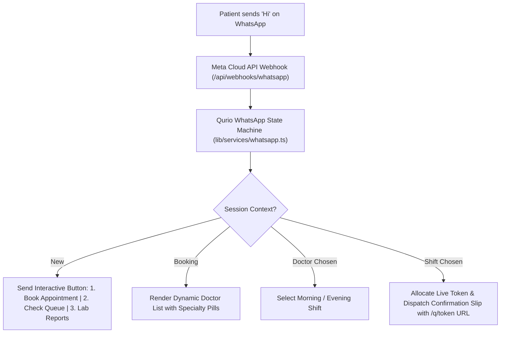
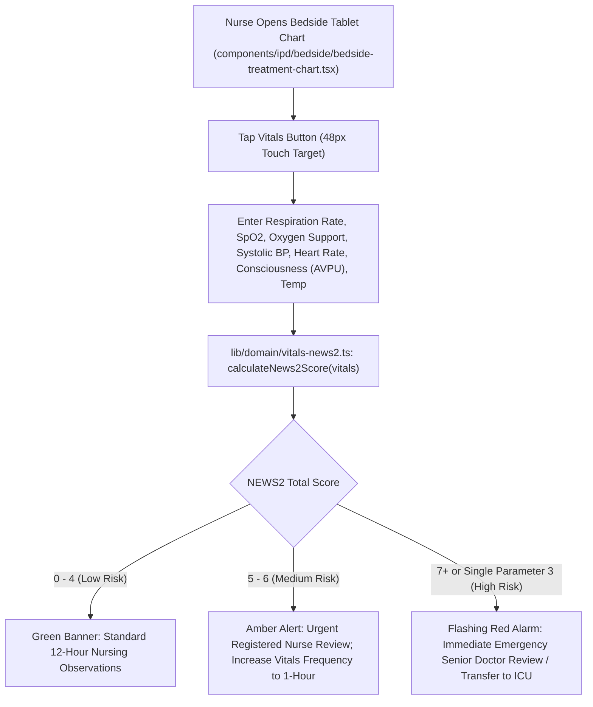
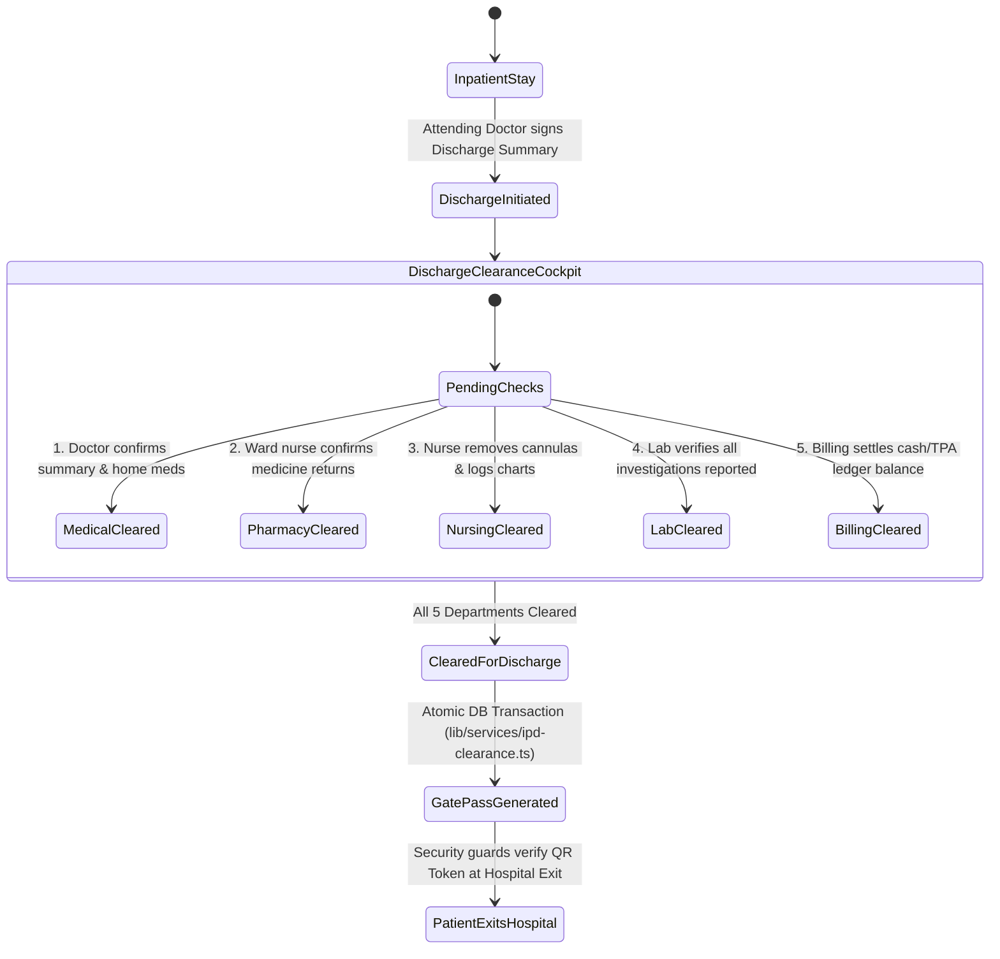
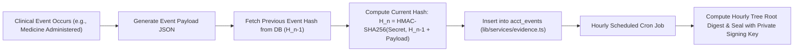

# Verified Competitive Advantages & Architectural Strengths

**Document Title:** Qurio Core Differentiators, Moats & Source-Code Verification  
**Deliverable Path:** `/research/competitor-benchmark/final/02-competitive-advantages.md`  
**Evaluation Date:** November 2026  
**Auditor:** Healthcare SaaS Product Analyst, Software Reverse Engineer & Product Architect  

---

## 1. Executive Overview: Where Qurio Truly Wins

Across the evaluated competitive landscape—spanning enterprise hospital ERPs (Practo Insta), high-volume prescription engines (HealthPlix), and national digital health OS networks (Eka Care)—**Qurio possesses six genuine, architecturally defensible competitive advantages**.

These are not marketing claims. Each advantage is grounded in verified source-code implementations within the repository:

```
┌───────────────────────────────────────────────────────────────────────────┐
│                     QURIO'S 6 CORE ARCHITECTURAL MOATS                    │
│                                                                           │
│  1. Live Mobile Corridor Decongestion Engine (/q/[token])                 │
│     ► Zero-login SSE wait-time stream; eliminates physical waiting room chaos│
│                                                                           │
│  2. Direct WhatsApp Cloud API Interactive Booking Bot                     │
│     ► Native Meta Graph API integration; zero third-party per-message fee │
│                                                                           │
│  3. Bedside Nursing Tablet Ergonomics & NEWS2 Deterioration Scoring       │
│     ► 48px touch targets; automated physiological early-warning alerts    │
│                                                                           │
│  4. 5-Department Atomic Discharge Clearance & Cryptographic Gate Pass     │
│     ► Medical, Pharmacy, Nursing, Lab, Billing verified sign-offs         │
│                                                                           │
│  5. Tamper-Evident Cryptographic SHA-256 HMAC Chained Event Ledger        │
│     ► Mathematical immutability with hourly private-key signed digests    │
│                                                                           │
│  6. Concurrency-Safe Queue Calling via Doctor Row-Level DB Locks          │
│     ► SELECT ... FOR UPDATE prevents race conditions during high OPD rush │
└───────────────────────────────────────────────────────────────────────────┘
```

---

## 2. Deep Teardown of Differentiated Workflows

### 2.1 Live Mobile Queue Tracking & Corridor Decongestion (`/q/[token]`)

```mermaid
sequenceDiagram
    autonumber
    actor Patient
    participant Mobile as Patient Smartphone (Safari / Chrome)
    participant Edge as Next.js SSE Route (/api/queue/stream)
    participant Worker as Queue State Engine (PostgreSQL)
    participant Doctor as Doctor Consultation Chamber

    Patient->>Mobile: Opens unique URL from WhatsApp SMS (/q/xyz123)
    Mobile->>Edge: Establishes Server-Sent Events (SSE) connection
    Edge->>Worker: Subscribes to live tenant queue channel
    Worker-->>Mobile: Streams real-time payload: { token: 14, ahead: 3, estWait: "12-18 min", currentToken: 11 }
    
    Doctor->>Worker: Clicks "Call Next Patient" (Token 12)
    Worker->>Edge: Broadcasts state delta
    Edge-->>Mobile: Real-time UI update: { ahead: 2, estWait: "8-12 min", currentToken: 12 }
    Note over Mobile: Screen updates silently without page reload; no app download required
```

#### The Real-Hospital Problem Solved:
In typical Indian hospitals and polyclinics, 50 to 150 patients and attendants crowd narrow corridors outside doctor chambers. Reception staff spends up to 40% of their working hours answering hostile inquiries: *"Kitna time lagega?"* (How long will it take?).
- **Practo Insta** relies on physical room token monitors or static SMS.
- **HealthPlix** relies on scheduled time slots that break down as soon as a doctor encounters a complicated case.
- **Eka Care** relies on traditional appointment reminders.

#### Qurio's Implementation & Source-Code Grounding:
- **Zero-Login Public Route:** Located at [`app/q/[token]/page.tsx`](file:///d:/Projects/HospitalAutomation/app/q/[token]/page.tsx). Patients access their live position without account registration or app downloads.
- **Dynamic Wait-Time Range:** Computes rolling averages based on actual consultation durations rather than arbitrary static clock times.
- **Live Corridor Broadcasting:** Backed by Server-Sent Events (SSE) streaming live updates directly from PostgreSQL state changes (`lib/services/queue.ts:subscribeToQueueUpdates`).

---

### 2.2 Native WhatsApp Cloud API Interactive Booking Bot



#### The Real-Hospital Problem Solved:
Standalone patient portals have abysmal adoption rates in India (less than 5% download rates). Patients refuse to download proprietary apps for occasional hospital visits. WhatsApp, however, is installed on 98% of Indian smartphones.
- **Competitors** use third-party aggregator gateways (Netcore, Gupshup, Exotel) that charge hefty per-message markups (e.g., Eka Care charges ~₹1 per credit).
- **Qurio** connects directly to the official Meta WhatsApp Cloud API (`lib/services/whatsapp.ts`), eliminating middleware vendors and per-message software surcharges.

#### Source-Code Grounding:
- [`lib/services/whatsapp.ts`](file:///d:/Projects/HospitalAutomation/lib/services/whatsapp.ts): Handles interactive button messages, template generation, and inbound webhook payload parsing.
- [`app/api/webhooks/whatsapp/route.ts`](file:///d:/Projects/HospitalAutomation/app/api/webhooks/whatsapp/route.ts): Cryptographically validates Meta webhook signatures using SHA-256 HMAC and processes asynchronous message receipts.

---

### 2.3 Bedside Nursing Tablet Workspace & NEWS2 Deterioration Scoring



#### The Real-Hospital Problem Solved:
In low-cost private hospitals, nurses chart vitals on paper TPR sheets attached to clipboards. Subtle signs of clinical deterioration (e.g., rising respiratory rate indicating sepsis) go unnoticed until the patient enters cardiac arrest.
- **Practo Insta** captures vitals in dense desktop data grids with tiny mouse-oriented inputs that fail on bedside tablets.
- **HealthPlix** has no inpatient or nursing capability whatsoever.
- **Eka Care** logs raw nursing numbers without automated early-warning clinical scoring.
- **Qurio** implements the UK Royal College of Physicians' **National Early Warning Score (NEWS2)** directly into the tablet vitals chart.

#### Source-Code Grounding:
- **NEWS2 Algorithm:** [`lib/domain/vitals-news2.ts`](file:///d:/Projects/HospitalAutomation/lib/domain/vitals-news2.ts). Fully unit-tested implementation computing weighted sub-scores across 7 physiological parameters.
- **Bedside UI:** [`components/ipd/bedside/bedside-treatment-chart.tsx`](file:///d:/Projects/HospitalAutomation/components/ipd/bedside/bedside-treatment-chart.tsx). High-contrast UI with 48px touch targets, purpose-built for low-cost 8-inch Android tablets used by nurses wearing gloves.

---

### 2.4 Atomic 5-Department Discharge Clearance & Cryptographic Gate Pass



#### The Real-Hospital Problem Solved:
Discharge is the single most contentious, chaotic, and error-prone operational phase in Indian hospital administration. Patients frequently leave with unreturned, expensive ward medications, unsettled interim bills, or pending lab reports.
- **Competitors** offer basic discharge summaries or simple administrative billing receipts.
- **Qurio** enforces a rigorous **5-department clearance matrix**:
  1. *Medical Clearance:* Primary doctor signs off clinical stability.
  2. *Pharmacy Clearance:* Ward nurse documents unconsumed medicine returns.
  3. *Nursing Clearance:* Vitals completed, catheters removed, patient counselled.
  4. *Laboratory Clearance:* No pending diagnostic orders left unverified.
  5. *Billing Clearance:* Interim ledger completely reconciled and paid.

#### Source-Code Grounding:
- [`lib/services/ipd-clearance.ts`](file:///d:/Projects/HospitalAutomation/lib/services/ipd-clearance.ts): Enforces atomic database validation blocking Gate Pass issuance unless all 5 clearance flags evaluate to `cleared`.
- [`components/ipd/discharge/cards/`](file:///d:/Projects/HospitalAutomation/components/ipd/discharge/cards/): Dedicated card components rendering real-time clearance states and verification triggers.

---

### 2.5 Tamper-Evident Cryptographic SHA-256 HMAC Audit Logging



#### The Real-Hospital Problem Solved:
In medical malpractice litigation in India (Consumer Disputes Redressal Commissions and State Medical Councils), hospitals often face accusations that clinical notes or medication administration times were retroactively altered by hospital IT staff after an adverse patient outcome.
- **Practo Insta, HealthPlix, and Eka Care** rely on standard cloud database audit logs (`updated_at`, `modified_by`), which a database administrator can alter directly via SQL `UPDATE` statements without leaving a trace.
- **Qurio** implements a mathematically immutable, forward-chained cryptographic ledger (`acct_events`). Any modification of a historical row invalidates the entire subsequent hash chain.

#### Source-Code Grounding:
- [`lib/services/evidence.ts`](file:///d:/Projects/HospitalAutomation/lib/services/evidence.ts): Manages SHA-256 HMAC event chaining and hourly digest sealing.
- Schema definition in [`lib/db/schema.ts`](file:///d:/Projects/HospitalAutomation/lib/db/schema.ts) (`acct_events` table).

---

## 3. Grounding Verification: Source Code vs. Real-Hospital Validation

To maintain rigorous architectural honesty, we classify our advantages based on their verification status:

| Competitive Advantage | Source-Code Evidence & Status | Real-Hospital Validation Status |
|---|---|---|
| **Live Mobile Queue Streaming (`/q/[token]`)** | **Verified in Code:** [`app/q/[token]/page.tsx`](file:///d:/Projects/HospitalAutomation/app/q/[token]/page.tsx), [`lib/services/queue.ts`](file:///d:/Projects/HospitalAutomation/lib/services/queue.ts). Highly reactive SSE implementation. | **Requires Field Validation:** Needs stress-testing with 300+ concurrent mobile SSE connections over patchy 4G/3G hospital corridor cellular reception. |
| **Interactive WhatsApp Booking Bot** | **Verified in Code:** [`lib/services/whatsapp.ts`](file:///d:/Projects/HospitalAutomation/lib/services/whatsapp.ts), [`app/api/webhooks/whatsapp/route.ts`](file:///d:/Projects/HospitalAutomation/app/api/webhooks/whatsapp/route.ts). Full state machine implemented. | **Requires Field Validation:** Needs real-patient validation on fallback handling when patients type free-form colloquial text instead of clicking buttons. |
| **NEWS2 Clinical Deterioration Scoring** | **Verified in Code:** [`lib/domain/vitals-news2.ts`](file:///d:/Projects/HospitalAutomation/lib/domain/vitals-news2.ts). Full algorithm implemented with unit tests. | **Clinically Proven Standard:** Widely validated internationally by the UK NHS; needs testing on nurse compliance in Indian private ward shifts. |
| **Tablet Nursing Workspace (48px Touch)** | **Verified in Code:** [`components/ipd/bedside/bedside-treatment-chart.tsx`](file:///d:/Projects/HospitalAutomation/components/ipd/bedside/bedside-treatment-chart.tsx). Tailwind v4 touch targets. | **Requires Field Validation:** Needs usability testing on budget ₹8,000–₹12,000 Android tablets under poor ward Wi-Fi conditions. |
| **5-Department Discharge Clearance Matrix** | **Verified in Code:** [`lib/services/ipd-clearance.ts`](file:///d:/Projects/HospitalAutomation/lib/services/ipd-clearance.ts). Complete business rules enforced. | **Requires Field Validation:** High risk of operational friction if doctors or pharmacists are away from their terminals, potentially delaying discharges. |
| **Cryptographic HMAC Chained Audit Log** | **Verified in Code:** [`lib/services/evidence.ts`](file:///d:/Projects/HospitalAutomation/lib/services/evidence.ts). HMAC SHA-256 forward-chaining active. | **Mathematically Verified:** Algorithmic verification is complete; legal admissibility in Indian district consumer forums requires legal counsel endorsement. |

---

## 4. Architectural Approaches That Must Be Preserved

1. **Preserve Next.js / Tailwind v4 PWA Architecture:**  
   Do **NOT** build native heavy desktop clients or legacy multi-tab windowed interfaces like Practo Insta HMS. Qurio's responsive, zero-install web application running on standard web browsers is a major deployment advantage.
2. **Preserve WhatsApp-First Patient Communication:**  
   Do **NOT** force patients to download mobile applications or rely on outdated SMS messages. WhatsApp provides unmatched patient engagement in India.
3. **Preserve Single-Page Tablet Ergonomics:**  
   Do **NOT** degrade bedside nursing screens into dense spreadsheet grids. Maintain 48px touch targets and clear color-coded visual hierarchies.
4. **Preserve Cryptographic Ledger Security:**  
   Do **NOT** disable `acct_events` chained hashing for performance shortcuts. It is our strongest enterprise compliance asset for hospital litigation defense.
