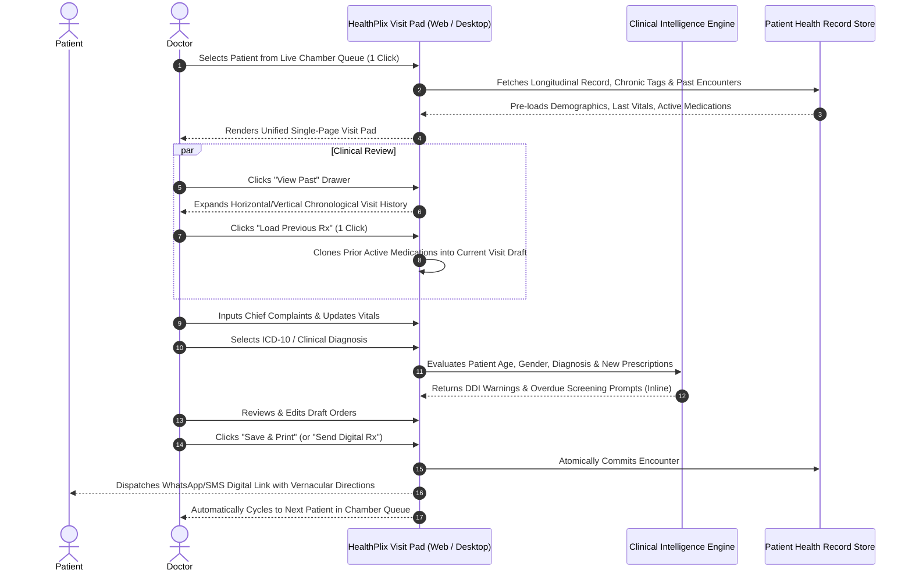
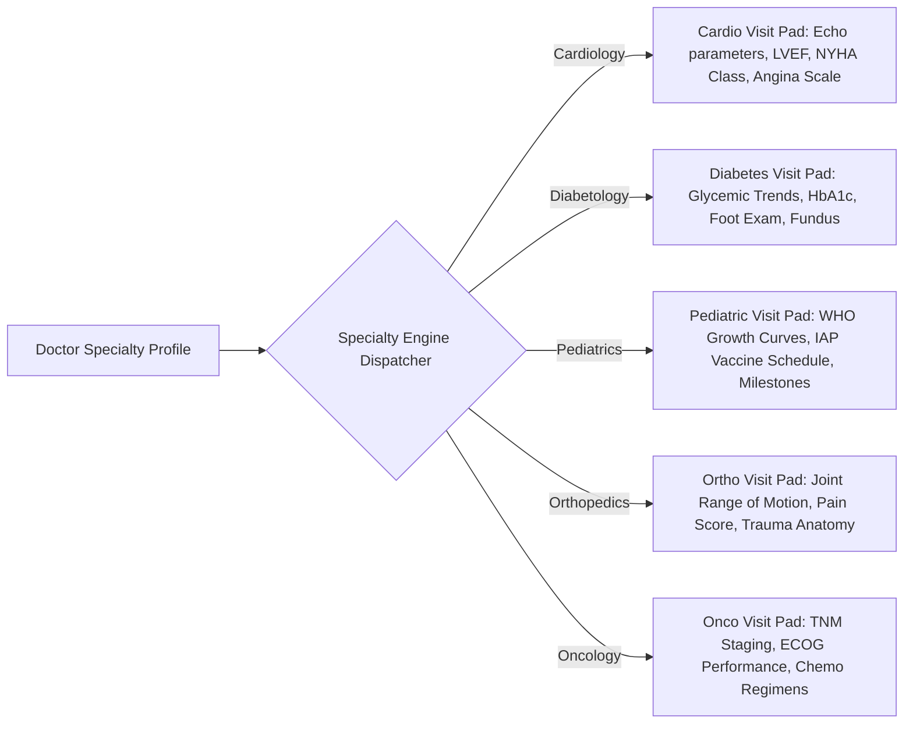
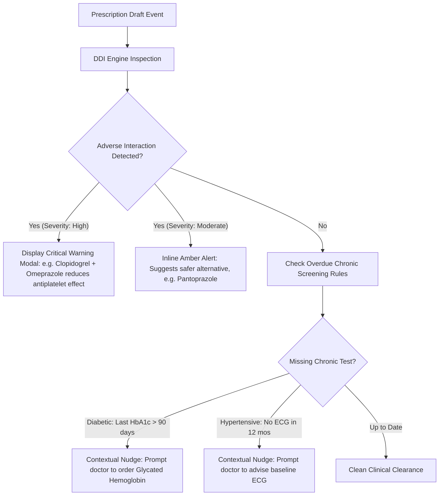
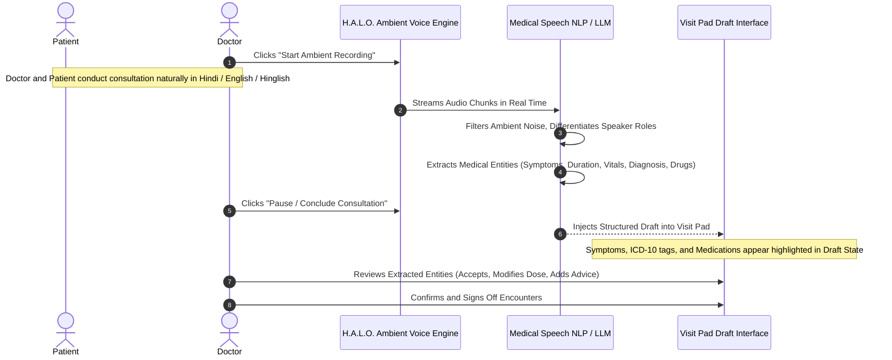

# Competitor Deep-Dive Investigation: HealthPlix EMR

**Competitor Target:** HealthPlix EMR (HealthPlix Technologies Pvt. Ltd.)  
**Primary Website:** [healthplix.com](https://www.healthplix.com/)  
**Investigation Date:** November 2026  
**Auditor:** Healthcare SaaS Product Analyst, Software Reverse Engineer & Product Architect  
**Deliverable Path:** `/research/competitor-benchmark/individual-reports/healthplix-emr-report.md`  
**Companion Artifacts:**  
- Capability Inventory: [`/research/competitor-benchmark/product-capability-inventory.csv`](file:///d:/Projects/HospitalAutomation/research/competitor-benchmark/product-capability-inventory.csv)  
- Evidence Register: [`/research/competitor-benchmark/evidence-register.csv`](file:///d:/Projects/HospitalAutomation/research/competitor-benchmark/evidence-register.csv)  
- Feature Comparison Matrix: [`/research/competitor-benchmark/feature-comparison.csv`](file:///d:/Projects/HospitalAutomation/research/competitor-benchmark/feature-comparison.csv)  
- Research Ledger: [`/research/competitor-benchmark/research-ledger.md`](file:///d:/Projects/HospitalAutomation/research/competitor-benchmark/research-ledger.md)  
- Baseline Product Audit: [`/research/competitor-benchmark/00-existing-product-audit.md`](file:///d:/Projects/HospitalAutomation/research/competitor-benchmark/00-existing-product-audit.md)  

---

## 1. Executive Summary

HealthPlix EMR (founded in 2014 by Sandeep Gudibanda, Raghuraj Sunder Raju, and Prasad Basavaraj; backed by Lightspeed Venture Partners, JSW Ventures, Chiratae Ventures, and Kalaari Capital with over $35 million in venture funding) is India’s largest doctor-first outpatient Electronic Medical Record (EMR) and digital prescription platform. 

Operating across more than 370 Indian cities, HealthPlix is utilized by over 14,000 active doctors, serving an estimated 40+ million patients and generating approximately **3% to 4% of all outpatient prescriptions issued in India**.

### 1.1 Architectural & Market Reality
HealthPlix is engineered as a **hyper-optimized outpatient consultation terminal**. Unlike full-suite hospital ERPs (such as Practo Insta HMS), HealthPlix does not attempt to manage bed allocation, ward nursing, operating theatres, mortuary services, or multi-payer insurance claims. Instead, it concentrates all engineering resources into a single core metric: **minimizing doctor cognitive load and reducing prescription authoring time to under 30 seconds**.

```
┌───────────────────────────────────────────────────────────────────────────┐
│                      HEALTHPLIX EMR SYSTEM TOPOLOGY                       │
│                                                                           │
│   [Reception Queue / PlixConnect]                                        │
│                 │                                                         │
│                 ▼                                                         │
│   ┌───────────────────────────────────────────────────────────────────┐   │
│   │               DOCTOR VISIT PAD (Central Workspace)                │   │
│   │                                                                   │   │
│   │  [Vitals & Chief Complaints] ──► [Specialty Examination Sheets]   │   │
│   │               │                                   │               │   │
│   │               ▼                                   ▼               │   │
│   │  [CDSS & Drug-to-Drug Interaction] ◄── [H.A.L.O. Ambient Voice]   │   │
│   │               │                                   │               │   │
│   │               ▼                                   ▼               │   │
│   │  [Rx-Groups Pre-Bundled Presets] ──► [14 Regional Languages Print] │   │
│   └───────────────────────────────────────────────────────────────────┘   │
│                 │                                                         │
│                 ▼                                                         │
│   [ROBIN Clinical Analytics] ──► [Life Sciences RWE & Sponsored Insights] │
│                                                                           │
└───────────────────────────────────────────────────────────────────────────┘
```

### 1.2 Core Takeaways from the Benchmark
1. **Where HealthPlix Outperforms Qurio:**
   - **Sub-30-Second Prescription Generation:** HealthPlix achieves unmatched prescribing speed using pre-bundled "Rx-Groups" (multi-drug clinical regimens inserted in a single click) and fuzzy search against an exhaustive Indian drug index containing 200,000+ brand and generic formulations.
   - **Specialty-Specific Customization (16+ Specialties):** HealthPlix dynamically alters its examination forms, diagnostic criteria, and longitudinal graphs based on the consulting physician's specialty (Cardiology, Diabetology, Pediatrics, Orthopedics, Oncology, Dermatology, etc.).
   - **Multilingual Prescription Printing (14 Regional Languages):** Standout clinical feature allowing doctors to write prescriptions in English while automatically translating patient instructions (e.g., dosage directions, frequency, food timings) into Hindi, Marathi, Bengali, Tamil, Telugu, Kannada, Gujarati, and other Indian languages.
   - **Clinical Decision Support (CDSS) & DDI:** Real-time drug-to-drug interaction alerts (e.g., Clopidogrel + PPI, Spironolactone + Telmisartan) and screening reminders for chronic conditions (e.g., annual diabetic microalbuminuria or diabetic foot exam reminders).
   - **Ambient Voice Scribing (H.A.L.O.):** Native ambient listening and speech-to-text capable of transcribing multilingual Indian doctor-patient dialogue into structured clinical notes and draft prescriptions for doctor verification.
   - **Offline Consultation Resilience:** Desktop client functionality with local caching allows doctors in rural or tier-3 settings to write and print prescriptions during broadband outages, synchronizing changes once connectivity returns.

2. **Where Qurio Outperforms HealthPlix:**
   - **True Inpatient Hospital Operations (IPD):** HealthPlix is strictly an Outpatient (OPD) clinic tool; it possesses **zero Inpatient Department (IPD) capabilities**. Qurio features a full IPD ward census, dynamic bed boards, bedside eMAR nursing grids, vital trend tracking with automated NEWS2 deterioration scoring, and a rigorous 5-department discharge clearance checklist with cryptographic gate passes.
   - **Corridor Flow & Waiting Room Decongestion:** Qurio's live mobile queue tracker (`/q/[token]`) provides zero-login real-time wait-time ranges and queue visibility directly on patient smartphones, coupled with a native Meta WhatsApp Cloud API booking bot. HealthPlix relies on traditional static appointment lists and standard SMS reminders.
   - **Data Privacy & Monetization Ethics:** HealthPlix operates a dual-monetization model where anonymized doctor prescribing data and patient trends are analyzed for pharmaceutical Real-World Evidence (RWE) studies and sponsored point-of-care recommendations (ROBIN). Qurio enforces strict cryptographic tenant isolation (`lib/db/index.ts:withTenant`), SHA-256 HMAC event audit logs (`acct_events`), and zero third-party data monetization.
   - **Zero Vendor Lock-in & Modern Web Stack:** Qurio runs as an ultra-fast Next.js / Tailwind v4 PWA requiring zero local installs. HealthPlix heavily relies on installed desktop runtimes and proprietary sync daemons.

---

## 2. Product Overview & Architecture

### 2.1 Target Customers & Market Positioning
HealthPlix targets individual medical practitioners, small-to-medium outpatient clinics, polyclinics, and specialty consulting chambers. Its core value proposition is:
- *"The Doctor-First EMR":* Engineered to eliminate computer-induced eye detachment during patient interactions.
- *"Write Prescriptions in Under 30 Seconds":* Faster than handwriting on paper pads.
- *"Evidence-Based Clinical Intelligence":* Longitudinal disease management without administrative friction.

### 2.2 System Modules & Functional Scope
1. **Visit Pad (Core Consultation Workspace):** Single-view outpatient charting screen integrating complaints, vitals, diagnosis, prescriptions, lab orders, and advice.
2. **Specialty EMR Engines:** 16+ specialty modules tailored with medical parameters (e.g., WHO growth curves for Pediatrics, glycemic tracking for Diabetology, Echo measurements for Cardiology).
3. **Smart Prescription Engine:** Autocomplete search across 200,000+ Indian pharmaceutical brands, pre-configured Rx-Groups, generic substitution toggles, and multilingual translation into 14 languages.
4. **Clinical Decision Support System (CDSS):** Real-time drug-drug interaction (DDI) engine, dosage limit guards, and chronic protocol alerts.
5. **H.A.L.O. (HealthPlix Ambient Listening Operations):** AI-powered voice scribe transcribing clinical dialogue into structured EMR documentation.
6. **ROBIN Practice Assistant:** Analytical dashboard surfacing patient footfall, top diagnoses, prescribing trends, and patient retention rates.
7. **PlixConnect (Patient Engagement):** Automated SMS/WhatsApp visit summaries, appointment reminders, and follow-up schedules.
8. **Clinic Billing & Day-Book:** Basic walk-in consultation fee collection, daily cash-register totals, and expense logging.
9. **Offline Sync Engine:** Local SQLite/IndexedDB caching allowing prescription authoring and printing without active internet.

### 2.3 Primary User Roles
- **Consulting Physician:** Primary user. Operates Visit Pad, dictates/types notes, reviews CDSS alerts, and authorizes prescriptions.
- **Clinic Assistant / Nurse / Triage:** Enters patient demographics, checks in walk-ins, records initial vitals (BP, Pulse, Weight, Height, SpO2, Temperature).
- **Receptionist:** Manages clinic appointments, collects basic consultation fees, issues printed token slips, and coordinates patient queues.
- **Patient (Passive via PlixConnect):** Receives digital prescriptions, vernacular dosage directions, and automated follow-up reminder messages via SMS and WhatsApp.

---

## 3. Reverse-Engineered Detailed Workflow Investigations

### 3.1 Doctor Consultation Workspace



#### 1. What problem does it solve?
Eliminates fragmented multi-tab EMR navigation. Doctors in high-volume Indian OPDs (consulting 40–80 patients per session) cannot afford 5 to 10 clicks across multiple tabs just to start a visit or review what was prescribed last month.

#### 2. Who uses it?
Outpatient doctors, specialists, and consulting physicians.

#### 3. What triggers the workflow?
Clicking a patient name from the clinic's daily appointment queue or walk-in triage list.

#### 4. Step-by-step user interactions:
1. Doctor views the **Live Chamber Queue** on the left pane.
2. In **exactly 1 click**, the doctor clicks the patient's card.
3. The system immediately loads the **Visit Pad**—a unified, single-screen modular workspace containing:
   - **Header:** Patient UHID, Name, Age, Gender, Blood Group, Allergies, and Chronic Flags (e.g., `Type-2 Diabetes`, `Hypertension`).
   - **Vitals Strip:** Triage vitals (BP, Pulse, SpO2, Temp, Weight, BMI) pre-populated by the clinic assistant.
   - **Chief Complaints:** Autocomplete tags with duration (e.g., `Fever x 3 days`, `Dry Cough x 1 week`).
   - **Clinical Examination:** Physical findings and specialty-specific checkboxes.
   - **Diagnosis:** Coded ICD-10 or free-text provisional diagnosis.
   - **Prescription Grid:** Active drug list with dosage, frequency, and duration.
   - **Investigations:** Ordered lab and imaging tests.
   - **Advice & Follow-Up:** Lifestyle counseling and next review date.
4. **Historical Encounters:** A slide-out **"View Past"** drawer displays all historical visits chronologically.
5. If the patient is on maintenance therapy for chronic illness, the doctor clicks **"Load Previous"**, instantly copying active medications, dosages, and instructions into the current draft.
6. The doctor adds or adjusts medications, clicks **"Save & Print"**, and the consultation closes while sending a digital link to the patient.

#### 5. Data captured:
Consultation Timestamp, Attending Doctor ID, Chief Complaints with Duration, Physical Vitals, Specialty Clinical Notes, Differential Diagnosis, Prescribed Drugs (Brand/Molecule, Form, Strength, Dose, Route, Frequency, Duration, Instructions), Diagnostic Tests Ordered, Follow-Up Date.

#### 6. Validations applied:
- Mandatory patient identifier.
- Dose and frequency validation (blocks zero or nonsensical durations).
- Real-time allergy warning if prescribed drug matches documented patient drug sensitivities.

#### 7. Statuses & transitions:
`Waiting in Queue` $\to$ `In Consultation` $\to$ `Consultation Completed` $\to$ `Prescription Dispatched`.

#### 8. Exceptional situations:
- **Broadband Disruption:** The Visit Pad transitions seamlessly into offline mode, writing encounter records to local browser/desktop storage and spooling print jobs directly to local printers.
- **Accidental Closure:** If the doctor closes the browser tab or loses power, the uncommitted draft is continuously autosaved in local cache and restored upon re-opening.

#### 9. Cross-module dependencies:
Appointment Queue, Specialty EMR Engine, Drug Database & CDSS, PlixConnect Messaging, ROBIN Analytics.

#### 10. Automation:
Auto-calculation of BMI from height and weight; automated cloning of prior medications via "Load Previous"; automatic calculation of review date based on prescription duration.

#### 11. Output / Reports:
Standard printed prescription slip (A4 or thermal), digital prescription PDF, WhatsApp/SMS summary link.

#### 12. Effectiveness:
By placing all consultation components onto a single, non-scrolling or cleanly sectioned pad, doctors maintain visual focus on the patient rather than navigating complex software hierarchies.

---

### 3.2 Specialty-Specific EMR Engines



#### 1. What problem does it solve?
A generic medical form forces cardiologists, pediatricians, and dermatologists to record specialized clinical metrics in unstructured text boxes. This degrades longitudinal searchability, prevents clinical graphing, and slows down documentation.

#### 2. Who uses it?
Specialist physicians across 16+ medical domains (Cardiology, Diabetology, Pediatrics, Gynecology & Obstetrics, Orthopedics, Oncology, Dermatology, Pulmonology, Neurology, ENT, Ophthalmology, Gastroenterology, Psychiatry, General Medicine, Nephrology, Urology).

#### 3. What triggers the workflow?
The doctor's account specialty configuration or encounter-level specialty selection.

#### 4. Step-by-step user interactions:
1. When a pediatrician opens a child's record:
   - The Visit Pad automatically swaps adult fields for pediatric-specific modules.
   - The system displays the **Interactive WHO / Indian Academy of Pediatrics (IAP) Growth Chart**, plotting weight-for-age, height-for-age, and head circumference percentiles against age.
   - The **Immunization Tracker** surfaces overdue and upcoming vaccines based on the national immunization schedule.
2. When a diabetologist opens a patient's record:
   - The Visit Pad highlights the **Glycemic Cockpit**, displaying historical fasting blood sugar (FBS), postprandial blood sugar (PPBS), and HbA1c trend lines.
   - A specialized physical examination checklist prompts for **Diabetic Foot Examination** (monofilament testing, peripheral pulses) and **Dilated Eye Exam** status.
3. When a cardiologist opens a patient's record:
   - Fields for **Left Ventricular Ejection Fraction (LVEF)**, **NYHA Functional Class** (I–IV), and **Angina Classification** appear natively.
4. The doctor can save any combination of customized fields as a personal **Encounter Template** for recurring patient presentations.

#### 5. Data captured:
Specialty-specific clinical parameters (e.g., gestational age, parity, LVEF, HbA1c, joint flexion angles, TNM staging, WHO z-scores, vaccination brand and lot numbers).

#### 6. Validations applied:
- Age-based bounding (e.g., pediatric vaccination schedules and percentile curves only render for patients under 18 years).
- Numeric range bounding for physiological metrics (e.g., LVEF 10%–80%, HbA1c 3.0%–18.0%).

#### 7. Output / Reports:
Specialized diagnostic case sheets, graphical growth trajectory curves, diabetic trend reports, and immunization certificates.

#### 8. Effectiveness:
Delivers the clinical precision of custom specialty software without fragmenting the underlying data schema or doctor user experience.

---

### 3.3 Digital Prescription Engine & Vernacular Translation

```mermaid
sequenceDiagram
    autonumber
    actor Doctor
    participant Pad as Prescription Pad
    participant Lex as 200,000+ Indian Drug Index
    participant DDI as DDI Rules Engine
    participant Trans as Vernacular Translation Engine
    participant Out as Thermal / A4 Print & WhatsApp

    Doctor->>Pad: Types "Aug" (2 keystrokes)
    Pad->>Lex: Executes fast trie autocomplete
    Lex-->>Pad: Suggests "Augmentin 625 Duo (Amoxicillin + Clavulanic Acid)"
    Doctor->>Pad: Selects Drug; Frequency auto-defaults to "1-0-1 (After Food) x 5 Days"

    alt One-Click Rx-Group Bundle
        Doctor->>Pad: Clicks "Upper Respiratory Infection Pack"
        Pad->>Pad: Inserts Antibiotic + Antacid + Antipyretic + Probiotic simultaneously
    end

    Doctor->>Pad: Toggles "Generic Name Display"
    Pad->>Pad: Displays active chemical molecule under brand name

    Doctor->>Pad: Selects Print Language: "Marathi" (or Hindi, Bengali, Telugu, etc.)
    Pad->>Trans: Passes instruction tokens: [1-0-1, After Food, 5 Days]
    Trans-->>Pad: Translates: "सकाळी १, रात्री १ (जेवणानंतर) - ५ दिवस"

    Doctor->>Pad: Clicks Authorize & Print
    Pad->>Out: Generates Multilingual Prescription
```

#### 1. What problem does it solve?
Illegible handwritten prescriptions cause medication errors; manual typing of repetitive multi-drug regimens slows doctors down; and patients often misunderstand English dosage instructions, leading to non-adherence.

#### 2. Who uses it?
Consulting physicians, clinic dispensers, and patients.

#### 3. What triggers the workflow?
Authoring medications in the Visit Pad prescription section.

#### 4. Step-by-step user interactions:
1. **Intelligent Autocomplete Search:**
   - The doctor types 2 or 3 letters (e.g., `Telm`).
   - The system executes instant autocomplete against a proprietary catalog of **200,000+ Indian pharmaceutical brands and generic molecules**, displaying dosage forms (`Tab`, `Syp`, `Cap`, `Inj`), active salt strengths (`40 mg`, `80 mg`), and manufacturer names.
2. **Pre-Bundled "Rx-Groups":**
   - For routine presentations (e.g., Acute Pharyngitis, Type-2 Diabetes Starter Pack, Hypertension Stage-1), the doctor clicks a single **Rx-Group**.
   - The system immediately populates 3 to 5 complementary medications with predefined dosages, frequencies, food timings, and durations in under **2 seconds**.
3. **Generic vs. Branded Transparency:**
   - With a single click, the doctor can toggle between displaying commercial brand names or active generic pharmacological salts (satisfying National Medical Commission [NMC] generic prescribing guidelines).
4. **Vernacular Translation Engine:**
   - The doctor selects the patient's preferred native language (e.g., **Hindi, Marathi, Bengali, Tamil, Telugu, Kannada, Gujarati, Malayalam, Odia, Punjabi, Assamese**).
   - The engine automatically translates dosage directions, administration routes, and special warnings into the chosen regional language while keeping scientific drug names in English.
5. **Output Generation:**
   - The prescription is generated with clinical clinic headers, QR-coded verification, and digital doctor signatures.

#### 5. Data captured:
Drug Brand Name, Generic Composition, Dosage Form, Unit Dose, Frequency Code (`1-0-1`, `1-0-0-1`, `SOS`), Administration Timing (`Before Food`, `After Food`, `At Bedtime`), Treatment Duration, Quantity Dispensed, Special Patient Instructions, Target Language Code.

#### 6. Validations applied:
- Mandatory frequency and duration for non-topical medications.
- Immediate allergy cross-checks against patient profile.
- Duplicate drug detection (prevents prescribing two drugs containing the same active ingredient, e.g., Paracetamol + Combiflam).

#### 7. Output / Reports:
A4 clinical prescription document, thermal receipt prescription, digital PDF link delivered via SMS and WhatsApp.

#### 8. Effectiveness:
The combination of Rx-Groups, instant autocomplete, and regional language translation makes HealthPlix the fastest and most patient-adherent prescription engine in the Indian outpatient market.

---

### 3.4 Clinical Intelligence & Decision Support (CDSS)



#### 1. What problem does it solve?
Prevents dangerous drug-drug interactions (DDI) and adverse drug events (ADEs) during hurried consultations, and ensures patients with chronic conditions adhere to evidence-based screening protocols.

#### 2. Who uses it?
Consulting physicians and clinical pharmacologists.

#### 3. What triggers the workflow?
Adding a new medication to the prescription grid or opening the consultation of a patient with chronic disease tags.

#### 4. Step-by-step user interactions:
1. As the doctor selects a medication (e.g., *Spironolactone*), the CDSS engine continuously cross-evaluates all currently selected medications and the patient's recorded active chronic medications.
2. If the patient is already taking *Telmisartan*, the engine triggers an amber **Drug-to-Drug Interaction Alert**:
   > *"Moderate Risk: Spironolactone + Telmisartan may cause severe hyperkalemia. Monitor serum potassium."*
3. If an interaction is life-threatening (e.g., *Methotrexate + High-Dose NSAID*), a high-priority red alert demands explicit physician acknowledgment before proceeding.
4. **Chronic Screening Nudges:**
   - If a tagged diabetic patient has no HbA1c record entered within the last 90 days, an inline prompt appears in the Investigations block:
   > *"Protocol Reminder: HbA1c test due (Last recorded: 114 days ago)."*
   - The doctor can click **"Add to Rx"** with one tap to include the test in the diagnostic order sheet.

#### 5. Data captured:
Overridden Alert IDs, Physician Justification Notes, Screening Prompts Accepted/Dismissed, Clinical Interaction Severities.

#### 6. Validations applied:
- Non-blocking advisory warnings for mild/moderate interactions (does not halt doctor flow).
- Hard confirmation modal for contraindicated drug pairs.

#### 7. Output / Reports:
Point-of-care interaction tooltips, clinical audit logs of overridden warnings, chronic protocol compliance metrics in practice summaries.

#### 8. Effectiveness:
Integrates clinical safety directly into the typing workflow without creating intrusive, frustrating alert fatigue.

---

### 3.5 AI-Assisted Documentation: H.A.L.O. (Ambient Voice Scribe)



#### 1. What problem does it solve?
Doctors spend an estimated 40% of their working day typing into electronic records, which creates visual disconnect and eye-contact loss with patients. H.A.L.O. restores natural doctor-patient dialogue while generating structured clinical records automatically.

#### 2. Who uses it?
Tech-forward doctors, high-volume practitioners, and clinicians seeking hands-free documentation.

#### 3. What triggers the workflow?
The doctor clicks the microphone icon or initiates **"Start H.A.L.O."** upon greeting the patient.

#### 4. Step-by-step user interactions:
1. The doctor taps the microphone icon on the Visit Pad.
2. The ambient listening engine records the conversation between the doctor and patient.
3. The engine is trained on **Indian clinical dialects, mixed accents, and code-switching** (e.g., Hinglish, mixing Hindi/Marathi symptoms with English drug names: *"Patient ko 3 din se bukhar hai aur dry cough hai"*).
4. As the consultation proceeds, speech-to-text algorithms transcribe the audio stream while a specialized medical LLM performs clinical entity recognition:
   - Identifies Chief Complaints: `Fever x 3 days`, `Dry Cough`.
   - Identifies Physical Examination findings spoken aloud: `Chest clear`, `Throat congested`.
   - Identifies Prescribed Medications: `Augmentin 625 BD for 5 days`.
5. Upon stopping the recording, H.A.L.O. parses the structured output directly into the corresponding sections of the Visit Pad.
6. **Mandatory Doctor Review:** All AI-extracted fields are highlighted in a distinct preview state. The doctor verifies the dosages, makes any manual adjustments, and clicks **"Approve & Finalize"**.
7. The finalized record is committed to the patient's medical history.

#### 5. Data captured:
Audio Snippet Hashes (for processing), Raw Speech Transcripts, Extracted Entity Tokens, Doctor Verification/Correction Delta.

#### 6. Validations applied:
- Mandatory physician review: The system strictly prohibits committing an AI-drafted prescription without explicit doctor review and signature.
- Strict medical entity confidence scoring: Low-confidence words are highlighted in red or left in the general clinical notes section rather than mapped to definitive drug prescriptions.

#### 7. Output / Reports:
Auto-populated Visit Pad, clinical consultation transcript, finalized bilingual prescription slip.

#### 8. Effectiveness:
Reduces consultation documentation time by 50% for complex cases, especially for narrative-heavy specialties like Internal Medicine, Psychiatry, and Pediatrics.

---

### 3.6 Doctor Productivity & Practice Analytics (ROBIN)

#### 1. What problem does it solve?
Independent outpatient doctors operate as small business owners but lack visibility into patient footfall patterns, seasonal disease spikes, medication adherence, and clinic revenue.

#### 2. Who uses it?
Clinic owners, practicing physicians, and healthcare administrators.

#### 3. What triggers the workflow?
Daily practice operation, morning executive reviews, or end-of-month clinic reconciliations.

#### 4. Step-by-step user interactions:
1. Doctor logs into the **ROBIN Clinical Practice Assistant**.
2. The dashboard displays key operational metrics:
   - **Footfall & Volume:** Total patients seen today, new vs. returning patient ratio.
   - **Top Diagnoses:** Visual Pareto charts of presenting complaints (e.g., 34% Upper Respiratory Infection, 22% Type-2 Diabetes, 14% Essential Hypertension).
   - **Prescribing Heatmaps:** Most frequently prescribed therapeutic classes and molecules.
   - **Follow-Up Retention Rate:** Percentage of patients advised to return who actually booked and attended their follow-up visits.
3. **Follow-Up Automation:**
   - During consultation, when the doctor advises "Review in 2 weeks," the system schedules an automated WhatsApp/SMS check-in message sent 48 hours before the review date, driving patient compliance and clinic retention.

#### 5. Data captured:
Patient encounter counts, diagnosis frequencies, therapeutic category distributions, review schedule compliance rates.

#### 6. Output / Reports:
Daily Clinic Practice Summary, Weekly Diagnostic Trends, Patient Retention Matrix, Monthly Practice Growth Report.

#### 7. Effectiveness:
Empowers private clinicians with enterprise-grade clinical analytics without requiring manual spreadsheet data entry.

---

## 4. Product Quality, Usability & Architectural Analysis

### 4.1 Usability & Cognitive Ergonomics
- **Prescription Ergonomics:** **Industry Benchmark.** The Visit Pad is arguably the most ergonomically refined outpatient prescription interface in the Indian market. The elimination of unnecessary modal dialogs, coupled with multi-drug Rx-Groups and regional translation, delivers exceptional speed.
- **Visual Design:** Clean, modern, high-contrast typography with clear visual grouping between symptoms, diagnosis, and medications.
- **Learning Curve:** Minimal. A practicing doctor can become proficient in under 15 minutes of hands-on use.

### 4.2 Architectural Trade-Offs & Technical Weaknesses
- **Monetization & Data Ethics Concerns:** HealthPlix's dual business model—charging doctors a modest SaaS fee (HealthPlix Pro at ~₹12,000/year, Elite at ~₹18,000/year) while partnering with pharmaceutical companies to monetize Real-World Evidence (RWE) analytics and sponsored clinical content (ROBIN)—introduces inherent data privacy and commercial conflict trade-offs. While HealthPlix asserts compliance with data anonymization standards, privacy-conscious hospital owners and enterprise clinical boards frequently reject platforms that leverage patient prescription patterns for commercial sponsorships.
- **Zero Inpatient Functionality (IPD Blindspot):** HealthPlix is completely incapable of managing a hospital. It lacks:
  - Inpatient bed boards and ward census tracking.
  - Bedside nursing eMAR charts and vital monitoring.
  - Multi-tier room rent calculations and ADT transfers.
  - 5-department discharge clearance workflows.
- **No Outpatient Pharmacy POS or Store Management:** HealthPlix can beam an e-prescription to a patient's phone, but it cannot run a hospital's internal pharmacy counter, manage batch expiries, issue credit notes, or conduct purchase orders.
- **No Laboratory Analyzer Interfacing:** While doctors can order investigations, the software cannot interface with hematology or biochemistry analyzers via ASTM/HL7, nor can laboratory technicians enter parameter-wise numerical results against reference ranges.

---

## 5. Direct Comparative Evaluation: Qurio vs. HealthPlix EMR

The following evaluation compares Qurio's baseline implementation (audited in [`/research/competitor-benchmark/00-existing-product-audit.md`](file:///d:/Projects/HospitalAutomation/research/competitor-benchmark/00-existing-product-audit.md)) against HealthPlix EMR using the normalized 0–5 capability scoring scale:

| Functional Domain / Capability | Qurio Baseline Score | HealthPlix EMR Score | Detailed Architectural Comparison & Implementation Evidence |
|---|---|---|---|
| **Instant Consultation Start (1-Click)** | **4 / 5** | **5 / 5** | **HealthPlix leads slightly.** Both open the consultation in 1 click from the queue. HealthPlix pre-loads specialty-specific fields and last encounter data into a customizable modular pad. Qurio loads draft state in `app/(app)/dashboard/consultation-panel.tsx` via `getDoctorDashboardAction`. |
| **Longitudinal Medical History View** | **3 / 5** | **5 / 5** | **HealthPlix leads decisively.** HealthPlix features an interactive longitudinal drawer embedding vitals graphs (BP, glucose, HbA1c, weight) and chronic condition timelines. Qurio provides a chronological text list of past 20 OPD visits in `HistoryDrawer` (`consultation-panel.tsx`). |
| **Specialty-Specific Visit Pads (16+)** | **1 / 5** | **5 / 5** | **HealthPlix leads decisively.** HealthPlix dynamically adjusts clinical examination fields, diagnostic criteria, and graphs for 16+ medical specialties. Qurio has a single, static general consultation template for all doctors (`consultation-panel.tsx`). |
| **Pediatric Growth Charts & Vaccines** | **0 / 5** | **5 / 5** | **HealthPlix leads decisively.** HealthPlix implements full WHO/IAP growth curves (percentile z-scores) and automated pediatric vaccination schedules. Qurio has zero pediatric charting or immunization tracking. |
| **Sub-30-Second Prescription Engine** | **3 / 5** | **5 / 5** | **HealthPlix leads decisively.** HealthPlix features pre-bundled "Rx-Groups" (multi-drug regimens inserted in 1 click) and a 200,000+ Indian drug index. Qurio supports individual medicine search with dosage presets (`app/(app)/dashboard/consultation-panel.tsx`), but requires line-by-line drug entry. |
| **Multilingual Prescription Generation** | **1 / 5** | **5 / 5** | **HealthPlix leads decisively.** HealthPlix automatically translates dosage instructions into 14 Indian languages (Hindi, Marathi, Bengali, Tamil, etc.). Qurio prints prescriptions exclusively in English (`app/print/prescription/[id]/page.tsx`), though the web UI supports Hindi/Marathi. |
| **Drug-to-Drug Interaction (DDI) Alerts** | **0 / 5** | **4 / 5** | **HealthPlix leads decisively.** HealthPlix performs real-time multi-drug interaction checks (e.g., Clopidogrel + PPI) at point of care. Qurio checks allergies but has no molecule-to-molecule interaction engine. |
| **Clinical Decision Support (CDSS)** | **0 / 5** | **4 / 5** | **HealthPlix leads decisively.** HealthPlix provides contextual screening nudges (e.g., overdue diabetic HbA1c/eye checkups). Qurio has no CDSS or protocol reminder system. |
| **Ambient Voice Scribing (AI EMR)** | **0 / 5** | **4 / 5** | **HealthPlix leads decisively.** HealthPlix's H.A.L.O. records multilingual ambient consultations and auto-drafts structured clinical notes and prescriptions. Qurio has no speech-to-text or ambient documentation tools. |
| **Practice Analytics Assistant (ROBIN)** | **1 / 5** | **4 / 5** | **HealthPlix leads decisively.** HealthPlix surfaces top diagnoses, prescribing trends, and patient return rates. Qurio's `/reports` page provides basic operational queue and revenue counts (`app/(app)/reports/page.tsx`). |
| **Inpatient Department (IPD) Suite** | **5 / 5** | **0 / 5** | **Massive Qurio advantage.** Qurio features a complete IPD ward census, dynamic bed boards, and bedside nursing charts (`app/(app)/ipd/page.tsx`, `components/ipd/bed-grid.tsx`). HealthPlix has **zero** IPD capabilities. |
| **Bedside eMAR Nursing Grid** | **4 / 5** | **0 / 5** | **Massive Qurio advantage.** Qurio provides a tablet-optimized eMAR medication administration grid with 48px touch targets (`components/ipd/bedside/bedside-treatment-chart.tsx`). HealthPlix has no nursing or inpatient medication administration. |
| **5-Department Discharge Clearance & Gate Pass** | **5 / 5** | **0 / 5** | **Massive Qurio advantage.** Qurio enforces a verified 5-department discharge checklist (Medical, Pharmacy, Nursing, Lab, Billing) and issues cryptographic gate passes (`lib/services/ipd-clearance.ts`). HealthPlix cannot manage patient discharges. |
| **Corridor Flow & Live Queue Tracker (/q/token)** | **5 / 5** | **1 / 5** | **Massive Qurio advantage.** Qurio's live mobile queue tracker (`/q/[token]`) streams real-time wait times and "N patients ahead" without app downloads, backed by a native WhatsApp booking bot. HealthPlix relies on static appointment lists and standard SMS. |
| **Data Privacy & Cryptographic Integrity** | **5 / 5** | **2 / 5** | **Massive Qurio advantage.** Qurio guarantees mathematical tamper resistance via SHA-256 HMAC chained logs (`acct_events`), strict RLS isolation (`withTenant`), and zero data monetization. HealthPlix monetizes de-identified prescription data with pharma sponsors. |

---

## 6. Identified Gaps & Strategic Recommendations for Qurio

### 6.1 Critical Gaps in Qurio (Discovered via Benchmark)
1. **Absence of Pre-Bundled Prescription Regimens (Rx-Groups):** In Qurio, prescribing an antibiotic, an antacid, and a probiotic requires searching and configuring 3 separate line items. Doctors write 30–60 prescriptions a day and find line-by-line entry fatiguing.
2. **Static Generic Consultation Form:** Qurio uses the same consultation panel for every doctor. A pediatrician needs growth percentiles; a diabetologist needs longitudinal glucose graphs; an ophthalmologist needs visual acuity charts.
3. **English-Only Prescription Printing:** In tier-2 and tier-3 Indian towns, elderly patients and caregivers frequently fail to understand English dosage instructions (`1 Tab BD PC x 5 Days`), resulting in treatment errors.
4. **Lack of Drug-to-Drug Interaction (DDI) Safety Checks:** Qurio allows a doctor to prescribe contraindicated drug combinations (e.g., *Sildenafil + Nitroglycerin*, *Warfarin + NSAIDs*) without a warning.
5. **No Ambient Voice Dictation:** Qurio relies entirely on keyboard entry, creating friction for senior consultants who type slowly.

### 6.2 What Qurio Should Adopt from HealthPlix EMR
1. **Implement "Rx-Groups" (Multi-Drug Regimen Packs):**
   - Enhance Qurio's prescription picker (`app/(app)/dashboard/consultation-panel.tsx`) with an "Rx-Groups" dropdown allowing doctors to create and insert bundled medication sets (e.g., *"URTI Adult Standard"*, *"Post-Op Day 1 Kit"*, *"GDM Maintenance"*) in **1 click**.
2. **Specialty Visit Pad Presets:**
   - Add a specialty selector to `profiles` / `doctors` in `lib/db/schema.ts`. When a doctor logs in, dynamically render specialty-relevant cards:
     - **Pediatrics:** WHO weight/height growth percentile curves.
     - **Diabetology:** Fasting, PP, and HbA1c historical trend sparklines.
     - **Cardiology:** BP trends, NYHA functional class, and baseline ECG status.
3. **Vernacular Prescription Printing Engine:**
   - In `app/print/prescription/[id]/page.tsx`, implement a translation dictionary for standard dosage instructions (e.g., mapping `1-0-1` $\to$ `"सकाळी १, रात्री १"`, `After Food` $\to$ `"जेवणानंतर"` in Marathi and Hindi). Allow doctors to toggle a **"Print in Regional Language"** checkbox on the consultation panel.
4. **Curated Open-Source Drug-to-Drug Interaction (DDI) Checker:**
   - Integrate an offline-accessible, curated DDI table covering the top 300 Indian pharmaceutical molecules to display non-intrusive inline amber warnings when potentially interacting drugs are co-prescribed.
5. **Web Speech API Dictation Prototype:**
   - Add a microphone toggle to the "Chief Complaints" and "Clinical Notes" textareas using the browser's native `webkitSpeechRecognition` API, allowing doctors to dictate notes hands-free without third-party subscriptions.

### 6.3 What Qurio Should Deliberately AVOID Copying
1. **Do NOT Adopt HealthPlix's Pharmaceutical Monetization Model:**
   - Never sell de-identified patient data or inject sponsored pharmaceutical brand suggestions into doctor workflows. Qurio's strict data privacy, zero-ad environment, and cryptographic auditability (`acct_events`) are major selling points for hospital owners and ethically minded clinicians.
2. **Do NOT Restrict Qurio to Outpatient Clinics:**
   - HealthPlix is trapped in the OPD clinic segment because it lacks inpatient hospital infrastructure. Qurio must maintain and expand its IPD ward census, bedside nursing eMAR, and 5-department discharge clearance workflows to serve the lucrative 20–150 bed nursing home and hospital market.
3. **Do NOT Abandon WhatsApp-Native Waiting Room Experience:**
   - HealthPlix relies on traditional SMS reminders and native patient apps. Qurio's friction-free mobile web queue tracker (`/q/[token]`) and Meta WhatsApp interactive bot provide a far superior patient experience that eliminates corridor crowding.

---

## 7. Evidence & Research Limitations

1. **Evidence Grounding:** All findings regarding HealthPlix EMR are corroborated by official vendor documentation, product walkthroughs, verified doctor tutorials, peer-reviewed clinical publications (e.g., *International Journal of Basic & Clinical Pharmacology*), and corporate financial filings registered in [`/research/competitor-benchmark/evidence-register.csv`](file:///d:/Projects/HospitalAutomation/research/competitor-benchmark/evidence-register.csv) under IDs `EVD-HPLX-001` through `EVD-HPLX-020`.
2. **Research Boundaries:** Investigation was conducted strictly through authorized public documentation, video demonstrations, vendor release notes, and third-party healthcare software reviews. No unauthorized access controls were bypassed, and no private patient data was accessed.
3. **Limitations:** Proprietary machine-learning algorithms powering HealthPlix's H.A.L.O. speech parsing and ROBIN analytics models cannot be directly decompiled and were evaluated based on their observed clinical interface behavior, advertised capabilities, and published user case studies.
