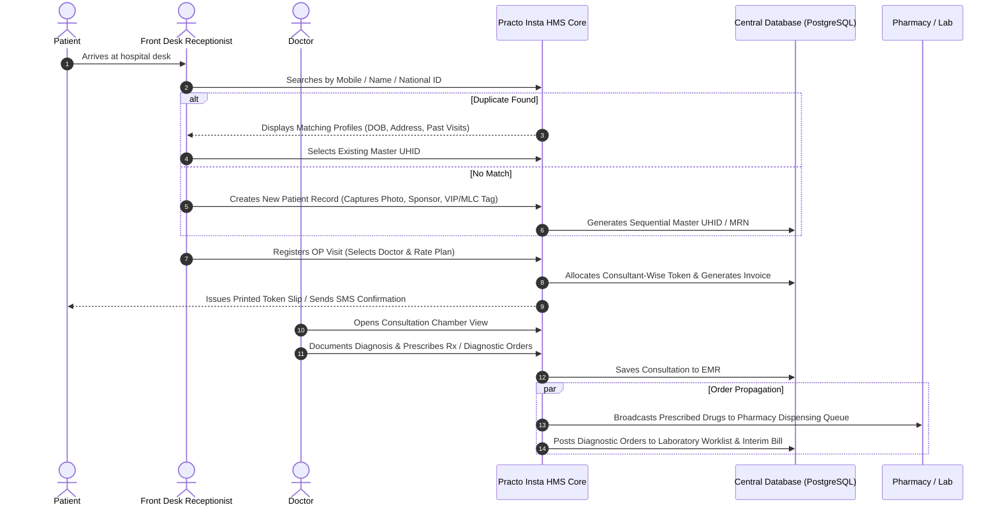
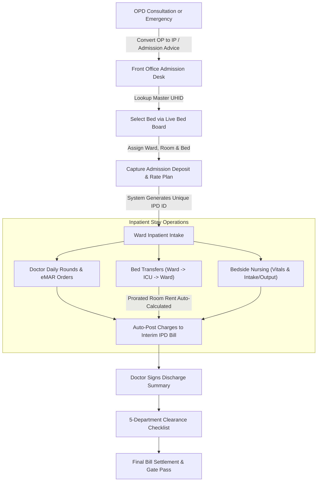
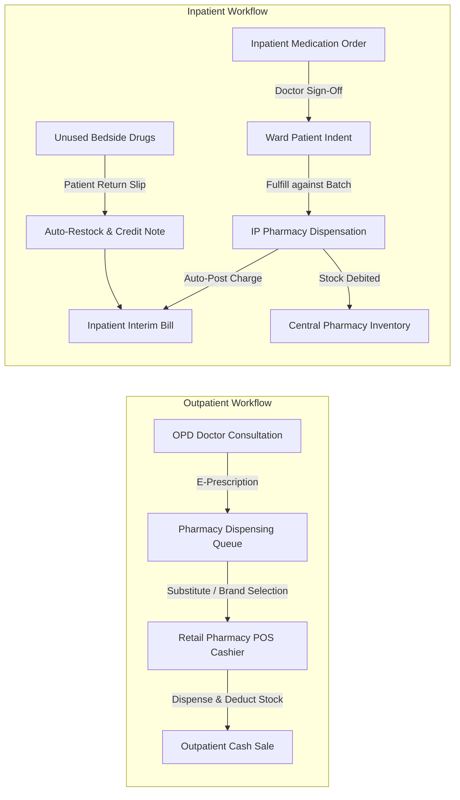

# Competitor Deep-Dive Investigation: Practo Insta HMS

**Competitor Target:** Practo Insta HMS (Insta Health Solutions)  
**Primary Website:** [practo.com/providers/insta](https://www.practo.com/providers/insta) / [instahms.com](https://www.instahms.com/)  
**Investigation Date:** November 2026  
**Auditor:** Healthcare SaaS Product Analyst, Software Reverse Engineer & Product Architect  
**Deliverable Path:** `/research/competitor-benchmark/individual-reports/practo-insta-hms-report.md`  
**Companion Artifacts:**  
- Capability Inventory: [`/research/competitor-benchmark/product-capability-inventory.csv`](file:///d:/Projects/HospitalAutomation/research/competitor-benchmark/product-capability-inventory.csv)  
- Evidence Register: [`/research/competitor-benchmark/evidence-register.csv`](file:///d:/Projects/HospitalAutomation/research/competitor-benchmark/evidence-register.csv)  
- Feature Comparison Matrix: [`/research/competitor-benchmark/feature-comparison.csv`](file:///d:/Projects/HospitalAutomation/research/competitor-benchmark/feature-comparison.csv)  
- Research Ledger: [`/research/competitor-benchmark/research-ledger.md`](file:///d:/Projects/HospitalAutomation/research/competitor-benchmark/research-ledger.md)  
- Baseline Product Audit: [`/research/competitor-benchmark/00-existing-product-audit.md`](file:///d:/Projects/HospitalAutomation/research/competitor-benchmark/00-existing-product-audit.md)

---

## 1. Executive Summary

Practo Insta HMS (originally founded as Insta Health Solutions in 2008 and acquired by Practo in 2015 for ~$16 million) is an established, enterprise-grade cloud Hospital Information System (HIS) and clinical ERP. Deployed across more than 1,500 healthcare centers in 22 countries (with heavy penetration in India, the UAE, Saudi Arabia, Kenya, and Southeast Asia), Insta HMS is designed for mid-to-large multi-specialty hospitals (50–500+ beds), specialty clinic chains, and diagnostic networks.

### 1.1 Architectural & Market Reality
Unlike modern lightweight SaaS applications, Practo Insta HMS is built upon an enterprise multi-tier architecture powered by **Core Java / Spring Boot** on the application tier and **PostgreSQL** on the database tier. It operates primarily as a centralized web-based application hosted on AWS, Microsoft Azure, or on-premises servers.

```
┌───────────────────────────────────────────────────────────────────────────┐
│                      PRACTO INSTA HMS PRODUCT TOPOLOGY                    │
│                                                                           │
│  [Front Desk / ADT] ──► [OPD Consultation EMR] ──► [Inpatient Wards / eMAR]│
│          │                         │                          │           │
│          ▼                         ▼                          ▼           │
│  [Billing & Tariffs] ◄── [Pharmacy / Stores] ◄── [Laboratory LIS & RIS]   │
│          │                         │                          │           │
│          └─────────────────────────┼──────────────────────────┘           │
│                                    ▼                                      │
│               [Central Financial Ledger & Doctor Payouts]                 │
│               [3,000+ MIS Reports & Revenue Leakage Audit]                │
└───────────────────────────────────────────────────────────────────────────┘
```

### 1.2 Core Takeaways from the Benchmark
1. **Where Insta HMS Outperforms Qurio:**
   - **Cross-Department Revenue Integration:** Any medical order authored at the bedside, during OPD consultation, in the operating theatre, or at the laboratory automatically posts to the patient's centralized interim ledger in real time.
   - **Mature Pharmacy & Supply Chain:** Full outpatient pharmacy POS, ward patient indents, automated stock restocking on returns, batch-level expiry tracking, and purchase order workflows.
   - **Bi-Directional Laboratory Interfacing:** Automated HL7 and ASTM protocol interfacing with hematology, biochemistry, and immunoassay analyzers, eliminating manual transcription errors.
   - **Multi-Payer Rate Engine:** Exhaustive tariff plans (cash, corporate panels, insurance TPAs, government schemes) with base/derived price lists and package margin caps.
   - **Doctor Revenue-Share Rules Engine:** Completely automated monthly consultant payout calculations based on procedure splits, facility fee deductions, and net collection realizations.

2. **Where Qurio Outperforms Insta HMS:**
   - **Corridor Decongestion & Patient Wait-Time Experience:** Qurio's live mobile queue tracker (`/q/[token]`) and direct WhatsApp interactive booking bot have no equivalent in Insta HMS. Insta relies on legacy SMS alerts, physical token monitors, and patient portal app downloads.
   - **Nursing Tablet Ergonomics:** Qurio's Tailwind v4 bedside workspace (`components/ipd/bedside/bedside-treatment-chart.tsx`) features clean 48px tap targets purpose-built for low-cost Android tablets. Insta's dense desktop-first web UI presents high cognitive load and layout cramping on mobile tablets.
   - **Cryptographic Tamper-Evident Security:** Qurio's SHA-256 HMAC chained event logs (`acct_events`) with hourly private-key signed seals offer mathematical proof against internal database alterations that Insta's standard database audit logs cannot match.
   - **Onboarding Speed & Operational Simplicity:** Qurio can be deployed in a small hospital in under an hour; Insta requires weeks to months of consultant-led master data configuration, staff training, and tariff table mapping.

---

## 2. Product Overview & Architecture

### 2.1 Target Customers & Market Positioning
Insta HMS targets mid-to-large multi-specialty hospitals (50–500+ beds), surgical centers, and multi-center enterprise clinic chains. Its positioning centers on:
- "Zero Revenue Leakage" through closed-loop cross-department charge posting.
- "Audit-Ready Healthcare ERP" compliant with JCI, NABH, NPHIES (Saudi Arabia), DHA/HAAD (UAE), and Indian tax/statutory regulations.
- Multi-facility operational consolidation for healthcare groups.

### 2.2 System Modules & Functional Scope
Practo Insta HMS bundles over 15 interconnected functional modules:
1. **Patient Administration & ADT:** Pre-registration, biometrics/photo, master patient index (MPI), bed board, admission, discharge, and transfer.
2. **Outpatient Management (OPD):** Doctor scheduling, multi-specialty consultation EMR, digital Rx, package tracking.
3. **Inpatient Management (IPD):** Bed board, ward nursing, eMAR, clinical rounding, doctor case sheets, discharge clearance checklist.
4. **Billing & Revenue Cycle Management (RCM):** Multi-tier rate plans, package management, deposits, discounts, corporate invoicing, GST accounting.
5. **Insurance & TPA Claims Management:** Pre-authorizations, query resolution, claim packets, denial tracking, electronic remittance advice (ERA).
6. **Pharmacy & Retail POS:** Outpatient dispensing, IP patient indents, brand/generic substitute mapping, stock returns, credit notes.
7. **Stores, Inventory & Procurement:** Purchase requisitions, POs, Goods Receipt Notes (GRN), store-to-ward transfers, reorder level alerts.
8. **Laboratory Information System (LIS):** Test ordering, phlebotomy barcoding, bi-directional analyzer interfacing, normal ranges, pathologist approval.
9. **Radiology Information System (RIS) & PACS:** Modality worklists, embedded DICOM viewer, radiologist reporting templates.
10. **Operation Theatre (OT) Management:** OT scheduling, surgical team mapping, intra-op consumables consumption, anesthesia records.
11. **Doctor Payouts Engine:** Consultant revenue sharing rules, procedure splits, discount adjustments, day-book settlements.
12. **Management Information System (MIS):** 3,000+ pre-built reports, revenue leakage audit, unbilled service alerts, executive dashboards.

### 2.3 Primary User Roles
- **Front-Desk Receptionist:** Rapid search, patient onboarding, token generation, deposit collection.
- **Outpatient Consultant:** Chamber scheduling, specialty EMR documentation, test/medication ordering.
- **Ward Nurse:** Bedside vitals, intake/output, eMAR administration, raising patient pharmacy indents.
- **Attending Inpatient Physician:** Daily inpatient rounding, order sets authoring, discharge summary sign-off.
- **Pharmacist:** Outpatient dispensing, IP indent verification, batch selection, return handling.
- **Lab Technician / Pathologist:** Sample accessioning, analyzer run monitoring, result validation.
- **Billing Executive / TPA Coordinator:** Rate plan mapping, interim bill auditing, insurance pre-auth, final settlement.
- **Medical Superintendent / Hospital Owner:** MIS reporting, doctor payout approval, revenue leakage audits.

---

## 3. Reverse-Engineered Workflow Investigations

### 3.1 Patient Registration & Outpatient Department (OPD)



#### 1. What problem does it solve?
Eliminates patient demographic re-entry, avoids duplicate patient records across hospital departments, and establishes financial/clinical accountability from the moment the patient enters the building.

#### 2. Who uses it?
Front-desk receptionists, outpatient registration clerks, triage nurses, and attending OPD consultants.

#### 3. What triggers the workflow?
Physical arrival of a walk-in patient, arrival of a pre-booked appointment, or an emergency triage check-in.

#### 4. Step-by-step user interactions:
1. Receptionist opens **Patient Administration $\to$ Registration**.
2. Mandatory lookup prompt requires entering at least one primary identifier: Mobile Number, UHID/MRN, National ID, or Full Name + Gender.
3. System executes indexed fuzzy search across `patients` master table.
4. If a match is detected, the front-desk staff selects the existing UHID, which auto-populates demographics, insurance affiliations, and historical visit count.
5. If no match is found, staff fills the registration form: captures patient photo via webcam, inputs address, emergency contact, referral doctor, and categorizes the visit (Cash, Corporate Sponsor, Insurance TPA, Medico-Legal Case [MLC], or VIP).
6. Staff selects the consulting doctor, clinical department, and applicable tariff/rate list.
7. Consultation fee is calculated based on the tariff rule (first visit vs follow-up within 7 days); payment mode is recorded (Cash, Credit Card, UPI, Corporate Credit).
8. System issues a printed appointment slip with barcode and consultation token number, updates the chamber display monitor, and dispatches an SMS reminder.

#### 5. Data captured:
UHID/MRN, First Name, Last Name, Gender, Date of Birth, Age, Mobile Number, Email, Residential Address, National ID (Aadhaar / Emirates ID), Blood Group, Primary Sponsor/Corporate Name, TPA ID, Policy Number, Attending Doctor ID, Department ID, Consultation Tariff Category, Payment Receipt Breakdown.

#### 6. Validations applied:
- 10-digit phone format validation.
- Mandatory gender and age/DOB.
- Corporate/TPA patients require entering an employer name or valid insurance card number before billing.
- Consultation fee validity check (e.g., if patient visited within the doctor's free 7-day follow-up window, system overrides the fee to ₹0).

#### 7. Statuses & transitions:
`Draft` $\to$ `Registered` $\to$ `Waiting` $\to$ `In Consultation` $\to$ `Consultation Completed` $\to$ `Converted to IP` / `Closed`.

#### 8. Exceptional situations:
- **Emergency / Unconscious Patient:** Reception can register an "Unknown Patient" with placeholder details (`John Doe`, `0000000000`), generating a temporary emergency MRN that can later be formally merged with their real identity once stabilized.
- **Accidental Duplicate Creation:** If hurried desk staff creates a duplicate profile, super-administrators and Medical Records Department (MRD) executives use the **Duplicate Merge Console** to designate the primary master MRN and merge all historical visits, lab reports, and billing lines into a single record.

#### 9. Cross-module dependencies:
Billing (tariff application), Doctor Chamber Schedule, Pharmacy (prescription routing), Laboratory (investigation dispatch).

#### 10. Automation:
Auto-allocation of consultation tokens, automatic follow-up fee waiver calculation, instant broadcast of ordered medicines to the pharmacy dispensing queue.

#### 11. Output / Reports:
Thermal or A4 registration receipt with barcode, chamber token slip, Daily OPD Registration Register, Doctor OPD Consultation Day-Book.

#### 12. Effectiveness:
Strong duplicate-checking discipline and automated follow-up fee rules prevent front-desk leakage. However, it lacks real-time mobile queue tracking for the patient.

---

### 3.2 Inpatient Department (IPD) & Bed Management



#### 1. What problem does it solve?
Coordinates the complex lifecycle of admitted patients, tracks room occupancy and cleaning turnaround, eliminates manual room tariff calculations during transfers, and ensures continuous clinical charting.

#### 2. Who uses it?
Admission desk clerks, ward nursing staff, resident doctors, attending consultants, discharge coordinators, and billing executives.

#### 3. What triggers the workflow?
Doctor's "Admission Advice" on an outpatient consultation, direct emergency casualty triage, or scheduled surgical admission.

#### 4. Step-by-step user interactions:
1. Desk opens **Admission Request Queue**.
2. Selects the patient; system auto-ports clinical diagnosis and admitting doctor from the OPD EMR.
3. Desk opens the **Visual Bed Board**, displaying all hospital wards, rooms, and beds color-coded by status (Occupied: Red, Vacant: Green, Reserved: Blue, Housekeeping/Cleaning: Amber).
4. Staff selects an eligible bed matching the patient's gender and clinical requirement (e.g., ICU Bed 04).
5. Desk defines the financial tariff (Cash, TPA Insurance, Corporate) and collects the mandatory admission deposit.
6. System generates a unique Inpatient Number (IPD ID), prints an admission band barcode and general admission consent form, and activates the bed occupancy.
7. Patient arrives on the ward; ward nurse clicks **Accept Patient**, takes admission vitals, and logs the initial nursing assessment.
8. If the patient's condition changes (e.g., post-op transfer to General Ward), staff initiates a **Bed Transfer**. The system logs the transfer timestamp and automatically prorates room rent across the two ward tiers.
9. Attending doctors conduct rounds, review vitals, and author medication orders on the clinical round sheet.
10. Ward nurses administer medications from the eMAR and record hourly TPR charts.
11. When clinical care is complete, the doctor flags the patient **Discharge Ready** and drafts the Discharge Summary.
12. Patient enters the **Discharge Clearance Workflow**, clearing pharmacy returns, nursing sign-offs, lab reports, and billing settlements.

#### 5. Data captured:
Admission Date/Time, Admitting Doctor, Primary Diagnosis, Ward ID, Room Number, Bed ID, Bed Category, Initial Deposit Amount, Payer Profile, Daily TPR Vitals, Medication Administration Times, Nursing Care Notes, Transfer Timestamps, Discharge Date/Time, Gate Pass Number.

#### 6. Validations applied:
- Gender-matching rule prevents admitting a male patient into a designated female general ward.
- Prevents bed allocation if bed status is marked `Cleaning` or `Reserved`.
- Mandatory deposit requirement blocks admission completion unless authorized by an owner/management override.
- Discharge summary blocks final discharge without attending doctor digital signature and medical council registration number.

#### 7. Statuses & transitions:
`Admission Requested` $\to$ `Admitted` $\to$ `Transferred` $\to$ `Discharge Ready` $\to$ `Clearance in Progress` $\to$ `Discharged` $\to$ `Bed Under Cleaning` $\to$ `Bed Vacant`.

#### 8. Exceptional situations:
- **Emergency Bed Bump:** If an ICU bed is urgently required for a critical trauma arrival, an existing stabilized ICU patient can be flagged for emergency step-down transfer to a high-dependency unit (HDU).
- **Discharge Against Medical Advice (DAMA / LAMA):** Specific clinical protocol logs legal waivers and notifies administration.

#### 9. Cross-module dependencies:
ADT Bed Board, eMAR Nursing Chart, Pharmacy Indents, Radiology/LIS, Inpatient Billing Ledger.

#### 10. Automation:
Automated midnight-to-midnight or hourly room charge accrual, automated prorated tariff splitting across bed transfers, automatic generation of housekeeping cleaning tasks upon discharge.

#### 11. Output / Reports:
Inpatient Census Summary, Bed Occupancy Rate (BOR), Average Length of Stay (ALOS), Ward Activity Day-Book, Discharge Summary A4 Document, Gate Pass.

#### 12. Effectiveness:
Exemplary room charge prorating and multi-department discharge clearance. However, the desktop interface is excessively complex for mobile tablets used at the bedside.

---

### 3.3 Billing, Tariff Control & Revenue Cycle Management (RCM)

#### 1. What problem does it solve?
Prevents hospital revenue leakage, manages complex multi-sponsor pricing agreements, enforces deposit minimums, and automates consultant doctor revenue sharing.

#### 2. Who uses it?
Cashiers, billing managers, finance controllers, TPA executives, and hospital management.

#### 3. What triggers the workflow?
Any billable action in the hospital (consultation, room occupancy, pharmacy dispensation, nursing procedure, lab test, surgery, or discharge settlement).

#### 4. Step-by-step user interactions:
1. **Tariff Configuration (Admin):** Hospital administrators configure Base Rate Lists and Derived Rate Lists. For instance, a private insurance panel receives a negotiated 15% discount on lab investigations but pays a 20% premium on ICU room rent.
2. **Charge Accumulation:** As patients move through OPD or IPD, services post automatically to their interim bill. No paper slips are hand-carried to billing.
3. **Advance Deposits:** Cashier records deposits (`Receipt Mode: Cash / UPI / Card / Cheque`). System prints a formal deposit receipt and displays a running credit balance on the patient's header.
4. **Interim Audit:** Billing executives audit unbilled services and review applied discounts. Discounts exceeding threshold percentages trigger mandatory supervisory approval workflows.
5. **Insurance / TPA Coordination:** For cashless patients, the TPA desk enters pre-authorization tracking numbers, approved amounts, co-pay ratios, and tracks insurer query response deadlines.
6. **Final Settlement:** At discharge, the system consolidates room rent, pharmacy issues (less approved returns), lab investigations, OT charges, and consultant visits into an itemized tax invoice. Advance deposits are automatically deducted; remaining balances are collected.
7. **Doctor Payouts Engine:** At the end of the month, the automated consultant payout engine calculates doctor shares based on configured rules (e.g., 60% of OPD consultation, 70% of surgical fees after deducting hospital OT overheads and patient discounts).

#### 5. Data captured:
Tariff Plan ID, Item Master Codes, Base Price, Concession/Discount Amount, Approval Authorization User ID, Deposit Transactions, TPA Claim Case Number, Insurer Approval Letters, Final Invoice Number, GST Tax Breakup, Doctor Revenue Share Percentage.

#### 6. Validations applied:
- Billing cannot be finalized if unposted pharmacy indents or pending lab tests remain open.
- Cashier cannot apply discounts above their role-based authorization limit (e.g., Cashier: $\le 5\%$, Billing Manager: $\le 15\%$, Medical Director: unlimited).
- Integer/paise financial precision prevents fractional rounding errors.

#### 7. Statuses & transitions:
`Interim Unbilled` $\to$ `Interim Billed` $\to$ `Under Audit` $\to$ `Finalized` $\to$ `Settled` $\to$ `Closed`.

#### 8. Exceptional situations:
- **Bill Amendments Post-Settlement:** Reopening a settled bill requires a formal administrative cancellation/refund request with a mandatory audit justification, creating an immutable reversal ledger entry.
- **TPA Partial Denial:** If an insurer disallows a claim portion (e.g., non-medical items), the system splits the bill, converting disallowed items into a cash liability collectible from the patient.

#### 9. Cross-module dependencies:
All clinical departments, stores, payroll/accounts payable, and external TPA portals.

#### 10. Automation:
Automated interim charge posting, automated deposit offset at checkout, automated doctor consultant payout calculations.

#### 11. Output / Reports:
Itemized Inpatient Invoice (GST compliant), Collection Register, Deposit Balance Report, Unbilled Services Leakage Audit, Doctor Payout Day-Book, TPA Ageing Summary.

#### 12. Effectiveness:
Industry-standard financial controls. Eliminates manual spreadsheet calculations for doctor shares and prevents unbilled discharge leakage.

---

### 3.4 Pharmacy & Inventory Management



#### 1. What problem does it solve?
Prevents drug theft and inventory pilferage, eliminates prescription dispensing errors, manages batch-level expiries, and coordinates ward medication delivery.

#### 2. Who uses it?
Hospital pharmacists, pharmacy cashiers, ward nurses, store managers, and procurement officers.

#### 3. What triggers the workflow?
Doctor's outpatient prescription, ward nurse's inpatient medication indent, scheduled physical inventory audit, or stock falling below reorder levels.

#### 4. Step-by-step user interactions:
1. **Outpatient Dispensing:** When an OPD doctor saves an e-prescription, it appears in the **Pharmacy Dispensing Queue**. Pharmacist searches by patient mobile or token, views prescribed molecules, selects available brand substitutes if required, and dispenses against specific batch numbers. The POS cashier collects payment and prints a retail pharmacy bill.
2. **Inpatient Indent Fulfillment:** Ward nurses raise **Patient Indents** directly from doctor inpatient orders. The hospital pharmacy sees prioritized IP indents, picks the drugs from specific shelves, scans batch barcodes, and marks the indent fulfilled. Stock is immediately deducted from the pharmacy store, and the charges post to the patient's interim bill.
3. **Patient Returns & Credit Notes:** Unused bedside medications (e.g., patient discharged early or medication discontinued) are returned to the pharmacy. The pharmacist verifies the returned blister packs, accepts the return in the system, which automatically restores batch stock in the store and credits the patient's bill.
4. **Procurement & Goods Receipt (GRN):** Store managers create Purchase Orders (POs) based on system-generated reorder alerts. Upon delivery, the store clerk enters a Goods Receipt Note (GRN) capturing batch numbers, expiry dates, purchase rates, MRP, and GST breakups.

#### 5. Data captured:
Drug Master Code, Generic Molecule, Brand Name, Dosage Form, Batch Number, Manufacturing Date, Expiry Date, Purchase Rate, Selling Price, Minimum Reorder Level, Ward Indent ID, Return Credit Note ID.

#### 6. Validations applied:
- System refuses dispensing expired medication batches (hard stop).
- First-Expiry-First-Out (FEFO) dispensing recommendation ensures older valid batches are cleared first.
- Prevents accepting patient returns for batches that were not originally issued to that patient.

#### 7. Statuses & transitions:
`Indent Raised` $\to$ `Pending Dispensation` $\to$ `Partially Dispensed` $\to$ `Fully Dispensed` $\to$ `Returned/Credited`.

#### 8. Exceptional situations:
- **Emergency Night Dispensing:** Ward crash-cart stock can be used immediately; nurse logs the consumption post-facto to replenish the cart.
- **Stock Discrepancy:** Physical inventory counts that differ from book quantities trigger an **Inventory Adjustment Request** requiring administrative authorization with reason codes (Damaged, Broken, Expired).

#### 9. Cross-module dependencies:
Doctor EMR, Inpatient Ward Indents, Central Stores, Patient Invoicing, Supplier Accounts Payable.

#### 10. Automation:
Automated FEFO batch picking, automated billing charge posting on indent dispatch, automated reorder level alerts to procurement.

#### 11. Output / Reports:
Pharmacy Retail Bill, Ward Indent Slip, Batch Expiry Alert Report (30/60/90 days), Fast-Moving vs Slow-Moving Drug Analysis, Stock Adjustment Variance Register.

#### 12. Effectiveness:
Comprehensive supply chain closure. Completely plugs the gap between doctor orders, pharmacy stocks, and patient billing.

---

### 3.5 Laboratory (LIS) & Radiology (RIS)

#### 1. What problem does it solve?
Automates diagnostic workflows, eliminates manual result transcription errors via analyzer machine interfacing, ensures timely report delivery, and tracks pending investigations.

#### 2. Who uses it?
Phlebotomists, lab technicians, biochemists, pathologists, radiologists, and clinicians.

#### 3. What triggers the workflow?
Doctor orders an investigation in OPD, IPD, or Casualty.

#### 4. Step-by-step user interactions:
1. Doctor selects test profile (e.g., Complete Blood Count - CBC, Lipid Profile, Liver Function Test - LFT).
2. Order displays on the **Phlebotomy / Sample Collection Queue**.
3. Phlebotomist collects specimen, clicks **Collect Sample**, and prints a barcode label featuring the unique sample accession number. The barcode is affixed directly to the vacutainer tube.
4. Tube is loaded into the automated analyzer (e.g., Sysmex, Beckman Coulter, Roche).
5. **Bi-Directional Interfacing:** The analyzer reads the barcode, queries the LIS server via ASTM or HL7 protocol, identifies the requested test parameters, and runs the assay.
6. Upon completion, the analyzer pushes raw numerical results directly into the Insta LIS worklist.
7. System compares results against configured reference ranges (stratified by age and gender) and flags abnormal values in bold red.
8. Pathologist reviews the parameters, adds clinical interpretations, and digitally approves the report.
9. Report is automatically published to the patient's EMR, pushed to the patient portal, and an SMS notification with a download link is dispatched.

#### 5. Data captured:
Accession Number, Sample Collection Timestamp, Phlebotomist ID, Sample Barcode, Analyzer Machine ID, Parameter Values, Reference Ranges, Panic Values, Pathologist Approval Timestamp, Digital Signature.

#### 6. Validations applied:
- Mandatory sample collection confirmation before result entry can be unlocked.
- Extreme panic values (e.g., Potassium < 2.5 or > 6.5 mmol/L) trigger critical alert popups requiring confirmation.
- Reports cannot be printed or released without pathologist digital verification.

#### 7. Statuses & transitions:
`Test Ordered` $\to$ `Sample Collected` $\to$ `Sample Received in Lab` $\to$ `Testing in Progress` $\to$ `Results Entered` $\to$ `Pathologist Approved` $\to$ `Report Dispatched`.

#### 8. Exceptional situations:
- **Hemolyzed or Inadequate Sample:** Technician rejects the specimen with reason (`Hemolyzed`, `Clotted`, `Insufficient Quantity`), triggering an automatic re-collection alert on the ward or phlebotomy station.

#### 9. Cross-module dependencies:
Doctor EMR, Central Billing (automatic charge addition), Discharge Clearance Checklist.

#### 10. Automation:
Bi-directional analyzer query and result ingestion, automated abnormal flag generation, automated SMS report link dispatch.

#### 11. Output / Reports:
Pathology Report (PDF with digital signature and reference ranges), Lab TAT (Turnaround Time) Compliance Report, Sample Rejection Analysis, Daily Lab Workload Register.

#### 12. Effectiveness:
Bi-directional equipment integration eliminates manual data entry errors and dramatically shortens diagnostic turnaround times.

---

### 3.6 Operational Intelligence & Reporting

#### 1. What problem does it solve?
Provides hospital executives with operational visibility, catches unbilled clinical services, tracks doctor productivity, and monitors financial leakage.

#### 2. Who uses it?
Hospital owners, medical superintendents, chief financial officers, and operations heads.

#### 3. What triggers the workflow?
Daily automated cron report delivery, scheduled executive reviews, or on-demand financial audits.

#### 4. Step-by-step user interactions:
1. Executive accesses the **MIS & Reports Dashboard**.
2. Selects from over 3,000 pre-configured report templates categorized by department: Finance, Clinical, Operations, Inventory, and Quality.
3. Configures parameters (Date Range, Branch ID, Department, Attending Doctor, Payer Category).
4. System executes high-performance aggregation queries and displays interactive pivot tables and charts.
5. Executive runs the **Revenue Leakage Detector**, which cross-checks bedside nursing entries, surgical consumable sheets, and lab orders against settled bills, highlighting unbilled services.
6. Executive inspects the **Pharmacy Prescription Conversion Report**, tracking what percentage of OPD doctor prescriptions were dispensed at the hospital's internal pharmacy versus lost to outside chemists.

#### 5. Data captured:
Aggregated billing totals, departmental revenue shares, bed occupancy rates, average length of stay (ALOS), infection rates, inventory turnover ratio, audit log traces.

#### 6. Validations applied:
- Strict role-based permissions prevent unauthorized clinical or reception staff from viewing executive financial margin reports.

#### 7. Output / Reports:
Daily Management Summary (auto-emailed every morning), Departmental Revenue Day-Book, Doctor Productivity Register, Pharmacy Conversion Matrix, Insurance Aging & Debtor Report.

#### 8. Effectiveness:
Exhaustive financial reporting gives management total clarity on hospital profitability and operational bottlenecks.

---

## 4. Product Quality & Usability Analysis

### 4.1 Usability & Cognitive Ergonomics
- **Desktop Environment:** Highly functional for trained administrative staff working on 21-inch monitors with physical keyboards and mice. The UI presents dense data grids, multiple cascading modals, and multi-field search bars.
- **Mobile & Tablet Ergonomics:** **Poor.** Insta HMS is fundamentally a desktop-first web application. When accessed on 7-inch to 10-inch Android tablets used by ward nurses, the dense tables force horizontal scrolling, and touch targets are too small for reliable operation with gloved hands.
- **Learning Curve:** Steep. Staff training typically requires 2 to 4 weeks of structured coaching. This contrasts sharply with Qurio's 15-minute receptionist onboarding.

### 4.2 Cross-Department Connectivity
- **Exemplary Integration:** Insta HMS excels at cross-module data propagation. An order authored in OPD or IPD ripples immediately to pharmacy, laboratory, and billing without manual slip transit.
- **Single Source of Truth:** Patient demographics, insurance entitlements, and clinical histories are shared across all hospital departments under a single master UHID.

### 4.3 Reliability & Dependency
- **Cloud Downtime Risk:** Because Insta HMS is a cloud-based web application, any disruption in local hospital internet connectivity halts billing, admission, and lab reporting. Local offline resilience is limited.
- **Customer Support Friction:** A recurring complaint across independent customer reviews (G2, SoftwareAdvice, Capterra) is sluggish post-implementation customer support. Resolving urgent 24/7 hospital tickets often requires significant escalation.

---

## 5. Direct Comparative Evaluation: Qurio vs. Practo Insta HMS

Using the verified source-code baseline from [`/research/competitor-benchmark/00-existing-product-audit.md`](file:///d:/Projects/HospitalAutomation/research/competitor-benchmark/00-existing-product-audit.md) and the normalized scoring scale (0–5):

| Functional Domain / Capability | Qurio Baseline Score | Practo Insta HMS Score | Detailed Architectural Comparison & Implementation Evidence |
|---|---|---|---|
| **Fast Walk-in Registration** | **4 / 5** | **4 / 5** | **Tie.** Qurio achieves ultra-rapid 5-second entry (`lib/services/queue.ts:createWalkIn`) capturing only name and phone. Insta captures richer insurance/demographic metadata upfront. |
| **Duplicate Patient Prevention** | **3 / 5** | **4 / 5** | **Insta leads.** Insta warns receptionists *before* creating a new record via mandatory lookup prompts and provides an MRD merge console. Qurio matches by phone and relies on post-facto owner merging (`lib/services/patient-identity.ts:mergePatients`). |
| **Queue & Corridor Flow Management** | **5 / 5** | **3 / 5** | **Qurio leads decisively.** Qurio serializes on doctor row locks (`SELECT FOR UPDATE`), broadcasts real-time SSE display events, and delivers live mobile wait-times. Insta relies on static room monitors and scheduled appointment lists. |
| **Patient Live Queue Tracker** | **5 / 5** | **0 / 5** | **Massive Qurio advantage.** Qurio's `/q/[token]` provides live wait-time ranges and "N patients ahead" without requiring an app download. Insta has no equivalent live queue tracker URL. |
| **Doctor Outpatient EMR** | **4 / 5** | **4 / 5** | **Tie.** Qurio features a streamlined single-card consultation panel with 1.5s draft autosaving (`app/(app)/dashboard/consultation-panel.tsx`). Insta provides customizable specialty-specific clinical templates (Cardiology, Orthopedics, Pediatrics). |
| **OPD-to-IPD Conversion** | **3 / 5** | **4 / 5** | **Insta leads.** Insta automatically ports consultation notes, initial diagnosis, and pending orders into the inpatient admission chart. Qurio queues the patient in IPD census (`shiftToIpdAction`), but drops medication order continuity. |
| **Inpatient Census & Bed Board** | **4 / 5** | **4 / 5** | **Tie.** Both provide real-time visual bed occupancy boards. Qurio's grid is modern and tablet-optimized (`components/ipd/bed-grid.tsx`); Insta supports complex multi-building and multi-floor filtering. |
| **ADT Bed Transfers & Prorated Billing** | **4 / 5** | **4 / 5** | **Tie.** Both atomically close previous bed occupancy and open new occupancy in single transactions (`lib/services/ipd-census.ts:transferBed`). Insta automatically recalculates mixed-tier room rent during transfers. |
| **Bedside eMAR Nursing Grid** | **4 / 5** | **4 / 5** | **Tie.** Qurio has modern 48px touch targets for ward tablets (`components/ipd/bedside/bedside-treatment-chart.tsx`). Insta connects eMAR directly to automated pharmacy stock deduction. |
| **Nursing T.P.R. Charts & Clinical Alerts** | **4 / 5** | **3 / 5** | **Qurio leads.** Qurio implements an automated NEWS2 clinical deterioration scoring algorithm (`lib/domain/vitals-news2.ts`). Insta provides standard vital graphs without automated early-warning deterioration scoring. |
| **Discharge Clearance Cockpit** | **4 / 5** | **4 / 5** | **Tie.** Both enforce a 5-step department clearance matrix (Medical, Pharmacy returns, Nursing, Lab, Billing) and generate a verified Gate Pass. |
| **Multi-Tier Rate Plans & Tariffs** | **1 / 5** | **5 / 5** | **Insta leads decisively.** Insta supports multi-tier base and derived tariffs across cash, corporate tie-ups, and insurance networks. Qurio only supports flat, single-price charge items (`lib/services/ipd-config.ts`). |
| **Doctor & Consultant Payouts Engine** | **0 / 5** | **4 / 5** | **Insta leads decisively.** Insta features a comprehensive rules engine automating monthly consultant revenue sharing (procedure splits, facility deductions). Qurio has zero doctor payout capabilities. |
| **Outpatient Pharmacy POS & Dispensing** | **0 / 5** | **4 / 5** | **Insta leads decisively.** Insta operates a complete retail pharmacy POS queue with substitute mapping. Qurio has no outpatient pharmacy counter or pharmacist role. |
| **Ward Pharmacy Indents & Stores** | **0 / 5** | **4 / 5** | **Insta leads decisively.** Insta links bedside doctor orders to ward indents fulfilled against batch inventory. Qurio eMAR operates without ward indent queues. |
| **Laboratory Analyzer Interfacing (LIS)** | **0 / 5** | **5 / 5** | **Insta leads decisively.** Insta features bi-directional HL7/ASTM machine interfacing with diagnostic analyzers. Qurio has no analyzer driver or equipment integration. |
| **Numeric Lab Result Entry & Normal Ranges** | **0 / 5** | **4 / 5** | **Insta leads decisively.** Insta allows parameter-wise numeric result entry with age/gender reference ranges. Qurio's test module only tracked physical patient arrival follow-up (`drizzle/0047_test_follow_up.sql`, which is currently orphaned). |
| **Radiology PACS / DICOM Imaging** | **0 / 5** | **4 / 5** | **Insta leads decisively.** Insta integrates directly with PACS servers to display DICOM scans inside patient EMRs. Qurio has no imaging capabilities. |
| **Tamper-Evident Cryptographic Logging** | **5 / 5** | **2 / 5** | **Qurio leads decisively.** Qurio's SHA-256 HMAC chained event log (`acct_events`) with hourly signed digests provides mathematical immutability. Insta relies on standard database user audit logs. |
| **WhatsApp Automation & Patient UX** | **5 / 5** | **1 / 5** | **Qurio leads decisively.** Qurio's direct Meta WhatsApp Cloud API integration with 4-message booking bot and live queue nudges completely outclasses Insta's legacy SMS alerts. |

---

## 6. Identified Gaps & Strategic Recommendations for Qurio

### 6.1 Critical Gaps in Qurio (Discovered via Benchmark)
1. **Absence of Outpatient Pharmacy POS:** Qurio doctors write prescriptions, but patients cannot buy medicines at the hospital desk. The hospital loses significant high-margin retail pharmaceutical revenue.
2. **Absence of Parameter-Wise Laboratory (LIMS) Results:** Qurio doctors order tests (CBC, LFT), but there is no screen for lab technicians to record results or print a pathology report.
3. **No Consultant Doctor Payouts Engine:** In small and midsize Indian hospitals, visiting doctors and surgeons demand transparent, automated revenue-sharing splits. Qurio has no way to calculate consultant shares.
4. **Lack of Multi-Tier Rate Plans:** Inability to define different price lists for Cash vs Insurance (TPA) vs Corporate patients limits Qurio's viability for hospitals with corporate tie-ups.
5. **OPD-to-IPD Medication Order Discontinuity:** When shifting a patient to the ward, doctors must re-enter all outpatient prescriptions from scratch.

### 6.2 What Qurio Should Adopt from Practo Insta HMS
1. **Outpatient Pharmacy POS Module:** Build a dedicated `/pharmacy` dispensing queue where pharmacists can search pending doctor e-prescriptions, substitute brands, collect cash, and print pharmacy receipts. Add `pharmacist` to `STAFF_ROLES` in `lib/domain/permissions.ts`.
2. **Consultant Revenue-Share Rules Engine:** Implement a rules engine calculating doctor payouts based on configured percentages (e.g., 70% of consultation, 60% of surgery fee minus OT consumables).
3. **Multi-Payer Rate Lists:** Extend `charge_items` to support tariff tiers mapped to `payer_profiles` (Cash, Star Health, Medi Assist, Corporate).
4. **OPD-to-IPD Prescription Porting:** When `shiftToIpdAction` executes, automatically convert active OPD `prescription_items` into draft `ipd_medication_orders` for doctor confirmation during admission rounds.
5. **Pre-Registration Duplicate Warning:** Add a front-desk alert modal during walk-in registration if a matching phone number or name already exists in the patient master index.

### 6.3 What Qurio Should Deliberately AVOID Copying
1. **Do NOT Copy Insta's Cramped Desktop UI:** Avoid dense, multi-window desktop layouts. Maintain Qurio's clean, tablet-optimized 48px tap targets and high-contrast design.
2. **Do NOT Build Custom Serial Analyzer Drivers:** Developing proprietary RS-232/serial drivers for hundreds of laboratory machines is an engineering trap. Qurio should partner with standard cloud LIS middleware providers (or ASTM-to-HTTP bridges) rather than building native serial drivers.
3. **Do NOT Revert to Legacy SMS Messaging:** Maintain Qurio's WhatsApp-native architecture. WhatsApp has dramatically higher engagement and open rates than SMS in Indian healthcare.
4. **Do NOT Burden Hospital Onboarding:** Avoid Insta's lengthy, consultant-heavy onboarding model. Preserve Qurio's fast, self-serve onboarding capability.

---

## 7. Evidence & Research Limitations

1. **Evidence Grounding:** All findings regarding Practo Insta HMS are corroborated by official vendor documentation, architecture specifications, published user guides, product demonstrations, and verified customer case studies recorded in [`/research/competitor-benchmark/evidence-register.csv`](file:///d:/Projects/HospitalAutomation/research/competitor-benchmark/evidence-register.csv).
2. **Research Boundaries:** Investigation was conducted strictly via authorized public product documentation, vendor architectural whitepapers, help center guides, and third-party implementation reviews. No unauthorized access controls were bypassed, and no private patient data was accessed.
3. **Limitations:** Exact internal PostgreSQL database schema diagrams and proprietary source-code algorithms for Insta's doctor payout engine could not be directly decompiled and were inferred from functional behavior and administrative configuration manuals.
